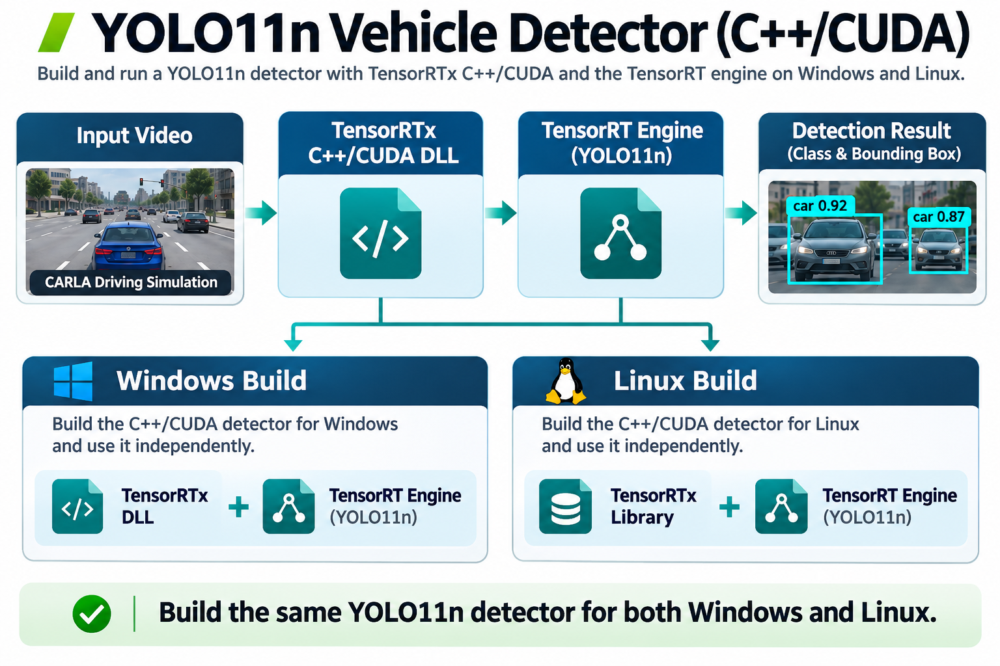
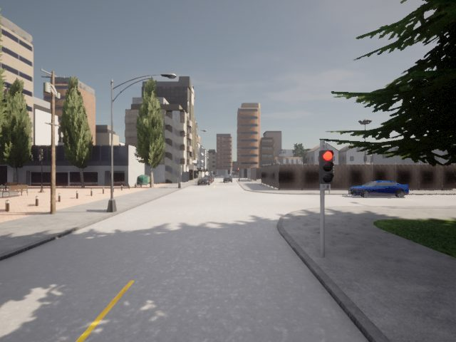
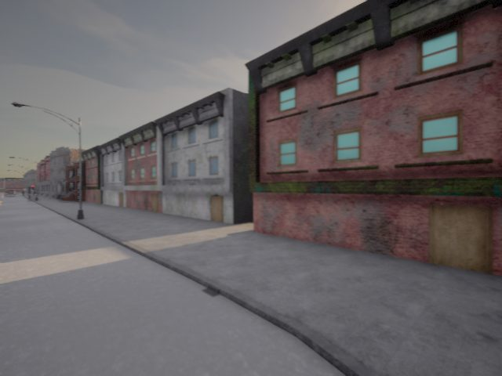
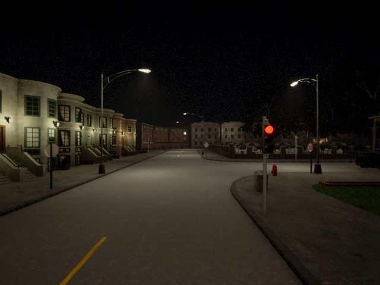
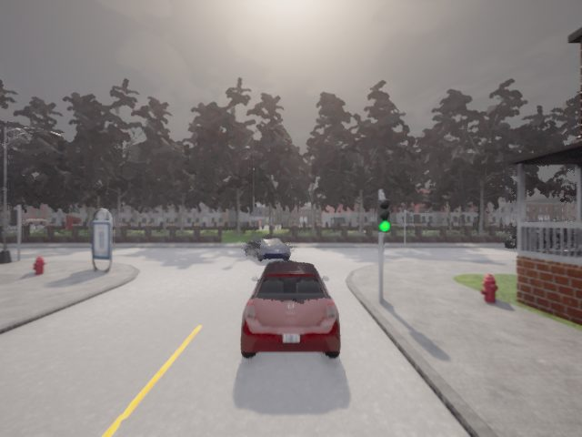
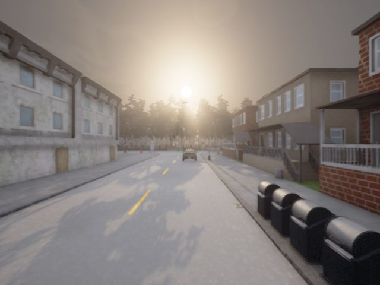
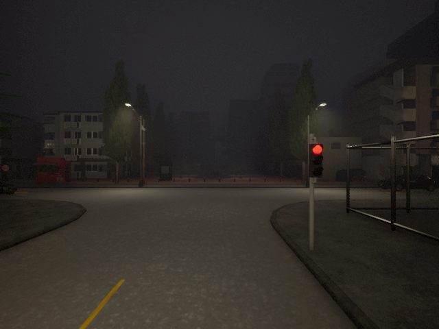
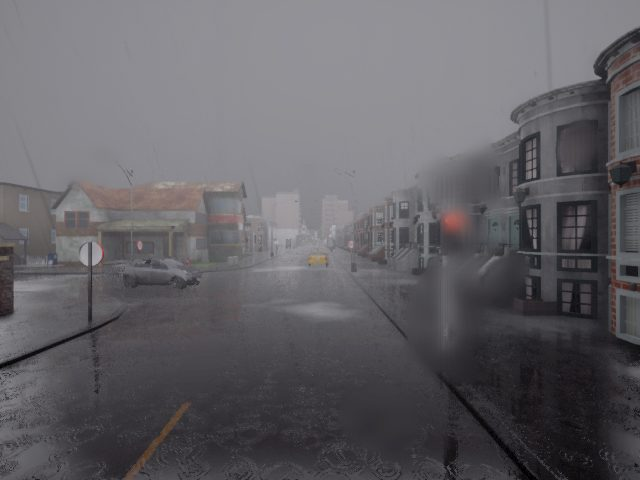
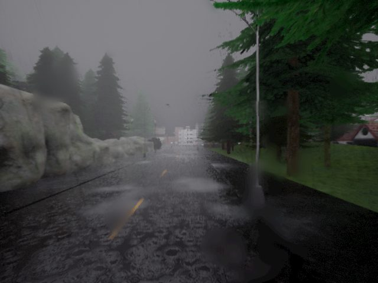
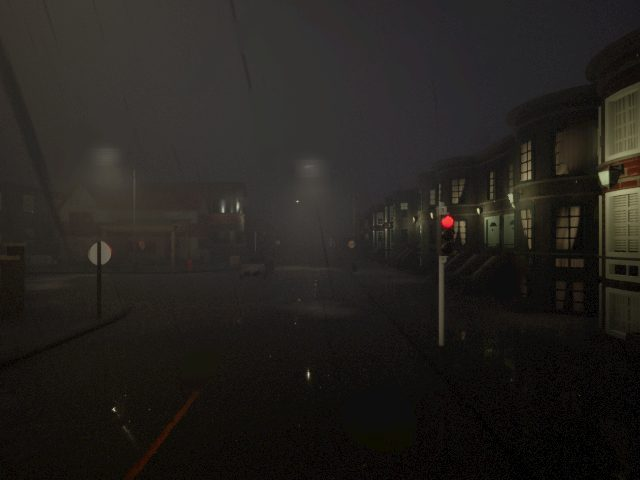

# DriveFusion
Real-Time Camera–Radar Vehicle Perception and Distance Evaluation in CARLA

DriveFusion is a CARLA-based system for **real-time vehicle detection, tracking, and inter-vehicle distance estimation using camera and radar sensors**. It integrates sensor acquisition, YOLO11n inference, tracking, sensor fusion, a Qt dashboard, recording, replay, and quantitative evaluation. Nine simulated weather/time-of-day conditions were used to examine accuracy, the benefits of radar assistance, and limitations.

**Project page:** [DriveFusion — Real-Time Camera–Radar Perception](https://931njhthe-star.github.io/drivefusion/)

## Contents

1. [System Overview and Key Findings](#1-system-overview-and-key-findings)
2. [CARLA Simulation](#2-carla-simulation)
3. [Benefits of Simulation-Based Validation](#3-benefits-of-simulation-based-validation)
4. [Qt Dashboard](#4-qt-dashboard)
5. [Detector: YOLO11n](#5-detector-yolo11n)
6. [Sensors](#6-sensors)
7. [Tracking and Post-Processing](#7-tracking-and-post-processing)
8. [Camera–Radar Distance Fusion and Evaluation](#8-cameraradar-distance-fusion-and-evaluation)
9. [Experimental Conditions](#9-experimental-conditions)
10. [Evaluation Results](#10-evaluation-results)
11. [Summary](#11-summary)
12. [Limitations and Future Work](#12-limitations-and-future-work)

## 1. System Overview and Key Findings

### Real-Time CARLA Camera–Radar Perception and Evaluation System

I designed and implemented a desktop evaluation system that acquires camera and radar data from CARLA, detects and tracks vehicles, and displays, records, and evaluates inter-vehicle distance estimates. A **TensorRTx-based YOLO11n C++/CUDA detector** is built with CMake for Windows and Linux. The Windows application integrates Python-based sensor interfaces, tracking, distance calculation, evaluation, and a Qt dashboard, covering **acquisition → inference → tracking and measurement → visualization and recording → replay and evaluation**.

### Impact of Radar Assistance on Distance Estimation

The evaluation examined whether radar assistance improves distance estimation when camera detections are interrupted. Across **16,491 common samples** from nine sessions, M3 reduced **MAE by 5.41%** and **RMSE by 0.83%** compared with M1. On the **437 predictions with radar-corrected track positions (A+B)**, MAE decreased **39.42%** and RMSE **25.15%**. Among these, **242 cases (A)** used radar as the final distance source and improved MAE **80.95%** and RMSE **71.43%**; **195 cases (B)** used camera-derived final distance after radar track correction and improved MAE **8.77%** and RMSE **11.68%**. The larger improvements apply **only to the selected radar-corrected subset**, not the entire dataset.

## 2. CARLA Simulation

**[CARLA](https://carla.org/)** is an open-source autonomous-driving simulator with configurable camera/radar sensors, weather, and time of day. This project uses its sensor streams for perception and its vehicle positions and dimensions as **ground truth (GT)** for evaluation.

https://github.com/user-attachments/assets/3348c5f7-52f8-4de5-afcb-39ad1498cd0f

## 3. Benefits of Simulation-Based Validation

CARLA enables testing without arranging physical vehicles, sensors, or a road-test site. Routes, speed, weather, lighting, and object positions can be controlled, allowing repeated comparisons between algorithm versions.

- **Cost:** Reduces vehicle, sensor, and test-site setup expenses.
- **Time:** Enables experiments without physical road-test preparation.
- **Repeatability:** Supports comparison under repeatable scenarios.
- **Quantitative analysis:** Ground truth supports error measurement alongside FPS and latency.
- **Safety:** Allows testing scenarios that would be dangerous or difficult to reproduce on roads.

These results describe a controlled simulated environment and **do not guarantee real-world performance**.

## 4. Qt Dashboard

https://github.com/user-attachments/assets/6b0777bf-e69e-44e2-9350-950728dbf9f5

- **Real-time comparison:** Raw images, YOLO detections, camera tracking, radar-assisted tracking, and vehicle distance.
- **Experiment controls:** Track retention frames, radar position correction, weather-based capture schedules, and traffic lights.
- **Recording:** Manual or scheduled sensor and processing output capture, including automated weather sessions.
- **Analysis:** Replay recorded sessions and generate comparison videos and evaluation reports by distance range, weather, and aggregate results.

## 5. Detector: YOLO11n

YOLO11n inference runs through a **TensorRT engine and TensorRTx-based C++/CUDA DLL**, built separately for Windows and Linux.

## 6. Sensors

| Sensor | Configuration | Purpose |
| --- | --- | --- |
| RGB camera | `sensor.camera.rgb` · 640×480 · 90° horizontal FOV | YOLO vehicle detection, image-based tracking, ground-projection distance estimation |
| Radar | Maximum range 100 m · horizontal/vertical FOV 35°/20° · 1,500 points/s configured | Track association, predicted-position correction during detection gaps, conditional distance correction |

Radar returns **range, azimuth, altitude angle, and radial relative velocity** for each reflection. Range and angles yield radar-point positions, which are projected into the camera image and associated with vehicle boxes and tracks. Radial velocity measures the component **toward or away from the radar**, not full vehicle velocity.

Reference: [CARLA radar sensor documentation](https://carla.readthedocs.io/en/latest/ref_sensors/#radar-sensor).

## 7. Tracking and Post-Processing

A background worker sends camera frames to the **C++/CUDA YOLO detection DLL** and forwards detected vehicle boxes to tracking. Two approaches are compared:

### Camera-Based Tracking

Vehicle detections are associated across frames using **class, intersection-over-union (IoU), and box-center distance**. When detections are missing, motion is used to predict the position; tracks are removed after the configured retention-frame limit.

### Radar-Assisted Tracking

Radar range and relative velocity supplement camera-based association. When YOLO detection is missing and a valid radar cluster matches an existing track, the radar observation can **correct the predicted box position**. This position correction is separate from selecting the final camera/radar distance value.

Tracking, distance calculation, Qt controls, recording, and evaluation logic are implemented in **Python**.

## 8. Camera–Radar Distance Fusion and Evaluation

Distance is the **planar clearance between the ego vehicle body and a target vehicle body**. Ground truth is the shortest planar separation between the boundaries of their rotated bounding boxes in the same frame. The target vehicle's CARLA position and size are used **only during evaluation**.

1. **M1 — Camera tracking + camera distance:** Associate YOLO boxes by class, IoU, and center distance. Project the bottom of the observed or predicted box onto the ground and calculate planar clearance to the ego vehicle boundary.
2. **M2 — Camera tracking + conditional radar distance correction:** Use M1 tracking, but substitute radar distance only if the radar cluster has **at least three points**, maximum deviation from its median is **≤0.5 m**, discrepancy from camera distance is **≤1 m**, and temporal movement validation passes. Otherwise, use valid camera distance.
3. **M3 — Radar-assisted tracking + conditional radar distance correction:** Use radar range and relative velocity for track association. During YOLO detection gaps, correct predicted boxes using radar clusters that pass position, velocity, and displacement checks. Apply **the same final-distance selection rules as M2**. Track-position correction and final-distance correction remain separate stages.

## 9. Experimental Conditions

Nine CARLA conditions combine **clear, cloudy, and heavy rain** with **noon, sunset, and night**.

| Weather | Noon | Sunset | Night |
| --- | --- | --- | --- |
| **Clear** |  Clear noon |  Clear sunset |  Clear night |
| **Cloudy** |  Cloudy noon |  Cloudy sunset |  Cloudy night |
| **Heavy rain** |  Heavy-rain noon |  Heavy-rain sunset |  Heavy-rain night |

Each condition was recorded **once, sequentially, for approximately two minutes**. M1, M2, and M3 were compared using the same saved input. Because traffic and scene composition varied across sessions, differences **cannot be attributed to weather alone**.

## 10. Evaluation Results

### Overall and Radar-Corrected Subsets

| Group | Samples evaluated | Count | Share | MAE reduction | RMSE reduction |
| --- | --- | ---: | ---: | ---: | ---: |
| Overall | All common evaluation samples | **16,491** | **100%** | **5.41%** | **0.83%** |
| A+B | Predictions with radar-corrected track position | 437 | **2.65%** | **39.42%** | **25.15%** |
| A | Final distance from radar after correction | 242 | 1.47% | **80.95%** | **71.43%** |
| B | Final distance from camera after correction | 195 | 1.18% | **8.77%** | **11.68%** |

### Distance Error Across 16,491 Common Samples

| Method | MAE (m) | RMSE (m) |
| --- | ---: | ---: |
| M1 — Camera tracking + camera distance | 1.6233 | 2.5621 |
| M2 — Camera tracking + camera/radar distance selection | 1.5468 | 2.5493 |
| M3 — Radar-assisted tracking + camera/radar distance selection | **1.5355** | **2.5410** |

**MAE reductions:** M1→M2 **4.71%**, M2→M3 **0.73%**, M1→M3 **5.41%**. **RMSE reductions:** **0.50%**, **0.33%**, and **0.83%**, respectively. Lower values indicate better accuracy; RMSE penalizes large errors more strongly.

### Error Reduction for 437 Radar-Corrected Predictions (A+B)

The 437 samples represent **2.65% of all common samples**, compared at the same vehicle and frame.

| Comparison | MAE (m) | RMSE (m) | MAE decrease (m) | RMSE decrease (m) | MAE improvement | RMSE improvement |
| --- | --- | --- | ---: | ---: | ---: | ---: |
| **M1 → M2** | 1.3280 → 1.0816 | 1.6843 → 1.6154 | 0.2464 | 0.0688 | **18.55%** | **4.09%** |
| **M2 → M3** | 1.0816 → 0.8046 | 1.6154 → 1.2607 | 0.2770 | 0.3547 | **25.61%** | **21.96%** |
| **M1 → M3** | 1.3280 → 0.8046 | 1.6843 → 1.2607 | 0.5234 | 0.4235 | **39.42%** | **25.15%** |

Improvement rate = `(baseline error − comparison error) / baseline error × 100`, computed from unrounded MAE and RMSE values.

For these 437 samples, M2 reduced MAE **18.55%** and RMSE **4.09%** versus M1. M3 then reduced MAE **25.61%** and RMSE **21.96%** versus M2. The total M1→M3 reductions were **39.42% MAE** and **25.15% RMSE**. **These are subset results, not overall improvements.**

### Improvements by Final Distance Source

Of the 437 corrected predictions, **242 (A)** used radar-derived final distance and **195 (B)** used camera-derived final distance.

| Group | Final distance | Samples | Comparison | MAE improvement | RMSE improvement |
| --- | --- | ---: | --- | ---: | ---: |
| A | Radar | 242 | M1 → M2 | **38.992%** | **12.085%** |
| A | Radar | 242 | M2 → M3 | **68.770%** | **67.501%** |
| A | Radar | 242 | M1 → M3 | **80.947%** | **71.429%** |
| B | Camera | 195 | M1 → M2 | **3.471%** | **0.631%** |
| B | Camera | 195 | M2 → M3 | **5.486%** | **11.121%** |
| B | Camera | 195 | M1 → M3 | **8.767%** | **11.682%** |

## 11. Summary

I implemented a complete **CARLA → camera/radar acquisition → YOLO11n inference → tracking → distance estimation → Qt visualization and recording → replay and evaluation** workflow, and compared M1, M2, and M3 using the same saved inputs and CARLA-derived planar vehicle-body distance ground truth.

Across **16,491 common samples**, M3 improved MAE by **5.41%** and RMSE by **0.83%** versus M1. On **437 radar-corrected predictions**, the reductions were **39.42% MAE** and **25.15% RMSE**. Radar assistance was most effective in the limited cases satisfying correction conditions, rather than uniformly across all samples.

## 12. Limitations and Future Work

- **Limited data and scene diversity:** Nine approximately two-minute sessions, one per weather/time-of-day condition, provide limited variation in routes, surrounding traffic, distances, and occlusions. Only **437 of 16,491 samples (2.65%)** received radar-based track-position correction.
- **Simulation-only validation:** CARLA may not adequately capture real-world noise, occlusion, vibration, lighting changes, and sensor-mounting errors. These findings do not establish physical-vehicle performance.
- **No repeated matched-condition trials:** Scene and vehicle differences between sessions prevent isolating the effect of weather and time of day.
- **Conditional gains:** The **39.42% MAE** and **25.15% RMSE** reductions are specific to the corrected subset; overall gains were **5.41% MAE** and **0.83% RMSE**.
- **Limited evaluation scope:** The analysis covers planar vehicle-body clearance, not long-term tracking stability or driving safety.

Future work includes repeated trials with consistent routes and traffic, larger and more diverse scenarios (vehicle counts, relative distances, occlusion, and velocity), validation against real sensor data, and improved radar association/correction rules. Additional evaluation metrics may include **track continuity, ID switches, recovery from missed detections, and processing latency**.
