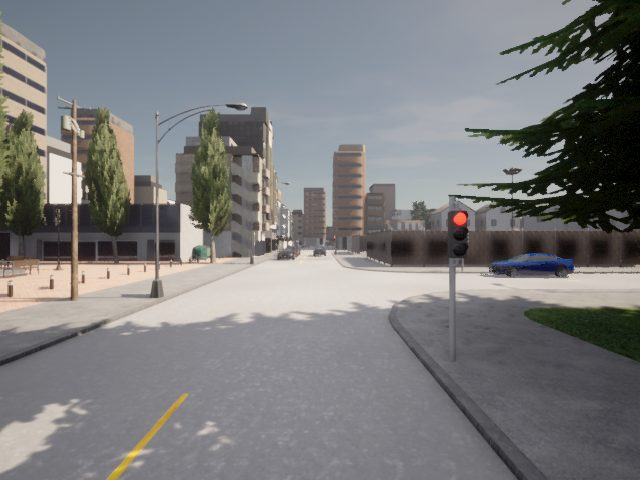
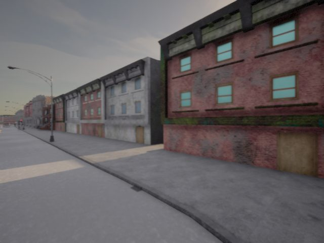
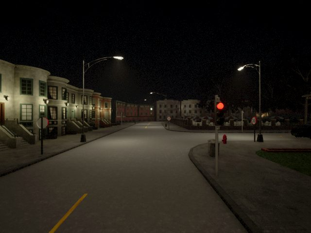
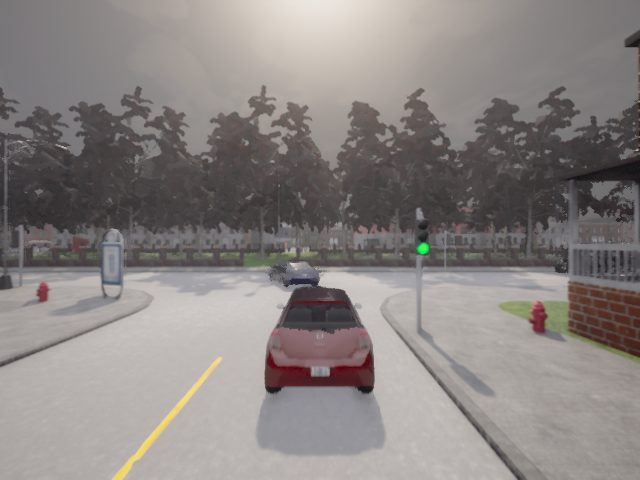
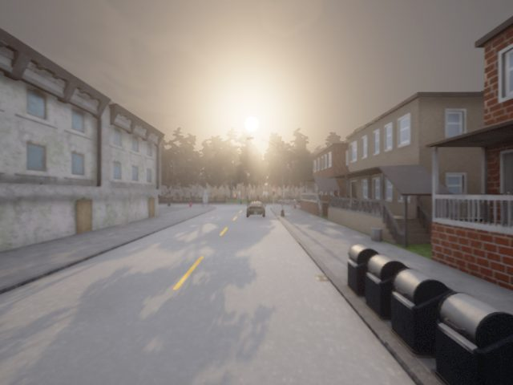
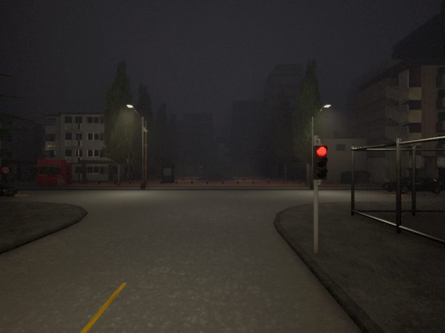
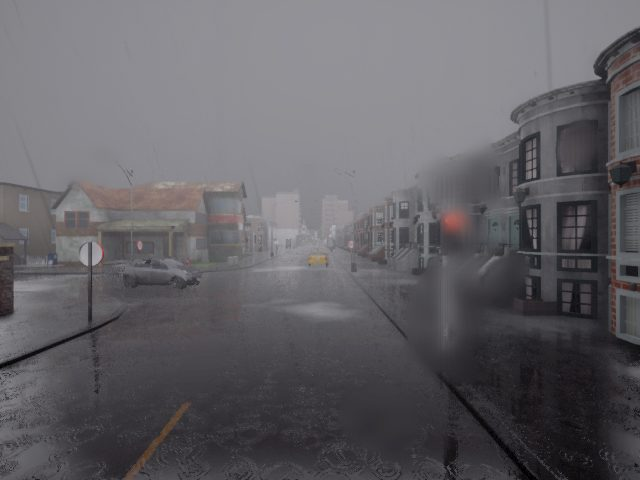
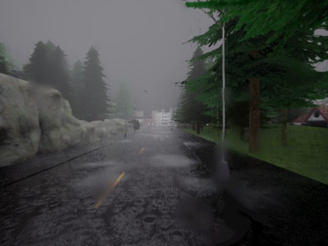
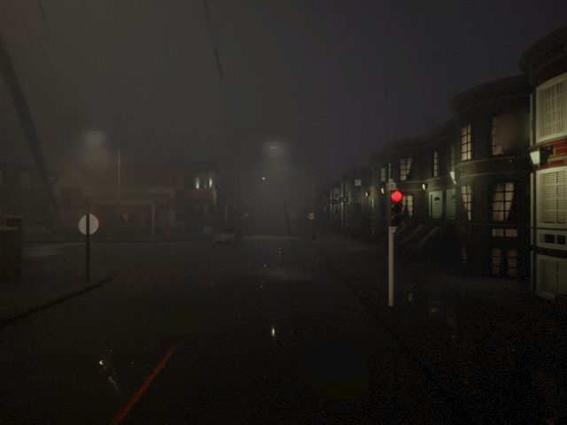

# DriveFusion CARLA 시뮬레이션 기반 실시간 계측 시스템 개발과 레이더 보조 트래킹의 거리 추정 개선 효과 분석

### 프로젝트 목적

본 프로젝트는 CARLA 시뮬레이션 환경에서 **카메라·레이더 기반 실시간 객체 검출·추적 및 거리 추정 시스템을 구축하고, 그 성능을 정량적으로 평가**하는 것을 목적으로 합니다.
이를 위해 센서 데이터 수집·처리, 객체 검출·추적, 센서 융합, Qt 기반 시각화 및 데이터 저장·평가 기능을 통합 구현하였습니다.
또한 다양한 주행·환경 조건에서 **거리 추정 정확도, 센서 융합 효과 및 시스템의 한계**를 분석하여 구현한 시스템의 유효성을 검증하였습니다.

## 목차

1. [시스템 구성 및 분석 요약](#1-시스템-구성-및-분석-요약)
2. [CARLA 시뮬레이션 소개](#2-carla-시뮬레이션-소개)
3. [시뮬레이션 기반 검증의 장점](#3-시뮬레이션-기반-검증의-장점)
4. [Qt 기반 대시보드](#4-qt기반-대시보드)
5. [검출기 (YOLO11n)](#5-검출기yolo11n)
6. [센서](#6-센서)
7. [트래킹 및 후속 처리](#7-트래킹-및-후속-처리)
8. [카메라·레이더 거리 융합과 평가](#8-카메라레이더-거리-융합과-평가)
9. [실험 환경: 9개 날씨·시간대 조건](#9-실험-환경-9개-날씨시간대-조건)
10. [검증 결과](#10-검증-결과)
11. [연구 요약](#11-연구-요약)
12. [연구의 한계 및 향후 개선](#12-연구의-한계-및-향후-개선)

## 1. 시스템 구성 및 분석 요약
### CARLA 시뮬레이션 및 카메라·레이더 기반 실시간 계측·검증 시스템 구축

본 프로젝트는 CARLA 가상 주행 환경에서 카메라·레이더 데이터를 수집하고, 차량 검출·추적과 차체 간 거리 추정 결과를 실시간으로 확인·저장·평가하는 데스크톱 검증 시스템을 설계하고 구현했습니다. TensorRTx 기반 YOLO11n C++/CUDA 검출 모듈은 CMake를 통해 Windows와 Linux에서 빌드·실행하도록 구성했습니다. Windows에서는 Python 기반 센서 연동·추적·거리 산출·평가와 Qt 대시보드를 통합하여 **수집부터 추론, 추적·계측, 표시·기록, 저장 입력 재생 평가까지의 전체 파이프라인**을 구축했습니다.
  

----------

### 카메라 기반 트래킹 대비 레이더 보완시 차량간 거리 추정 개선 효과

또한 **카메라 기반 트래킹과 위치 예측을 레이더로 보완했을 때, 영상 검출이 끊긴 구간에서 거리 추정 정확도가 얼마나 개선되는지 검증했습니다.** 9개 날씨·시간대 세션의 전체 공통 표본 16,491건에서는 **MAE(평균 절대 오차)가 5.41%, RMSE(오차의 제곱평균제곱근)가 0.83% 감소하여 개선 폭이 제한적**이었습니다. 반면 레이더 보정이 적용된 예측 **437건(A+B)** 에서는 카메라 기반 방식 대비 **MAE가 39.42%, RMSE가 25.15% 감소**했습니다. 특히 최종 거리에 **레이더값을 사용한 242건(A)** 에서는 **MAE가 80.95%, RMSE가 71.43% 감소**했습니다. **카메라값을 사용한 195건(B)** 에서도 레이더로 보정된 예측 박스를 활용해 **MAE가 8.77%, RMSE가 11.68% 감소**했습니다. 전체 평균보다 **보정 조건을 만족하는 특정 구간에서 센서 연계의 효과가 두드러졌습니다.**
  

## 2. CARLA 시뮬레이션 소개
**CARLA는 카메라·레이더 등 차량 센서와 다양한 날씨·시간대를 재현할 수 있는 오픈소스 자율주행 시뮬레이터입니다.** ([CARLA 공식 사이트](https://carla.org/)) 이 프로젝트에서는 센서 데이터를 수집하고, 시뮬레이터가 제공하는 차량 위치·크기 정답값(GT)을 이용해 검출·추적 및 차량 간 거리 추정 결과를 검증하는 데 사용했습니다.

https://github.com/user-attachments/assets/3348c5f7-52f8-4de5-afcb-39ad1498cd0f

## 3. 시뮬레이션 기반 검증의 장점
CARLA 시뮬레이터를 활용하면 실제 차량과 카메라, 시험 장소를 준비하지 않고도 영상처리 파이프라인을 검증할 수 있습니다. 장비 대여·설치와 도로 시험에 드는 비용과 준비 시간을 줄이고, 같은 주행 조건을 반복 재현해 결과를 빠르게 비교할 수 있습니다.

주행 경로, 속도, 날씨, 조명, 객체 위치를 통제할 수 있어 조건별 성능 변화를 체계적으로 분석할 수 있습니다. 시뮬레이터가 제공하는 객체 정보를 기준값(Ground Truth)으로 활용하면 검출 정확도와 위치 오차를 측정하고, FPS와 처리 지연 시간도 함께 평가할 수 있습니다. 실제 도로에서 위험하거나 반복하기 어려운 상황도 안전하게 시험할 수 있습니다.
- 비용 절감: 실제 차량, 센서, 시험 장소를 준비하는 데 드는 비용 감소
- 시간 절약: 장비 설치와 도로 시험 준비 없이 빠르게 실험 시작
- 반복 재현: 동일한 주행 조건을 재생해 알고리즘 변경 전후 비교
- 정량 분석: 정확한 Ground Truth 기반 정확도·오차와 FPS·지연 시간 측정
- 안전한 시험: 위험 상황이나 재현이 어려운 조건을 시뮬레이션에서 검증
시뮬레이션 결과는 통제된 가상 환경에서의 검증 결과이며, 실제 도로 환경의 성능을 그대로 보장하지는 않습니다.
  

## 4. QT기반 대시보드

https://github.com/user-attachments/assets/6b0777bf-e69e-44e2-9350-950728dbf9f5

- **실시간 비교:** 원본 영상·YOLO 검출·영상 추적·레이더 보조 추적 결과와 차량 간 거리를 비교합니다.
- **실험 제어:** 추적 유지 프레임, 레이더 위치 보정, 날씨별 수집 스케줄과 신호등 설정을 조절합니다.
- **데이터 기록:** 수동 또는 시간 지정으로 센서·처리 결과를 저장하고, 날씨별 세션을 자동 수집합니다.
- **결과 분석:** 저장 세션으로 비교 영상과 거리 구간별·날씨별·통합 평가 보고서를 생성합니다.
  

## 5. 검출기(YOLO11n)

YOLO11n 검출기는 TensorRTx의 C++/CUDA DLL과 TensorRT 엔진으로 실행하며 windows/linux에서 각각 빌드되었습니다.

## 6. 센서

| 센서 | 종류 및 설정 | 활용 |
| --- | --- | --- |
| RGB 카메라 | `sensor.camera.rgb` · 640×480 · 수평 시야각 90° | YOLO 차량 검출, 영상 트래킹, 지면 투영 기반 거리 추정 |
| 레이더 | · 최대 거리 100m · 수평/수직 시야각 35°/20° · 초당 1,500점 설정 | 차량 연결 보조, 검출 공백 중 예측 위치 보정, 조건부 거리 보정 |

레이더는 각 반사점의 **거리·방위각·고도각·방사방향 상대속도**를 제공합니다. 거리와 각도로 반사점의 위치를 계산하고 카메라 영상에 투영해 차량 박스·트랙과 연결합니다. 상대속도는 **레이더를 향하거나 멀어지는 방향의 속도 성분**으로, 차량의 전체 이동 속도와는 구분합니다. 
레이더 정보 : **[sensor.other.radar](https://carla.readthedocs.io/en/latest/ref_sensors/#radar-sensor)**

## 7. 트래킹 및 후속 처리
백그라운드 작업자가 카메라 프레임을 **C++/CUDA 기반 YOLO 검출 DLL**에 전달하고, 반환된 차량 박스를 추적 알고리즘에 연결합니다. 추적 방식은 **클래스·IoU·박스 중심 거리로 차량 ID를 연결하는 영상 기반 트래킹**과, 여기에 **레이더 거리·속도 정보를 활용한 연결 및 검출 공백 중 위치 보정을 추가한 레이더 보조 트래킹** 두 가지입니다. 두 추적 방식과 거리 계산·Qt 화면 제어·세션 기록·평가 로직은 Python으로 구현했습니다.

### 영상 기반 트래킹
YOLO 차량 박스를 **클래스·박스 겹침 비율(IoU)·중심 거리**로 비교해 같은 차량을 연결하고 ID를 유지합니다. 검출이 끊기면 이전 움직임으로 위치를 예측하며, 설정한 유지 프레임을 초과하면 추적 정보(트랙)을 삭제합니다.

### 레이더 보조 트래킹
영상 기반 추적에 **레이더 거리·속도 정보를 추가해 차량 연결을 보조**합니다. YOLO 검출이 끊긴 동안에도 기존 트랙과 연결되는 유효한 레이더 묶음이 있으면 예측 박스의 위치를 보정합니다. 이 위치 보정과 최종 거리값의 카메라·레이더 선택은 별도 단계입니다.

## 8. 카메라·레이더 거리 융합과 평가

거리는 **내 차와 상대 차의 차체 사이 평면 간격**입니다. GT는 같은 프레임의 두 차량 회전 bounding box 외곽 사이 최단 거리이며, 상대 차량의 CARLA 위치·크기는 평가에만 사용합니다.

1. **M1. 영상 트래킹 + 카메라 거리 추정:** YOLO 박스를 클래스·IoU·중심 거리로 연결해 차량을 트래킹합니다. 관측 또는 예측 박스 하단을 지면에 투영하고, 해당 지점에서 내 차 차체 외곽까지의 평면 거리를 계산합니다.
2. **M2. 영상 트래킹 + 조건부 레이더 거리 보정:** M1과 같은 영상 트래킹을 사용하되, 레이더 군집이 **3점 이상**, 중앙값 기준 최대 편차 **0.5m 이하**, 카메라 거리와 차이 **1m 이내**이며 시간적 이동 검사를 통과하면 카메라 거리를 레이더 거리로 대체합니다. 조건을 만족하지 않으면 유효한 카메라 거리를 사용합니다.
3. **M3. 레이더 보조 트래킹 + 조건부 레이더 거리 보정:** 레이더 거리·상대속도로 트랙 연결을 보조하고, YOLO 검출이 끊기면 위치·속도·이동량 검사를 통과한 레이더 군집으로 예측 박스를 보정합니다. 최종 거리에는 **M2와 동일한 거리 보정 규칙**을 적용하며, 트랙 위치 보정과 거리 보정은 별도 단계입니다.
  

## 9. 실험 환경: 9개 날씨·시간대 조건

CARLA에서 **맑음·흐림·강한 비**와 **낮·해질녘·밤**을 조합한 9개 조건으로 데이터를 수집했습니다.

| 날씨 | 낮 | 해질녘 | 밤 |
| --- | --- | --- | --- |
| **맑음** |  맑음 낮 |  맑음 낮 |  맑음 밤 |
| **흐림** |  흐림 낮 |  흐림 해질녁 |  흐림 밤 |
| **강한 비** |  강항 비 낮 |  강한 비 해질녘 |  강한 비 밤 |

각 조건에서 **약 2분씩 한 번, 순차적으로 수집**했으며, 동일한 저장 입력에 M1·M2·M3를 적용해 비교했습니다. 조건마다 주변 차량과 주행 장면·거리 분포가 달라, 조건 간 성능 차이를 날씨만의 영향으로 해석하지는 않습니다.
  

## 10. 검증 결과

| 구분 | 평가 대상 | 표본 수 | 전체 대비 비중 | MAE 감소율 | RMSE 감소율 |
| --- | --- | ---: | ---: | ---: | ---: |
| 전체 | 전체 평가 표본 | **16,491건** | **100%** | **5.41%** | **0.83%** |
| A + B | **전체 중 레이더로 트랙 위치를 보정한 표본** | 437건 | **2.65%** | **39.42%** | **25.15%** |
| A | **보정 후 최종 거리에 레이더값 사용** | 242건 | 1.47% | **80.95%** | **71.43%** |
| B | **보정 후 최종 거리에 카메라값 사용** | 195건 | 1.18% | **8.77%** | **11.68%** |

수집한 9개 세션의 평가 **전체 공통 표본 16,491건**에서 M3는 M1 대비 MAE 5.41%, RMSE 0.83%를 줄였습니다.
그중 **A + B : 레이더 보정 예측 437건**에서는 MAE 39.42%, RMSE 25.15%가 감소했습니다.
437건 중 최종 거리로 **A : 레이더값을 사용한 242건**은 MAE 80.95%, RMSE 71.43%, **B : 카메라값을 사용한 195건**은 MAE 8.77%, RMSE 11.68%가 감소했습니다.
  

### 전체 공통 표본 16,491건의 방법별 거리 추정 오차

| 방법 | 거리 MAE (m) | 거리 RMSE (m) |
| --- | ---: | ---: |
| M1. 영상 트래킹 + 카메라 | 1.6233 | 2.5621 |
| M2. 영상 트래킹 + 카메라·레이더 거리 선택 | 1.5468 | 2.5493 |
| M3. 레이더 보조 트래킹 + 카메라·레이더 거리 선택 | **1.5355** | **2.5410** |

전체 공통 표본의 **MAE** 감소율은 **M1→M2 4.71%, M2→M3 0.73%, M1→M3 5.41%**이며, 큰 오차에 더 민감한 **RMSE** 감소율은 **M1→M2 0.50%, M2→M3 0.33%, M1→M3 0.83%**입니다. 두 지표 모두 낮을수록 거리 추정이 정확합니다.

### A + B : 레이더 보정 예측 437건의 방법 간 거리 오차 개선율

**A + B: 레이더 보정이 적용된 예측 437건**을 동일한 차량·프레임 기준으로 비교한 결과입니다.
이 437건은 **전체 공통 표본 16,491건의 2.65%에 해당하는 하위집단**입니다.

- **M1:** 영상 트래킹 + 카메라 거리
- **M2:** 영상 트래킹 + 카메라·레이더 거리 선택
- **M3:** 레이더 보조 트래킹 + 카메라·레이더 거리 선택

| 비교 | 거리 MAE 변화 (m) | 거리 RMSE 변화 (m) | MAE 감소량 (m) | RMSE 감소량 (m) | MAE 개선율 | RMSE 개선율 |
| --- | ---: | ---: | ---: | ---: | ---: | ---: |
| **M1 → M2** | 1.3280 → 1.0816 | 1.6843 → 1.6154 | 0.2464 | 0.0688 | **18.55%** | **4.09%** |
| **M2 → M3** | 1.0816 → 0.8046 | 1.6154 → 1.2607 | 0.2770 | 0.3547 | **25.61%** | **21.96%** |
| **M1 → M3** | 1.3280 → 0.8046 | 1.6843 → 1.2607 | 0.5234 | 0.4235 | **39.42%** | **25.15%** |

개선율은 `(기준 방법 오차 − 비교 방법 오차) / 기준 방법 오차 × 100`이며, MAE와 RMSE 각각의 반올림 전 값으로 계산했습니다. MAE는 평균적인 절대 거리 오차를, RMSE는 큰 거리 오차에 더 민감한 지표를 나타내며, 모두 낮을수록 정확합니다.

**A + B : 레이더 보정이 적용된 예측 437건**에서, 영상 트래킹에 조건부 레이더 거리 보정을 추가한 M2는 M1보다 **MAE가 18.55%, RMSE가 4.09% 감소**했습니다. 여기에 레이더 보조 트래킹까지 적용한 M3는 M2보다 **MAE가 25.61%, RMSE가 21.96% 추가 감소**했으며, M1 대비 총 감소율은 **MAE 39.42%, RMSE 25.15%**였습니다. 이는 레이더 보정이 적용된 하위집단에서의 결과로, 전체 데이터에 동일한 개선율이 나타났다는 의미는 아닙니다.

### 최종 거리 출처별 하위집단의 방법 간 거리 오차 개선율

(A + B)437건: 레이더로 예측 박스를 보정한 전체 표본
- (A) 242건: 최종 거리로 레이더값을 사용
- (B) 195건: 최종 거리로 카메라값을 사용

| 구분 | 최종 거리 구분 | 표본 수 | 비교 | MAE 개선율 | RMSE 개선율 |
| --- | --- | ---: | --- | ---: | ---: |
| A | 레이더 거리 사용 | 242건 | M1 → M2 | **38.992%** | **12.085%** |
| A | 레이더 거리 사용 | 242건 | M2 → M3 | **68.770%** | **67.501%** |
| A | 레이더 거리 사용 | 242건 | M1 → M3 | **80.947%** | **71.429%** |
| B | 카메라 거리 사용 | 195건 | M1 → M2 | **3.471%** | **0.631%** |
| B | 카메라 거리 사용 | 195건 | M2 → M3 | **5.486%** | **11.121%** |
| B | 카메라 거리 사용 | 195건 | M1 → M3 | **8.767%** | **11.682%** |

## 11. 연구 요약

본 연구에서는 CARLA 시뮬레이션을 이용해 카메라·레이더 데이터를 수집하고, 영상 기반 트래킹과 레이더 보조 트래킹의 차량 간 거리 추정 성능을 비교했습니다. 동일한 저장 입력에 세 가지 방법(M1·M2·M3)을 적용하고, CARLA의 차량 위치·크기 정보로 계산한 차체 간 평면 거리를 기준값으로 사용했습니다.

9개 날씨·시간대 세션의 전체 공통 표본 16,491건에서 M3는 영상 기반 방식인 M1보다 MAE를 5.41%, RMSE를 0.83% 낮췄습니다. 다만 **레이더로 트랙 위치를 보정한 437건에서는 M1 대비 MAE가 39.42%, RMSE가 25.15% 감소**했습니다. 이 결과는 레이더 보조의 효과가 전체 구간에 고르게 나타나기보다, 레이더 보정 조건을 만족하는 일부 구간에서 두드러졌음을 보여줍니다.

또한 **센서 데이터 수집부터 YOLO11n 검출, 트래킹·거리 산출, 실시간 표시·기록, 저장 데이터 재생 평가까지 연결한 검증 시스템을 구현**했습니다. 이를 통해 **레이더 보조 트래킹의 거리 추정 효과를 정량적으로 비교할 수 있는 실험 환경을 구축**했습니다.

## 12. 연구의 한계 및 향후 개선

본 연구는 CARLA 시뮬레이션에서 수집한 9개 날씨·시간대 세션을 대상으로 카메라 기반 거리 추정과 레이더 보조 방식을 비교했습니다. 다만 결과를 해석하고 실제 환경에 적용할 때 고려해야 할 한계가 있습니다.

- **수집 데이터의 규모와 다양성:** 9개 날씨·시간대 조건에서 약 2분씩 한 차례 수집한 데이터로 평가했습니다. 전체 공통 표본은 16,491건이지만, 주행 경로·주변 차량 구성·거리·가림 상황 등 장면의 다양성과 조건별 반복 데이터는 제한적입니다. 특히 레이더로 트랙 위치를 보정한 표본은 437건으로 전체의 2.65%에 해당합니다. 따라서 현재 결과만으로 다양한 주행 상황에서의 성능과 재현성을 일반화하기 어렵습니다.
- **시뮬레이션 환경에 한정된 검증:** 사용한 데이터와 정답값은 CARLA에서 생성되었습니다. 실제 도로의 센서 노이즈, 가림, 진동, 조명 변화와 센서 장착 오차가 충분히 반영되지 않을 수 있으므로, 시뮬레이션 결과만으로 실제 차량에서의 성능을 단정할 수 없습니다.
- **제한된 수집 조건과 반복 횟수:** 9개 조건에서 세션별로 약 2분씩 한 차례 수집했습니다. 주변 차량 구성과 주행 장면이 조건마다 달라, 날씨·시간대별 성능 차이를 해당 요인의 영향으로 분리해 해석하기 어렵습니다.
- **레이더 보정 표본의 비중:** 레이더로 트랙 위치를 보정한 437건은 전체 공통 표본 16,491건의 2.65%입니다. 이 하위집단에서 관찰된 개선율은 보정 조건이 충족된 상황의 결과이며, 전체 주행 구간에서 같은 수준의 개선을 의미하지 않습니다. 전체 표본에서는 M1 대비 M3의 MAE 감소율이 5.41%, RMSE 감소율이 0.83%였습니다.
- **적용 범위:** 현재 평가는 차량 간 평면 거리 추정에 초점을 둡니다. 복잡한 교통 상황에서의 장기 추적 안정성이나 실제 주행 안전성까지 검증한 것은 아닙니다.

향후에는 동일한 주행 경로와 차량 구성을 유지한 반복 실험으로 조건별 결과의 변동성과 재현성을 확인하고, 주행 경로·차량 수·상대 거리·가림 정도·상대 속도가 다양한 시나리오를 추가해 데이터 규모와 장면의 다양성을 확대할 계획입니다. 이를 바탕으로 실제 센서 데이터까지 검증 범위를 넓히고, 레이더 매칭 및 보정 조건을 개선해 전체 표본과 레이더 보정 적용 표본에서의 성능을 함께 평가할 필요가 있습니다. 평가 지표도 거리 오차뿐 아니라 트랙 유지율, ID 전환, 검출 누락 구간의 복구 성능, 처리 지연 시간까지 확장할 수 있습니다.
