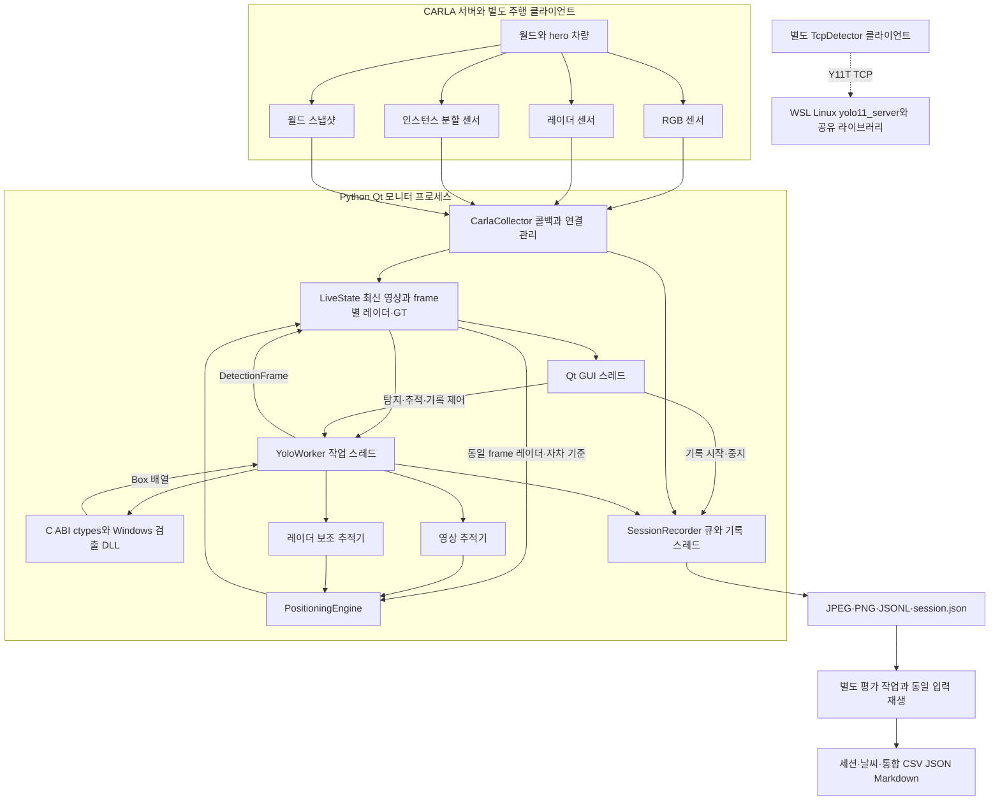
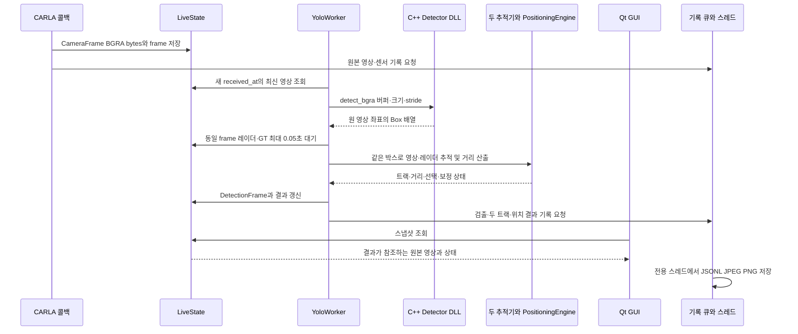
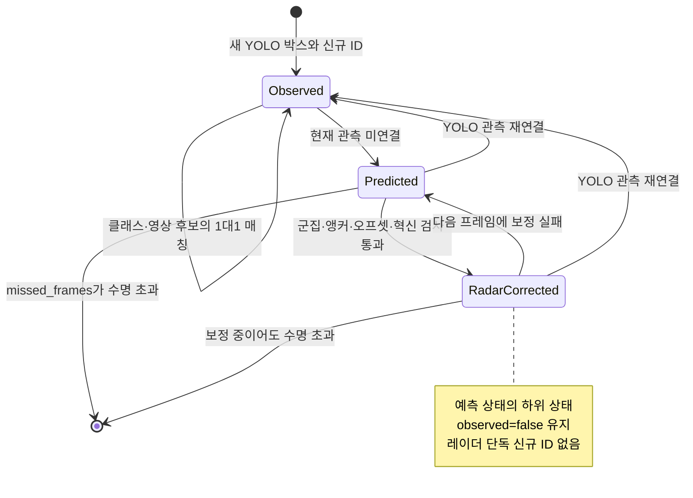
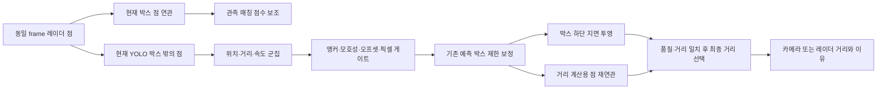
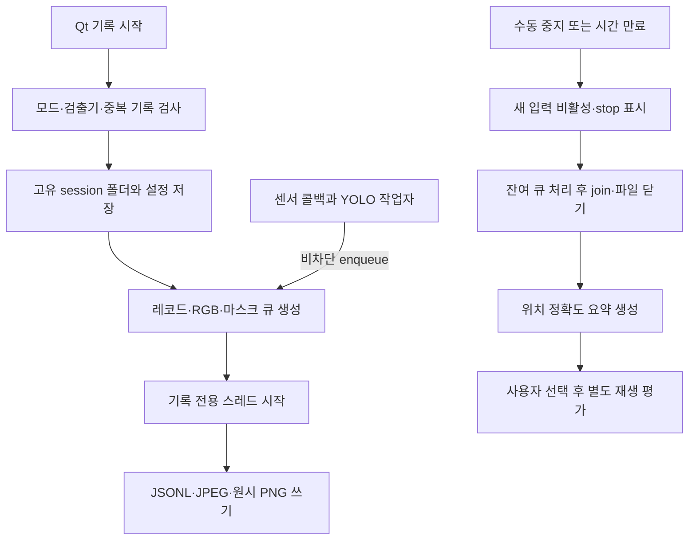
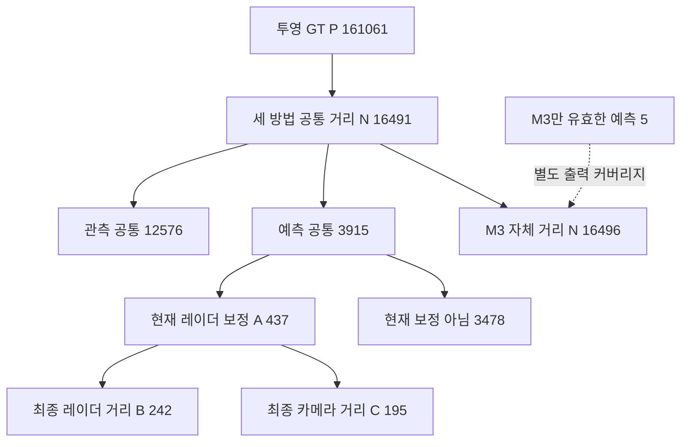

# CARLA RadarVision 통합 기술 포트폴리오

**센서 취득에서 크로스 플랫폼 검출기 연동, Qt 검증 도구, 추적·거리 추정과 재생 평가까지**

작성일: 2026-10-24 · 개발 형태: **1인 개발** · 실험: `workflow_20261023_203600_8af7ab2a`

## 문서 안내

- [실제 기능과 전체 결과](#1-무엇을-만들었고-무엇을-확인했는가)
- [CARLA부터 Qt까지의 실행 구조](#3-실행-주체와-전체-데이터-흐름)
- [CMake와 Windows/Linux 검출기](#4-cmake-기반-검출기와-플랫폼별-호출-경계)
- [한 프레임의 호출·표시 과정](#5-carla-한-프레임이-qt-화면에-도달하는-과정)
- [영상 추적 기술](#7-사용한-차량-추적-기술)
- [레이더 보조·박스 보정·거리 선택](#8-레이더-보조의-세-단계와-거리-산출)
- [저장과 재생 평가](#9-qt에서-기록을-시작하고-파일로-남기는-과정)
- [전체 데이터셋 결과](#12-전체-데이터셋-검증-결과)
- [전체 날씨·거리별 비교](#13-전체-데이터의-날씨거리별-비교)
- [437·242·195건 심층 분석](#14-레이더-보정이-적용된-구간의-심층-분석)
- [원본 영상·마스크 사례](#15-원본-영상마스크gt결과를-연결한-사례)
- [직무 연관성과 재현 근거](#17-골프존-업무와-연결되는-기술-경험)

## 1. 무엇을 만들었고 무엇을 확인했는가

CARLA의 전방 영상·레이더를 받아 차량을 검출·추적하고 차체 사이 거리를 산출하는 데스크톱 검증 시스템을 단독 개발했다. TensorRTx 기반 C++/CUDA 검출기를 CMake로 빌드하고, Python 작업자가 호출하며, Qt 대시보드에서 원본·검출·영상 추적·레이더 보조 추적을 비교한다. 취득 자료와 처리 결과는 같은 프레임 키로 저장하고, 저장 입력을 재생해 방법별 거리 오차와 가시 GT 기준 검출률을 평가한다.

**수집 → 추론 모듈 호출 → 상태를 가진 추적·계측 → 표시·기록 → 동일 입력 평가**의 전체 파이프라인을 설계하고 구현했다. 추적·레이더 처리·거리 계산·평가는 Python으로 구현하고, C++/CUDA 검출 모듈은 TensorRTx를 기반으로 연동했다.

### 1.1. 전체 결과와 보정 적용 결과를 함께 제시

9개 세션의 평가 16,213프레임, 투영 GT 161,061개 차량·프레임을 분석했다. 세 방법의 공통 유효 거리 표본 16,491건에서 영상 추적·카메라 거리(M1), 같은 영상 추적·조건부 거리 선택(M2), 레이더 보조 추적·같은 거리 선택(M3)의 MAE는 **1.6233 → 1.5468 → 1.5355m**였다. M1→M3의 MAE 감소율은 **5.41%**, RMSE 감소율은 **0.83%**다. 전체 가시 GT 기준 YOLO 재현율은 **12,365/35,669=34.67%**다. [통합 CSV][DCSV], [통합 JSON][DJSON]

레이더로 예측 박스를 보정한 437건에서는 M1→M3 MAE가 **1.3280→0.8046m, 39.42% 감소**했다. 이 부분집합은 전체 공통 거리 표본의 **2.65%**, 공통 예측 표본의 **11.16%**다. 따라서 39.42%를 전체 시스템 개선율로 사용하지 않는다. 전체 범위에서 얻은 효과, 보정이 작동한 구간에서의 효과, 최종 레이더 거리 선택 242건의 효과를 순서대로 구분한다. [보정 분석][A437], [하위집단 통합 분석][AINT]

### 1.2. 사용자가 할 수 있는 일

| 기능 | 실제 동작과 산출물 |
| --- | --- |
| 센서 모니터링 | CARLA·hero 연결, RGB·레이더·차량·IMU·GNSS·이벤트와 수신률 확인 |
| 검출·추적 비교 | 영상 A/B의 원본·YOLO·영상 추적·레이더 보조 추적 선택, ID·거리·출처 표시 |
| 실험 제어 | 탐지·트래킹·보정 설정, 두 추적기의 유지 프레임 조정, 비교 화면 확대 |
| 세션 기록 | 일반·YOLO·추적·융합 모드, 수동 중지 또는 지정 시간 종료 |
| 자동 수집 | 날씨 단계·기록 시간·안정화 대기 설정, 조건별 세션과 메타데이터 저장 |
| 사후 검증 | 원본·처리 결과의 비교 영상, 세션·날씨·통합 CSV·JSON·Markdown 보고서 |

현재 함수와 책임은 [앱 진입점][APP], [작업자][WORKER], [기록기][RECORDER], [세션 평가기][EVAL]에서 확인할 수 있다. 성능 결과는 저장 실험의 원본 기록·CSV·JSON을 대조해 검증했다.

## 2. 문제 정의와 CARLA를 사용하는 이유

영상에서 차량 박스가 잠시 연결되지 않아도 기존 트랙은 예측 상태로 유지될 수 있다. 그러나 ID가 살아 있다는 사실만으로 박스 위치나 거리값이 정확한 것은 아니다. 박스 하단의 지면 투영으로 거리를 구하면 픽셀 예측의 작은 오차가 원거리에서 크게 확대된다. 다른 차량의 반사점·바뀌는 차체 반사면을 그대로 따라가도 오차가 생기므로 레이더 보정에는 연관·군집·시간·이동 제한이 필요하다.

CARLA를 사용한 이유는 센서와 참조 차량의 자세·bounding box·시각을 함께 확보하고, 같은 기록을 여러 처리 경로에 입력해 비교하기 위해서다. 실제 차량에서는 독립적인 기준 계측 장비와 센서 동기화·자세·지면 추정이 추가로 필요하다. 시뮬레이션은 좌표·프레임 정렬, 처리 경계, 센서 선택과 실패 사례를 먼저 점검하는 환경이다.

센서와 날씨를 설정할 수 있는 기능과 이번 실험의 통제 수준은 다르다. 이번 자료는 조건별 1회 순차 수집이며 동일 경로·교통 시드의 독립 반복이 아니다. 실제 강우의 레이더 전파 감쇠·클러터, 하드웨어 시간 오차나 골프공·클럽의 고속 운동을 검증한 자료로 확대하지 않는다. CARLA 날씨 모델의 범위와 시뮬레이터 선택 근거는 [기존 논문 1.2절과 참고문헌][PAPER]에도 정리돼 있다.

## 3. 실행 주체와 전체 데이터 흐름

### 3.1. 프로세스와 모듈의 경계



실선은 현재 앱의 활성 Windows 실행 경로다. 점선은 별도 구현된 WSL TCP 경계다. Linux 검출기 빌드 산출물은 실제 존재하지만, 현재 `app.main()`과 `YoloWorker`는 로컬 `Detector`를 생성하며 TCP 검출기 선택 UI·CLI를 연결하지 않는다. 따라서 양 OS 검출기와 Windows Qt의 현재 활성 호출 경로를 같은 상태로 설명하지 않는다. [앱 옵션][APP], [작업자][WORKER], [TCP 클라이언트][TCP]

### 3.2. 실행·사용 순서

1. 별도 실행한 CARLA 서버와 `role_name=hero` 차량을 준비한다. 프로젝트 수집기는 월드를 생성하거나 차량을 운전하는 역할이 아니다.
2. 플랫폼에 맞게 검출기를 빌드하고 TensorRT 엔진을 생성한다. Windows에서는 `run_yolo11n.bat`이 라이브러리·엔진·종속 DLL 경로를 검사한다.
3. Qt 앱이 `LiveState`, `SessionRecorder`, `CarlaCollector`, 선택적 `YoloWorker`를 생성한다. 검출기 옵션이 없으면 센서 모니터로 동작한다.
4. 수집기가 CARLA에 연결해 hero를 찾고 센서를 부착한다. 작업자는 엔진을 한 번 로드하고 탐지 활성화를 기다린다.
5. 사용자가 탐지·트래킹·보정을 선택하거나 AI 기록 모드를 시작한다. GUI는 설정을 전달하고 작업자가 추론·상태 갱신·계측을 수행한다.
6. 화면에서 영상과 거리·출처·수신률을 비교한다. 기록 모드는 원본과 결과를 비동기로 저장한다.
7. 녹화를 종료한 뒤 세션 또는 workflow 상위 폴더를 선택해 재생 평가와 보고서를 만든다.

근거: [실행 스크립트][RUN], [앱 main][APP], [수집기][COLLECTOR], [AI 기록 제어][AI_START]. 수집기는 서버를 직접 tick하지 않으며 센서 배치 생성의 `apply_batch_sync(..., False)`도 새 tick을 요청하지 않는다. 종료 시 자신이 부착한 센서와 월드 콜백을 정리한다.

## 4. CMake 기반 검출기와 플랫폼별 호출 경계

### 4.1. 모델·엔진·라이브러리·실행 파일

| 항목 | 역할 | 확인 근거 |
| --- | --- | --- |
| `yolo11n.pt` | YOLO 학습 가중치 원본 | 외부 `models/`와 빌드 문서 |
| `yolo11n.wts` | TensorRTx 엔진 생성에 입력하는 가중치 형식 | 변환 결과와 엔진 빌드 로그 |
| `.engine` | 해당 환경에서 실행하는 직렬화 TensorRT 엔진 | Windows·Linux에 각각 존재 |
| DLL / `.so` | 엔진·GPU 자원을 소유하며 BGRA를 박스로 변환하는 C++ 모듈 | 공통 `detector.cpp`, C ABI |
| `yolo11_det` | 엔진 생성·이미지 폴더 추론용 CLI | Windows exe, Linux 실행 파일 |
| `yolo11_server` | Linux에서 동일 검출기를 상주시켜 TCP 요청 처리 | Linux 타깃·서버 소스·실행 파일 |

외부 소스 루트는 `C:\ai\tensorrtx\yolo11`이다. CMake는 `LANGUAGES CXX CUDA`, C++17·CUDA17, `find_package(CUDAToolkit)`, OpenCV, TensorRT import target을 정의한다. `yolo11_detector` SHARED 라이브러리에 신경망 구성·전후처리·검출 헤드 플러그인과 `detector.cpp`, `detector_c.cpp`를 연결하고 CLI는 라이브러리를 링크한다. `WIN32`는 export·Windows 매크로와 DLL 복사, Linux는 POSIX 소켓 서버 타깃으로 분기한다. [외부 CMake][XMAKE], [C++ 검출기][XDETECT], [서버][XSERVER], [빌드 문서][BUILD]

이는 각 OS에서 공통 소스를 네이티브 빌드하는 크로스 플랫폼 구성이다. Windows 컴파일러로 Linux 바이너리를 생성하는 크로스 컴파일을 수행했다는 의미는 아니다. CARLA 수집기·Qt 앱 전체를 하나의 루트 CMake로 빌드하는 구조도 아니다.

### 4.2. 실제 확인한 플랫폼별 근거

| 항목 | Windows | WSL Ubuntu 24.04 |
| --- | --- | --- |
| CMake 소스 | `C:/ai/tensorrtx/yolo11` | `/mnt/c/ai/tensorrtx/yolo11` |
| 빌드 폴더 | `build/yolo11-win-trt10.16` | `/home/nozy/build/yolo11-linux` |
| 생성기·컴파일러 | Visual Studio 17 2022, MSVC 19.38.33145.0 | Unix Makefiles, `/usr/bin/c++` |
| CUDA | CMake compiler 기록 13.4.92, architecture 89 | 캐시 `/usr/local/cuda-13.2/bin/nvcc` |
| TensorRT | 10.16.1.11 Windows SDK 경로 | `/home/nozy/opt/TensorRT-10.16.1.11` |
| OpenCV | `C:/opencv/build` | `/usr/lib/x86_64-linux-gnu/cmake/opencv4` |
| 라이브러리 | `yolo11_detector.dll`, 433,152B | `libyolo11_detector.so`, 461,552B |
| 엔진 | `yolo11n.engine`, 8,794,644B | `yolo11n.linux.engine`, 7,927,956B |
| 도구 | `yolo11_det.exe`, 샘플 출력·로그 | `yolo11_det`, `yolo11_server`, 샘플 출력 이미지 |
| 확인 수준 | 산출물·빌드 로그·세션의 Windows 엔진 경로·앱 연결 코드 | WSL에서 기존 산출물과 CMakeCache 직접 확인 |

Linux 빌드 근거는 WSL 파일시스템의 공유 라이브러리·서버·엔진과 CMakeCache다. 현재 GUI의 WSL 선택 경로 연결과 양 OS의 동일 입력 정확도 비교는 후속 검증 항목이다.

Windows의 [엔진 생성 로그][ENGINELOG]에는 빌드 성공이, [샘플 검출 로그][SAMPLELOG]에는 한 장의 처리 기록이 있다. 빌드 문서는 차량 1대의 C++ 박스·점수가 공식 YOLO 출력과 가까웠음을 기록한다. 이는 전체 검출 정확도나 장시간 추론 처리량 벤치마크가 아니다. `PROJECT_OVERVIEW`·`PHASE_1_5_CMAKE`의 “Ubuntu 빌드 미검증”은 작성일이 이전인 상태 설명이며, 이번에 확인한 Linux 산출물·캐시와 구분한다.

### 4.3. 빌드와 엔진 생성의 재현 경로

```powershell
# Windows: 실제 빌드 기록의 입력 구조
& 'C:/Program Files/Microsoft Visual Studio/2022/Community/Common7/IDE/CommonExtensions/Microsoft/CMake/CMake/bin/cmake.exe' `
  -S 'C:/ai/tensorrtx/yolo11' -B 'build/yolo11-win-trt10.16' `
  -G 'Visual Studio 17 2022' -A x64 `
  '-DTENSORRT_ROOT=C:/ai/TensorRT-10.16.1.11.Windows.amd64.cuda-13.2/TensorRT-10.16.1.11' `
  '-DOpenCV_DIR=C:/opencv/build' '-DCMAKE_CUDA_ARCHITECTURES=89'
cmake --build build/yolo11-win-trt10.16 --config Release --target yolo11_detector yolo11_det
```

```bash
# Linux: 확인한 CMakeCache에 대응하는 구성 입력 예시
cmake -S /mnt/c/ai/tensorrtx/yolo11 -B /home/nozy/build/yolo11-linux \
  -DCMAKE_BUILD_TYPE=Release \
  -DTENSORRT_ROOT=/home/nozy/opt/TensorRT-10.16.1.11 \
  -DOpenCV_DIR=/usr/lib/x86_64-linux-gnu/cmake/opencv4 \
  -DCMAKE_CUDA_COMPILER=/usr/local/cuda-13.2/bin/nvcc
cmake --build /home/nozy/build/yolo11-linux --target yolo11_detector yolo11_det yolo11_server
```

가중치의 `.pt→.wts` 변환 후 `yolo11_det -s <wts> <engine> n`으로 엔진을 만든다. 코드·가중치가 공통이어도 `.engine`은 OS·TensorRT·GPU 조합별로 생성·검증한다. 실행 전 SDK와 runtime 라이브러리 경로를 맞춰야 한다. [상세 빌드 기록][BUILD]

### 4.4. 현재 C++ 추론 소스에서 확인한 설정

외부 `include/config.h`는 640×640·batch 1·80클래스, `USE_FP16`, confidence 0.5·NMS 0.45를 정의하고 `DetectBgra`가 이를 사용한다. BGRA 640×480 센서 입력과 네트워크 640×640 입력은 다른 단계다. OpenCV BGRA→BGR, CUDA 전처리, TensorRT `enqueueV3`, 출력 복사·동기화, NMS·원본 영상 좌표 복원으로 이어진다. CUDA 코드의 역할은 TensorRTx 전후처리·플러그인이고 신경망 본체는 TensorRT 실행 경로다. [현재 config][XCONFIG], [실제 호출][XDETECT]

이 값은 **현재 검출기 소스 설정**이다. 실험 세션에는 DLL 빌드 해시·후처리 상수가 저장되지 않아 과거 9개 세션의 바이너리와 현재 소스 설정의 동일성은 추가 확인이 필요하다.

## 5. CARLA 한 프레임이 Qt 화면에 도달하는 과정

### 5.1. 센서 생성과 좌표 기준

수집기는 기본 `127.0.0.1:2000`, `hero`를 사용한다. RGB·인스턴스 카메라·레이더·IMU·GNSS를 같은 배치로 생성하고 충돌·차선 이탈 센서를 추가한다. 같은 주기 설정만으로 콜백 도착 순서나 누락 없는 동기화를 보장하지 않으므로 frame별 문맥 저장을 별도로 사용한다. [센서 부착][SENSORS]

| 입력 | 장착·설정 | 저장·후속 사용 |
| --- | --- | --- |
| RGB | 차량 기준 (1.5,0,2.4)m, 640×480, FOV 90° | BGRA 추론·JPEG 기록·원본 비교 |
| 인스턴스 분할 | RGB와 같은 장착·해상도·FOV | 무손실 원시 PNG·가시 GT 판정 |
| 레이더 | (2.2,0,0.7)m, range 100m, FOV 35°×20°, 1,500 points/s | 거리·각도·상대속도 검출점 |
| IMU·GNSS | 차량 원점, 센서 주기 공통 설정 | 가속·각속도·위치 모니터 |
| 충돌·차선 이탈 | 사건 콜백 | 최근 이벤트 표시·기록 |
| 월드 스냅샷 | 차량 transform·velocity·bounding box | 자차 기준과 평가 GT |

주기 설정 `sensor_tick=0.066666`초는 약 15Hz의 목표이며 실제 수신률과 다르다. 이 앱은 월드의 고정 시간 간격·동기식 모드·맵을 변경하지 않는다. 화면에서 읽은 맵 이름을 이번 세션 메타데이터에 저장하지 않았으므로 실험 맵을 특정하지 않는다.

ego 좌표는 X 전방·Y 우측·Z 상방, 길이는 m, 각도는 저장 시 rad, 속도는 m/s다. 레이더 로컬 점은 `x=r cos(alt) cos(az)`, `y=r cos(alt) sin(az)`, `z=r sin(alt)`로 만든 후 센서 transform을 통해 월드·카메라·ego로 변환한다. 카메라 전방 깊이 d, 우측 q, 상방 h일 때 `u=cx+fx·q/d`, `v=cy-fy·h/d`, `fx=fy=W/(2 tan(FOV/2))`다. [좌표·투영][POSITION]

### 5.2. 프레임 처리 순서와 메모리 경계



`CameraFrame`은 BGRA bytes와 원 프레임·시각·센서 정보를 보유한다. Python `Detector`는 `ctypes.CDLL`로 `yolo11_create/detect_bgra/destroy`를 연결한다. C++ 검출기는 엔진·context·CUDA stream·GPU 버퍼를 한 번 생성하며 프레임마다 실행 파일을 새로 띄우지 않는다. Python은 최대 1,000개 구조체 배열과 오류 버퍼를 전달한다. C++는 출력 용량 초과·입력·엔진 오류를 검사하고 예외를 null/-1 및 메시지로 바꾼다. [Python 브리지][BRIDGE], [C ABI][XCABI], [C++ 자원 관리][XDETECT]

C++에는 프로세스 전역 GPU mutex와 단일 Detector 인스턴스 제한이 있다. 호출은 worker 스레드에서 동기적으로 GPU 완료를 기다리고, 센서 콜백과 GUI 스레드는 추론 완료를 기다리지 않는다. GPU 추론을 다른 프로세스로 분리한 구조는 현재 Windows 경로에 없다.

Qt는 처리 결과가 있으면 `detections.camera`를 표시 프레임으로 선택해 그 결과의 박스를 같은 영상에 그린다. 따라서 지연된 박스를 최신 원본에 잘못 겹치지 않지만 탐지 중 원본 보기 역시 처리 결과의 프레임을 표시할 수 있다. 일부 상태 라벨은 최신 camera 값을 사용하므로 렌더링 프레임과 모든 화면 라벨이 반드시 같은 시점이라는 보장은 별도다. [표시 프레임 선택][DISPLAY]

### 5.3. Linux 호출 인터페이스

Linux 서버도 같은 C ABI의 검출기를 사용한다. Python `TcpDetector`는 지속 연결, magic `Y11T`, version 1, request 1·response 0x8001, 네트워크 바이트 순서를 사용한다. 헤더는 12B, 요청 메타데이터는 frame ID·width·height·stride의 20B다. 응답은 frame·상태·추론 시간·박스 수·박스 배열이다. 영상은 64MiB·치수 3,000 이하·행 padding·실제 길이를 검사하고 응답은 최대 1,000박스와 요청 frame 일치를 확인한다. `_recv_exact`는 TCP 분할 수신을 처리한다. [클라이언트][TCP], [서버][XSERVER], [프로토콜 테스트][TCPTEST]

현재 `YoloWorker`에는 DLL/TCP를 선택하는 factory가 연결돼 있지 않고, 앱 인자도 `--yolo-library`, `--yolo-engine` 경로다. 같은 Python 앱을 Linux에서 `.so`로 호출할 수 있는 브리지 형태와 Linux 바이너리의 존재, Windows Qt→WSL TCP의 현재 완성도는 구분한다. 실험 세션의 엔진 경로는 Windows DLL 경로를 뒷받침한다.

## 6. 시간 정렬과 실시간 처리 설계

| 시간·키 | 사용 위치 | 해석 |
| --- | --- | --- |
| `frame` | RGB·레이더·GT·마스크 연결 | 동일 CARLA 시뮬레이션 틱 |
| `simulation_timestamp` | 센서 시각·거리 이동 타당성 검사 | 가상 월드 시간 |
| `receive_timestamp` | 콜백 수신·영상 추적 운동 예측 | `time.time()` 벽시계 |
| `detection_timestamp` | 처리 결과 기록 시각 | 순수 GPU 완료 시각과 동일하지 않음 |
| `processing_ms` | worker 처리 구간 | 추론 외 문맥 대기·추적·계측도 포함 |

`LiveState`는 레이더·GT를 frame별 사전에 보관하고 최근 256개 항목으로 제한한다. worker는 같은 frame의 두 문맥을 최대 0.05초 기다리며 없으면 다른 frame을 보간해 쓰지 않는다. 입력은 큐에 모든 영상을 쌓는 방식이 아니라 최신 영상의 `received_at`을 비교해 새 프레임만 처리한다. 따라서 모든 원본 영상에 검출 결과가 존재한다고 가정할 수 없다. [상태·Condition][STATE], [worker][WORKER]

| 실행 단위 | 주 책임 | 지연·메모리 관리 |
| --- | --- | --- |
| 센서 콜백 | bytes·측정값 생성, 상태 반영·기록 요청 | 짧은 Lock, 기록 put_nowait |
| 수집 스레드 | 서버·hero 탐색, 센서 부착·재연결·정리 | Event 기반 중단·재시도 |
| YOLO 작업자 | 상주 검출기·두 추적기·거리 계산 | 최신 입력 우선, control Lock |
| 기록 스레드 | JSONL·JPEG·PNG 실제 쓰기 | 레코드 4,096, RGB·마스크 각 32 큐 |
| Qt GUI | 설정·상태·그리기·작업 실행 | 시그널·타이머·별도 평가 작업 |

큐가 차면 새 입력을 버리고 `dropped_records` 또는 `dropped_frames`를 올린다. 기록 누락을 관찰할 수 있지만 무손실을 보장하지 않는다. 원본 수집·GUI·추론을 분리한 소프트 실시간 구조이며 Python GIL, GPU 동기화, 디스크 변동을 포함한 최대 지연 보장은 없다. 현재 근거로는 장시간 p95/p99 종단 지연이나 최대 처리량을 제시하지 않는다.

설정 변경은 제어 Lock 안에서 추적·위치 상태를 초기화한다. 수명은 두 추적기에 공통 반영되며, 레이더 보정 변경은 관련 융합 상태를 비운다. 탐지 오류는 탐지·트래킹을 비활성화하고 상태를 제거한 뒤 메시지를 표시한다. 앱 종료는 collector·worker·recorder와 실행 중 작업을 기다리고 리소스를 해제한다. 이때 join·쓰기 종료가 지연될 수 있어 종료 응답 시간 보장도 별도 측정 대상이다. [제어][WORKER], [앱 종료][CLOSE], [기록기][RECORDER]

## 7. 사용한 차량 추적 기술

### 7.1. 검출과 추적을 구분

YOLO11n은 프레임의 박스·class·confidence를 출력한다. 동일 차량의 ID와 시간 상태를 유지하는 것은 `MultiObjectTracker`다. 영상 전용과 레이더 보조 인스턴스는 같은 검출 박스를 받지만 독립된 ID 공간을 가진다. 평가의 차량 클래스는 COCO 2·3·5·7이며, 실시간 추적기에 들어가는 모든 박스를 먼저 네 클래스로 제한하는 별도 코드는 없다. [추적기][TRACKER], [평가 차량 클래스][VISIBLE]

### 7.2. 클래스 인식 예측 박스 IoU·중심 거리 탐욕 매칭

| 단계 | 실제 계산·조건 |
| --- | --- |
| 박스 예측 | `x'=x+vx·dt`, `y'=y+vy·dt`, dt를 0~1초로 제한 |
| 후보 | 클래스 동일, IoU≥0.05 **또는** 중심 거리≤L |
| 중심 허용 거리 | `L=max(40px, sqrt(w²+h²)×1.5)` |
| 영상 점수 | `IoU+0.15×max(0,1-중심 거리/L)` |
| 배정 | 점수 내림차순, track ID·검출 index 순 정렬 후 1:1 탐욕 연결 |
| 속도 | 직전 관측 중심과 시간으로 측정, `v←0.65v+0.35v_measured` |
| 관측 성공 | 박스·점수·속도·hits 갱신, missed_frames=0 |
| 신규 검출 | 미배정 박스에 증가하는 새 ID, hits=1로 바로 출력 |
| 관측 공백 | 예측 박스 출력, missed_frames 증가 |
| 삭제 | missed_frames가 max_lost_frames를 초과하면 제거 |

추적기는 Kalman filter·Hungarian·SORT·DeepSORT·ByteTrack·외형 Re-ID를 사용하는 경로가 아니다. hits 기반의 별도 confirmed 단계도 없다. 0~100개의 **처리 프레임** 유지 기간을 UI에서 선택하고 두 추적기를 초기화한다. 이번 세션은 모두 10이다. 실제 영상 처리 간격이 변하므로 10처리 프레임을 일정한 초 단위 수명으로 환산하지 않는다. [상태와 매칭][TRACKER], [설정 전달][WORKER]

설계상 해석으로는 외형 모델·추가 학습 없이 검출 스트림과 레이더 연관의 차이를 재생 평가하기 쉬운 구조다. 다른 추적기를 정량 비교해 최적 방법으로 선정했다는 기록은 없으므로 선택의 우월성까지 주장하지 않는다.



## 8. 레이더 보조의 세 단계와 거리 산출

### 8.1. 공통 전처리와 영상 박스 연관

같은 frame 레이더 점을 센서→월드→카메라로 투영한다. 박스 여유는 각 축 `max(4px, 박스 변×0.08)`이며, 카메라 전방 추정과 레이더 전방 차이가 `max(3m, 카메라 전방거리×0.15)`보다 크면 제외한다. 여러 박스에 들어가면 크기로 정규화한 중심 거리가 최소인 하나에 점을 준다.

박스별 점은 거리순으로 묶고 이웃 점 차이>0.5m 또는 묶음 시작과 차이>1m이면 분리한다. 가까운 군집부터 점≥3·중앙값 최대 편차≤0.5m인 첫 군집을 고른다. 없으면 가장 가까운 군집을 연관 결과로 반환할 수 있어 ‘연관 결과 있음’과 ‘거리 선택 조건 통과’가 다르다. 위치·거리·시선 방향 거리변화율은 군집 중앙값이다. [점 연관][BOXMATCH]

### 8.2. A단계 관측 트랙의 매칭 점수 보조

기존 트랙과 현재 검출 박스의 레이더 묶음이 모두 3점 이상·편차 0.5m 이하이면 기존 거리와 평활 거리변화율로 현재 거리를 예측한다. `gate=max(6m, 예측거리×0.25)`, `bonus=0.22×(1-min(abs(r_current-r_pred)/gate,1))`를 영상 점수에 더한다. 큰 레이더 오차는 보너스를 0으로 만들며, 영상 후보를 반드시 탈락시키는 하드 게이트가 아니다. [매칭 가산][TRACKER]

### 8.3. B단계 관측 공백 중 기존 박스 보정

영상 관측이 연결된 동안 레이더 지면 투영 픽셀과 박스 하단 중앙의 오프셋을 학습한다. 월드 레이더 앵커는 실제 관측 간 이동으로 속도를 갱신하고, 공백 중에는 월드 상수속도로 예측한다. 이는 내 차의 이동과 상대 차량 상태를 공통 좌표에서 취급하기 위한 방식이며 Doppler 하나를 완전한 2D 속도로 해석하지 않는다.

현재 YOLO 박스 사방 4px 안의 점은 공백 보정에서 제외한다. 남은 점을 월드 위치·거리·속도 기준으로 묶고 기존 트랙의 예측 앵커와 1:1 연결한다. 반사점 자체를 차량 중심으로 쓰지 않고 학습 오프셋을 더한 박스 하단 위치를 후보로 만든다. [군집 구현][CLUSTERS], [보정 원리 문서][CORRECTION]

| 검사·갱신 | 값과 거부 동작 |
| --- | --- |
| 군집 최소 품질 | 최소 3점, 거리 중앙값 최대 편차≤0.5m |
| 군집 평면 이웃·거리차 | ≤1m·≤0.5m |
| 거리변화율 이웃·트랙 차 | ≤4m/s |
| 최근 유효 레이더 앵커 | ≤1초 |
| 예측 월드 앵커 연결 | 군집과≤1m |
| 후보 모호성 | 1·2위 거리 차<0.75m이면 군집 연결 거부 |
| 오프셋 안정성 | 최소 2회, 갱신 차>12px면 학습 재시작, 평활 변동≤6px |
| 오프셋 평활 | 이전×0.7+관측×0.3 |
| 월드 속도 갱신 | 관측 간격 0~1초, 측정 속도≤30m/s, 이전×0.65+관측×0.35 |
| 픽셀 혁신 크기 | ≤min(12px,max(6px,박스 대각선×0.25)) |
| 허용 혁신 적용 | x·y 각각 70%만 반영 |

보정은 트랙의 박스 위치와 레이더 상태를 갱신하지만 새 차량 ID를 만들거나 미관측 수명을 리셋하지 않는다. `predicted=true`, `observed=false`, `radar_corrected=true`이며 점 수를 남긴다. 이번 세션의 보정 토글은 모두 true다. 필드가 없는 과거 세션은 기본 false로 재생해 점수 보너스만 사용한다. UI 토글·기록 상태와 무관하게 과거 세션에 새 보정을 적용했다고 가정하지 않는다. [추적 갱신·오프셋·앵커][TRACKER], [세션 설정 적용][EVAL]

### 8.4. C단계 최종 거리 선택과 투영 품질

카메라 박스 하단 중앙 `(u,v)`의 로컬 광선은 `(1,(u-cx)/fx,-(v-cy)/fy)`다. 월드 회전 후 지면 `ground_z`와 만나는 점을 ego XY로 바꾼다. 평행한 광선, 뒤쪽 교점, 코드의 광선 매개변수>250은 산출 실패다. 박스 하단이 차체의 지면 관측점이라는 가정과 평면 지면 가정이 있다. [지면 투영][GROUND]

카메라 거리는 관측점과 내 차 회전 bounding box 평면 외곽의 최단 간격이다. 레이더 거리도 군집 각 점에서 내 차 외곽까지의 간격을 구해 중앙값을 취한다. 센서 원점 거리와 차체 간격을 혼용하지 않는다.

| 조건 | 현재 처리 |
| --- | --- |
| 최종 레이더 선택 | 점≥3, 거리 편차≤0.5m, 카메라·레이더 간격 차≤1m |
| 레이더 시간 검사 | 최근 1초 위치가 있을 때 이동≤3m+20m/s×dt |
| 예측 카메라 기준 | 마지막 YOLO 관측 앵커≤1초, 같은 이동 한계 통과 |
| 지면 투영 민감도 | 하단 ±1px 거리 변화≤max(3m,카메라 거리×10%) |
| 선택 조건 실패 | 유효한 카메라 거리 사용·사유 기록 |
| 카메라 거리 무효 | 현재 최종 선택 로직은 레이더만으로 유효 거리 표본을 만들지 않음 |
| 거리 미산출 | 트랙은 유지 가능하나 해당 거리 MAE/RMSE에는 미포함 |

최종 거리는 조건부 선택이며 카메라·레이더 거리의 가중평균이 아니다. 반면 XY 위치는 레이더 1점일 때 전방 레이더 0.25, 여러 점일 때 0.80, 측방 카메라 0.65·레이더 0.35로 별도 가중한다. 보정 예측에서 레이더 반사점→관측 기준의 월드 오프셋을 학습·적용하는 위치 경로 역시 최종 거리 선택과 구분한다. [위치·거리 계산][ENGINE]



### 8.5. 필드 의미를 단계별로 구분

| 필드 | 위치·의미 |
| --- | --- |
| `radar_track_correction_enabled` | session.json·평가 설정, 공백 박스 보정 사용 여부 |
| `predicted`, `missed_frames` | tracks.jsonl, 미관측 예측 상태·처리 프레임 수 |
| `observed` | positions·평가 CSV, 해당 트랙에 현재 검출 연결 여부 |
| `radar_corrected`, `radar_correction_points` | 트랙·위치·CSV, 현재 프레임 박스 보정 적용과 점 수 |
| 원본 위치 `radar_used` | 레이더 XY 사용 가능 여부이며 최종 거리 선택과 같지 않음 |
| 원본 `distance_source` | 최종 거리 출처, radar_near_cluster 또는 camera 등 |
| 평가 CSV `radar_used`, `position_source` | 최종 거리에서 레이더가 선택됐는지와 해당 출처 |
| `fusion_source` | 2차원 위치의 camera+radar·radar·camera_only 경로 |
| `raw_camera_distance_m`, `distance_rejection_reason` | 품질 검사 전 카메라값과 거부·대체 사유 |

상대 차량 GT 위치·ID는 예측 보정·거리값 선택에 입력하지 않고 정답 연결·평가에 사용한다. 자차 pose·지면 높이·외곽은 좌표·계측 기준이다. 따라서 독립적인 실차 센서만으로 모든 기준을 확보한 시스템이라고 해석하지 않는다.

## 9. Qt에서 기록을 시작하고 파일로 남기는 과정

### 9.1. 제어 흐름과 작업 분리

AI 기록 시작은 GUI의 `_start_ai_recording`이 유효한 모드·검출기 상태·다른 기록 여부를 확인하고 `SessionRecorder.start_session`으로 고유 폴더·파일·메타데이터·큐를 만든다. 이후 worker의 탐지·트래킹·레이더 모드를 설정한다. 기록 중 변경하면 재현성이 깨지는 제어는 비활성화하고, 종료 시 이전 활성 상태를 복구한다. [기록 버튼][AI_START], [세션 시작][RECORDER]

지정 시간이 0이면 수동 종료, 양수면 앱의 경과 시간 타이머가 기존 중지 경로를 호출한다. 날씨 워크플로는 `world.set_weather()` → 설정한 안정화 대기 → 단계별 기록 → 자동 종료 → 다음 단계 순이다. 수동 중지·연결 단절이면 남은 단계도 종료한다. pygame 키 입력을 조작하는 대신 CARLA API로 같은 월드를 제어한다. [워크플로][WEATHER]



기록 스레드는 루프마다 레코드 최대 20건과 RGB·마스크를 처리하고 핸들을 flush한다. `put_nowait` 실패나 이미지 저장 실패는 계수·상태에 남는다. 종료 시 입력을 끊고 큐가 빌 때까지 처리해 join한 뒤 파일을 닫는다. OS 캐시의 전원 차단 내구성·손상 복구·무한 대기 방지는 현재 별도 제품 검증 대상이다. [실제 쓰기·종료][WRITE]

### 9.2. 실제 기록 구조

```text
workflow_20261023_203600_8af7ab2a/
├─ workflow.json
├─ weather_ClearNoon/
│  └─ 20261023_203605_390374_radar_fusion/
│     ├─ session.json
│     ├─ measurements.jsonl
│     ├─ camera/*.jpg
│     ├─ visibility_masks/*.png
│     ├─ visibility_masks.jsonl
│     ├─ detections.jsonl
│     ├─ vision_tracks.jsonl
│     ├─ tracks.jsonl
│     ├─ positions.jsonl
│     ├─ radar_fusion.jsonl
│     ├─ ground_truth.jsonl
│     └─ accuracy_summary.json
├─ weather_CloudyNoon/ ...
├─ 나머지 7개 날씨 폴더/ ...
└─ experiment_results/
   ├─ weather_프리셋/ ...
   ├─ position_errors_weather_combined_all.csv
   ├─ summary_weather_combined_all.json
   ├─ report_weather_combined_all.md
   └─ report_weather_detailed_all.md
```

| 파일·주요 필드 | 생성 주체와 다음 소비자 |
| --- | --- |
| session.json | 기록기: mode·날씨·workflow·계획 시간·엔진·수명·보정 → 평가 설정 |
| measurements.jsonl | 센서·JPEG 쓰기 후 인덱스: kind·sensor_id·frame·시각·transform·레이더 점 → 재생 문맥 |
| camera JPEG | 원본 BGRA에서 품질 82로 저장 → 사후 영상·비교 표시 |
| raw mask PNG·인덱스 | semantic·16비트 actor ID 보존 → 가시 GT 판정 |
| detections.jsonl | worker: 박스·confidence·원 frame·처리시간 → 재추론 없이 재사용 |
| vision_tracks.jsonl | 영상 기준선 track_id·박스·predicted·속도 → 라이브 기록 확인 |
| tracks.jsonl | 선택 추적 경로·보정 상태·레이더 상태 → 라이브 기록 확인 |
| positions.jsonl | 추정값·GT 연결·품질·거리 출처 → 원본 결과 추적·accuracy_summary |
| radar_fusion.jsonl | 같은 positioning 결과를 kind만 바꾼 기록 → 전용 조회·검증 |
| ground_truth.jsonl | 월드 스냅샷·자차·차량 bounds → 투영·거리 GT |

`positions`와 `radar_fusion`을 독립 측정으로 합산하면 안 된다. 원본 JPEG·결과는 서로 다른 큐를 거쳐 저장되므로 처리 결과가 참조한 모든 영상 파일이 반드시 존재한다고 가정하지 않는다. 저장된 원본은 기록·재현, GT는 평가, 결과 이력은 오류 원인 확인에 각각 쓰인다. [기록 필드 생성][RECORD_DETECTION]

## 10. 저장 세션을 다시 평가해 보고서로 만드는 과정

### 10.1. 평가 버튼 이후

`_evaluate_saved_session`은 기록 중인 경로를 보호하고 선택 폴더·GT 거리 범위를 별도 평가 작업에 전달한다. 단일 세션은 session·measurements·detections·GT를 요구하고, workflow면 단계·폴더·날씨 메타데이터를 검사해 세션을 순회한다. 분석할 수 없는 세션은 사유를 남긴다. [버튼][EVAL_BUTTON], [세션 평가][EVAL], [워크플로 평가][POOL]

평가기는 저장된 **YOLO 박스를 재추론하지 않는다**. 동일 frame의 카메라·GT가 있는 검출 기록만 정렬하고, 그때의 수명·보정 설정을 읽어 두 추적기를 재생한다. 거리 계산도 저장 센서로 다시 수행한다. 원본 `tracks/positions`를 그대로 최종 보고서 행으로 복사하는 방식이 아니다.


### 10.2. 입력 필드와 결과 지표의 대응

| 결과 | 입력·계산 경로 |
| --- | --- |
| 평가 프레임 | detections와 동일 `(sensor_id,frame)` 카메라 및 frame GT |
| 투영 P·gt_distance_m | 양 차량 GT bounds와 카메라 transform, 평면 외곽 거리 |
| V·D/V | 동일 frame raw mask의 배우 픽셀과 차량 YOLO 박스 |
| T·ID 변경 | 저장 박스에서 재생한 관측 트랙과 투영 GT 연결 |
| estimated_distance_m | 저장 카메라·레이더·박스로 PositioningEngine 재실행 |
| error_m | 현재 관측 거리 절대오차 |
| predicted_error_m | 미관측 유지 트랙 거리 절대오차 |
| tracking_error_m | 차량·frame에서 관측 우선 OR 예측, 최종 거리 지표 |
| radar_used·position_source | 평가 최종 거리의 레이더 선택 여부와 출처 |
| 거리 미산출 | 예측 앵커·이동·투영 검사와 distance_rejection_reason |

세션 결과는 `report_distance_profile_*`, `summary_distance_profile_*`, `position_errors_distance_profile_*`다. workflow는 세션 결과를 더해 날씨별·전체 결과를 만들고, detailed Markdown은 전체 뒤에 날씨별 본문도 포함한다. 같은 이름으로 버튼을 다시 실행하면 기존 평가 파일을 덮어쓸 수 있다. 아래 성능 표는 보존된 평가 CSV에서 재집계했다. [풀링][POOL], [기존 통합 보고서][DREPORT]

## 11. GT와 모집단을 정의한 검증 설계

### 11.1. 거리의 참값과 추정값

GT g는 같은 frame의 자차와 상대 차량 회전 bounding box 평면 외곽 사이의 최단 간격이다. 접촉·중첩이면 0m다. 추정 d는 카메라·레이더에서 얻은 관측 지점과 자차 외곽의 간격이다. 차량 중심 간 거리나 단순 레이더 원점 거리와 다르며 상대 차량 전체 외곽을 복원하지 않아 기하학적 기준 차이가 남는다. [GT footprint와 최소 거리][GT_DISTANCE]

대상 차량 GT는 평가용이고 자차 pose·차체·지면은 추정 기준이다. 마스크와 GT ID를 온라인 검출기·트랙 보정의 정답 입력으로 주지 않는다. 다만 예측 트랙을 평가할 때 마지막 관측에서 연결한 GT actor ID를 이어 쓰므로 평가 연결의 정확성도 실험 한계다.

| 기호 | 선정 조건 | 해석 |
| --- | --- | --- |
| P | 주변 vehicle의 3D box가 화면에 투영 | 가림 미판정 기회 |
| V | 동일 frame 마스크의 차량 태그·actor ID 픽셀≥50, 가시 box 양 변≥8px | 렌더링 기준 가시 GT |
| D | 차량 클래스 2·3·5·7의 YOLO box와 V box IoU≥0.5, 1:1 | YOLO 재현율 분자 |
| T | 기존 GT 투영 box와 차량 검출 box IoU≥0.05, 현재 관측 트랙 연결 | D와 다른 매칭 정의 |
| N | 관측 OR 예측 트랙에 GT와 선택 방법 거리 오차가 유효 | 최종 MAE·RMSE 분모 |

`D/V`는 recall이며 precision이나 모든 화면 물체 검출 정확도가 아니다. V는 RGB의 어둠·비·안개 속 식별 가능성까지 보장하지 않는다. P−N은 미검출 수가 아니며 P→V→D→T→N을 단일 전환율로 계산하지 않는다. 마스크가 없으면 V·D·D/V는 측정 불가로 둔다. [마스크 판독·매칭][VISIBLE], [GT 매칭][GT_MATCH]

### 11.2. 같은 입력과 같은 표본으로 비교

| 방법 | 추적 경로 | 최종 거리 |
| --- | --- | --- |
| M1 camera_tracking | 영상 전용 | 카메라 |
| M2 vision_radar_fusion | M1과 같은 영상 트랙 | 조건부 카메라/레이더 선택 |
| M3 radar_tracking_fusion | 레이더 점수 보조·공백 보정 | 같은 조건부 선택 |

짝 키는 `(session, frame, gt_actor_id)`다. track ID는 방법마다 달라도 된다. 방법별 모든 유효 출력의 성능과 세 방법에 공통으로 유효한 표본 성능을 모두 제시한다. 선택 필터는 추정 거리가 아닌 GT 거리다. 구간은 `[0,3)`, `[3,5)`, `[5,10)`, `[10,15)`, `[15,20)`, `[20,30)`, `[30,∞)`m이며 별도 과거 비교용 3~15m는 양 끝 포함이다.

오차 `e=d-g`, `MAE=Σabs(e)/N`, `RMSE=sqrt(Σe²/N)`, `bias=Σe/N`이다. 감소량은 기준 지표−비교 지표, 개선율은 감소량/기준 지표×100이다. 음수는 악화, 기준이 0 또는 N=0이면 계산 불가다. 프레임 절대오차 차이의 1e-9m 이내를 동일로 판정한다. 전체는 오차를 풀링하며 날씨별 MAE·개선율을 단순 평균하지 않는다. [공식 집계 코드][STATS]

## 12. 전체 데이터셋 검증 결과

아래 표는 전체 CSV의 483,183행을 읽어 계산했고 기존 통합 JSON과 대조했다. 유효 거리의 `abs(estimated_distance_m-gt_distance_m)`와 `tracking_error_m`, 부호 오차를 비교했다. 분모가 다른 경우 표에 직접 표시한다. [CSV][DCSV], [JSON][DJSON], [통합 보고서][DREPORT]

### 12.1. 기록 규모와 평가 프레임

| 조건·원본 단계 | 계획 s | 검출 기록 | 평가 frame | 검출 수신 범위 s | RGB JPEG | 마스크 인덱스 |
| --- | --- | --- | --- | --- | --- | --- |
| 맑음·낮 / 1 | 120 | 1802 | 1801 | 120.067 | 1803 | 1803 |
| 흐림·낮 / 2 | 120 | 1802 | 1802 | 120.032 | 1802 | 1802 |
| 강한 비·낮 / 3 | 120 | 1802 | 1801 | 120.070 | 1801 | 1801 |
| 맑음·저녁 / 4 | 120 | 1801 | 1800 | 120.003 | 1802 | 1801 |
| 흐림·저녁 / 5 | 120 | 1802 | 1802 | 120.065 | 1803 | 1803 |
| 강한 비·저녁 / 6 | 120 | 1800 | 1799 | 119.936 | 1800 | 1800 |
| 맑음·밤 / 7 | 120 | 1802 | 1802 | 120.072 | 1802 | 1802 |
| 흐림·밤 / 8 | 120 | 1804 | 1803 | 120.204 | 1803 | 1803 |
| 강한 비·밤 / 9 | 120 | 1803 | 1803 | 120.107 | 1803 | 1803 |

각 계획 시간은 120초, 보정 true, 수명 10처리 프레임이며 날씨 적용 후 5초 안정화를 기록했다. 표의 시간은 **첫·마지막 검출 레코드의 수신 시각 차이**로 앱의 정확한 녹화 시작~종료 시간은 아니다. 각 시뮬레이션 시각 범위는 약 119.94~120.21초다. 원본 검출 레코드 중 카메라·GT 정렬 조건을 만족하지 않은 5건은 평가에서 빠졌다. 영상·마스크 파일 수도 검출·평가 프레임 수와 별개다.

평가 프레임은 16,213이지만 CSV에서 투영 GT 행을 하나 이상 가진 frame은 15,265다. 948프레임은 투영 GT 행이 없어 CSV의 frame 고유값만 세면 누락된다. 실제 측정 인덱스·검출·GT의 동일 프레임 교집합을 확인해 전체 평가 프레임을 복원했다.

### 12.2. 전체 가시성·검출과 표본 규모

| 범위 | P | V | D | D/V | T 관측 연결 |
| --- | --- | --- | --- | --- | --- |
| 전체 | 161061 | 35669 | 12365 | 34.67% | 12576 |
| 맑음·낮 | 13672 | 4345 | 1803 | 41.50% | 1831 |
| 맑음·저녁 | 16333 | 3795 | 1212 | 31.94% | 1247 |
| 맑음·밤 | 18143 | 2937 | 1073 | 36.53% | 1082 |
| 흐림·낮 | 25433 | 3466 | 1351 | 38.98% | 1390 |
| 흐림·저녁 | 19618 | 7245 | 2703 | 37.31% | 2738 |
| 흐림·밤 | 11006 | 2698 | 596 | 22.09% | 607 |
| 강한 비·낮 | 17689 | 2463 | 1135 | 46.08% | 1146 |
| 강한 비·저녁 | 13863 | 4303 | 1694 | 39.37% | 1732 |
| 강한 비·밤 | 25304 | 4417 | 798 | 18.07% | 803 |

전체 P=161,061, V=35,669, D=12,365다. 마스크는 16,213/16,213 평가 프레임에서 정렬되고 기존 JSON의 invalid mask는 0이다. 표의 V·D는 CSV와 JSON을 전수 대조했고 원시 마스크의 actor 픽셀 판독은 뒤의 두 영상 사례에서도 재확인했다.

| GT 구간 | P | V | D | D/V |
| --- | --- | --- | --- | --- |
| 0~3m | 2586 | 2496 | 1694 | 67.87% |
| 3~5m | 1027 | 1027 | 852 | 82.96% |
| 5~10m | 3586 | 3576 | 2608 | 72.93% |
| 10~15m | 2603 | 2591 | 1720 | 66.38% |
| 15~20m | 3727 | 3653 | 1617 | 44.26% |
| 20~30m | 9615 | 8471 | 2705 | 31.93% |
| 30m 이상 | 137917 | 13855 | 1169 | 8.44% |

30m 이상 P=137,917에 비해 V=13,855여서 투영만 된 대상을 미검출로 세면 분모가 크게 부풀려진다. 해당 구간의 D/V는 8.44%로 근거리보다 낮지만 조명·가림·물체 크기·장면 분포가 함께 달라 원인을 날씨 하나로 단정하지 않는다.

### 12.3. 방법별 모든 유효 출력

| 방법 | 관측 N | 예측 N | 전체 N | MAE m | RMSE m | bias m | 레이더 선택/N |
| --- | --- | --- | --- | --- | --- | --- | --- |
| M1 | 12576 | 3915 | 16491 | 1.6233 | 2.5621 | +1.2187 | 해당 없음 |
| M2 | 12576 | 3915 | 16491 | 1.5468 | 2.5493 | +1.1502 | 2764/16491 |
| M3 | 12576 | 3920 | 16496 | 1.5360 | 2.5415 | +1.1470 | 2815/16496 |

레이더 최종 선택은 M2 2,764/16,491=16.76%, M3 2,815/16,496=17.06%다. M1은 해당 선택 기능을 사용하지 않는다. 세 방법 모두 관측 T=12,576, 현재 정의의 전체 ID 변경=272회다. 거리 오차의 개선을 ID 유지 개선으로 주장할 수 없다.

GT 연결 예측 트랙은 방법별 3,999건이며 M1·M2는 3,915건 거리 산출·84건 미산출, M3는 3,920건 산출·79건 미산출이다. 미산출 사유는 M1·M2의 position_jump 51·projection_unavailable 33, M3의 46·33이다. **트랙을 삭제한 수가 아니라 살아 있는 예측 트랙에서 거리만 계산하지 않은 수**다.

### 12.4. 같은 16,491건의 공통 표본

| 방법 | 동일 N | MAE m | RMSE m | bias m | 절대오차 중앙값 m |
| --- | --- | --- | --- | --- | --- |
| M1 | 16491 | 1.6233 | 2.5621 | +1.2187 | 1.1795 |
| M2 | 16491 | 1.5468 | 2.5493 | +1.1502 | 1.1815 |
| M3 | 16491 | 1.5355 | 2.5410 | +1.1464 | 1.1741 |

| 비교 | MAE 감소 m | MAE 개선 % | RMSE 감소 m | RMSE 개선 % |
| --- | --- | --- | --- | --- |
| M1→M2 | 0.0765 | 4.71 | 0.0128 | 0.50 |
| M2→M3 | 0.0112 | 0.73 | 0.0084 | 0.33 |
| M1→M3 | 0.0878 | 5.41 | 0.0212 | 0.83 |

| 비교 | 동일 N | 절대오차 감소 건/% | 증가 건/% | 동일 건/% |
| --- | --- | --- | --- | --- |
| M1→M2 | 16491 | 2396 / 14.53% | 368 / 2.23% | 13727 / 83.24% |
| M2→M3 | 16491 | 232 / 1.41% | 140 / 0.85% | 16119 / 97.74% |
| M1→M3 | 16491 | 2588 / 15.69% | 493 / 2.99% | 13410 / 81.32% |

M3의 자체 전체 16,496건 수치와 공통 16,491건 수치는 다른 분모다. 공통 표본의 M3 MAE는 1.5355107m여서 소수 셋째 자리에서는 둘 다 1.536m로 보이지만 RMSE는 2.5409506m와 2.5414694m로 다르다. 같은 표본의 개선율은 공통값에서 계산한다.

### 12.5. M3만 유효한 5건을 확인

5건은 CloudyNoon 세션의 actor 184, frame 77270·77272·77316·77318·77320이며 모두 예측 표본·30m 이상이다. M1·M2는 prediction_position_jump로 거리가 없고, M3는 같은 GT에 거리가 있다. 해당 시점 `radar_corrected=false`이므로 이 5건을 현재 보정 적용 437건에 추가하지 않는다.

| frame | GT m | M1·M2 이동/허용 m | M3 최종 m | M3 절대오차 m | M3 출처 |
| --- | --- | --- | --- | --- | --- |
| 77270 | 41.4826 | 7.1545 / 7.0000 | 41.6219 | 0.1393 | radar_near_cluster |
| 77272 | 41.6048 | 8.4734 / 8.3333 | 43.2811 | 1.6763 | camera |
| 77316 | 40.6005 | 12.9576 / 9.6674 | 43.5657 | 2.9652 | camera |
| 77318 | 40.6786 | 13.6432 / 11.0008 | 46.5405 | 5.8619 | camera |
| 77320 | 40.7422 | 13.5651 / 12.3341 | 46.2012 | 5.4590 | camera |

M3에서 한 건은 레이더, 네 건은 카메라 최종 거리다. 상태 이력·이전 앵커·경로 차이가 현재 거리 게이트에 영향을 줄 수 있지만, 이 5건을 레이더의 신규 검출이나 5회 새로운 박스 보정이라고 해석하지 않는다.

### 12.6. 관측과 예측을 분리

| 표본 | 방법 | 자체 N | MAE m | RMSE m | bias m |
| --- | --- | --- | --- | --- | --- |
| 현재 관측 | M1 | 12576 | 1.3811 | 1.9614 | +1.1988 |
| 현재 관측 | M2 | 12576 | 1.3010 | 1.9445 | +1.1252 |
| 현재 관측 | M3 | 12576 | 1.3010 | 1.9445 | +1.1252 |
| 미관측 예측 | M1 | 3915 | 2.4012 | 3.9107 | +1.2826 |
| 미관측 예측 | M2 | 3915 | 2.3361 | 3.9026 | +1.2308 |
| 미관측 예측 | M3 | 3920 | 2.2899 | 3.8795 | +1.2171 |

**관측 공통 표본**

| 방법 | 동일 N | MAE m | RMSE m | bias m | 절대오차 중앙값 m |
| --- | --- | --- | --- | --- | --- |
| M1 | 12576 | 1.3811 | 1.9614 | +1.1988 | 1.0998 |
| M2 | 12576 | 1.3010 | 1.9445 | +1.1252 | 1.1013 |
| M3 | 12576 | 1.3010 | 1.9445 | +1.1252 | 1.1013 |

| 비교 | MAE 감소 m | MAE 개선 % | RMSE 감소 m | RMSE 개선 % |
| --- | --- | --- | --- | --- |
| M1→M2 | 0.0801 | 5.80 | 0.0169 | 0.86 |
| M2→M3 | 0.0000 | 0.00 | 0.0000 | 0.00 |
| M1→M3 | 0.0801 | 5.80 | 0.0169 | 0.86 |

| 비교 | 동일 N | 절대오차 감소 건/% | 증가 건/% | 동일 건/% |
| --- | --- | --- | --- | --- |
| M1→M2 | 12576 | 1942 / 15.44% | 318 / 2.53% | 10316 / 82.03% |
| M2→M3 | 12576 | 0 / 0.00% | 0 / 0.00% | 12576 / 100.00% |
| M1→M3 | 12576 | 1942 / 15.44% | 318 / 2.53% | 10316 / 82.03% |

**예측 공통 표본**

| 방법 | 동일 N | MAE m | RMSE m | bias m | 절대오차 중앙값 m |
| --- | --- | --- | --- | --- | --- |
| M1 | 3915 | 2.4012 | 3.9107 | +1.2826 | 1.6259 |
| M2 | 3915 | 2.3361 | 3.9026 | +1.2308 | 1.6219 |
| M3 | 3915 | 2.2887 | 3.8795 | +1.2145 | 1.5723 |

| 비교 | MAE 감소 m | MAE 개선 % | RMSE 감소 m | RMSE 개선 % |
| --- | --- | --- | --- | --- |
| M1→M2 | 0.0651 | 2.71 | 0.0081 | 0.21 |
| M2→M3 | 0.0474 | 2.03 | 0.0231 | 0.59 |
| M1→M3 | 0.1124 | 4.68 | 0.0312 | 0.80 |

| 비교 | 동일 N | 절대오차 감소 건/% | 증가 건/% | 동일 건/% |
| --- | --- | --- | --- | --- |
| M1→M2 | 3915 | 454 / 11.60% | 50 / 1.28% | 3411 / 87.13% |
| M2→M3 | 3915 | 232 / 5.93% | 140 / 3.58% | 3543 / 90.50% |
| M1→M3 | 3915 | 646 / 16.50% | 175 / 4.47% | 3094 / 79.03% |

관측 공통 12,576건에서 M2·M3의 거리값은 같았다. 공통 예측 3,915건에서는 M2→M3 MAE가 2.03% 감소했다. 따라서 전체 M2→M3 개선율 0.73%와 보정 표본에서의 25.61%는 동시에 성립한다. 대다수 전체 표본이 현재 관측이거나 현재 보정이 적용되지 않은 구간이기 때문이다.

## 13. 전체 데이터의 날씨·거리별 비교

이 절의 성능·개선율은 각 날씨 또는 거리 구간의 **세 방법 공통 표본**을 사용한다. 표의 각 방법 값은 `MAE / RMSE / bias` 순서·단위 m다. 감소량과 %는 표시 전 원정밀도 값으로 계산한다. 방법별 자체 유효 출력 N·누락·ID·레이더 선택은 별도 표에서 구분한다. [CSV][DCSV], [날씨 상세 보고서][DDETAIL]

### 13.1. 날씨별 표본과 출력 상태

| 날씨·구간 | T | M1/2 관측+예측=전체 N | M3 관측+예측=전체 N | 예측 미산출 M1/2·M3 | ID 변경 M1/M2/M3 | 레이더 선택 M2/N·M3/N |
| --- | --- | --- | --- | --- | --- | --- |
| 맑음·낮 | 1831 | 1831+458=2289 | 1831+458=2289 | 0 / 0 | 28/28/28 | 190/2289 · 189/2289 |
| 맑음·저녁 | 1247 | 1247+320=1567 | 1247+320=1567 | 14 / 14 | 26/26/26 | 60/1567 · 61/1567 |
| 맑음·밤 | 1082 | 1082+350=1432 | 1082+350=1432 | 3 / 3 | 22/22/22 | 135/1432 · 141/1432 |
| 흐림·낮 | 1390 | 1390+567=1957 | 1390+572=1962 | 5 / 0 | 38/38/38 | 340/1957 · 351/1962 |
| 흐림·저녁 | 2738 | 2738+901=3639 | 2738+901=3639 | 48 / 48 | 74/74/74 | 921/3639 · 944/3639 |
| 흐림·밤 | 607 | 607+198=805 | 607+198=805 | 4 / 4 | 15/15/15 | 194/805 · 194/805 |
| 강한 비·낮 | 1146 | 1146+312=1458 | 1146+312=1458 | 10 / 10 | 21/21/21 | 262/1458 · 260/1458 |
| 강한 비·저녁 | 1732 | 1732+453=2185 | 1732+453=2185 | 0 / 0 | 28/28/28 | 339/2185 · 353/2185 |
| 강한 비·밤 | 803 | 803+356=1159 | 803+356=1159 | 0 / 0 | 20/20/20 | 323/1159 · 322/1159 |

| 조건·구간 | 공통 N | M1 MAE/RMSE/bias m | M2 MAE/RMSE/bias m | M3 MAE/RMSE/bias m |
| --- | --- | --- | --- | --- |
| 맑음·낮 | 2289 | 1.8898 / 2.4974 / +1.4959 | 1.8632 / 2.4925 / +1.4809 | 1.8589 / 2.4854 / +1.4887 |
| 맑음·저녁 | 1567 | 1.6124 / 2.1159 / +1.4639 | 1.5959 / 2.1118 / +1.4474 | 1.5950 / 2.1115 / +1.4465 |
| 맑음·밤 | 1432 | 1.5746 / 1.8464 / +1.5207 | 1.5427 / 1.8381 / +1.4901 | 1.5311 / 1.8294 / +1.4786 |
| 흐림·낮 | 1957 | 1.7933 / 4.4119 / +0.3071 | 1.7476 / 4.4082 / +0.2848 | 1.7177 / 4.3889 / +0.2774 |
| 흐림·저녁 | 3639 | 1.7159 / 2.5477 / +1.3679 | 1.5579 / 2.5213 / +1.2141 | 1.5409 / 2.5129 / +1.1969 |
| 흐림·밤 | 805 | 1.3122 / 1.8088 / +1.3065 | 1.2146 / 1.7941 / +1.2102 | 1.2153 / 1.7942 / +1.2109 |
| 강한 비·낮 | 1458 | 1.3581 / 1.8297 / +1.1903 | 1.2622 / 1.8100 / +1.0973 | 1.2594 / 1.8029 / +1.1265 |
| 강한 비·저녁 | 2185 | 1.4348 / 1.9972 / +1.0312 | 1.3827 / 1.9806 / +0.9909 | 1.3687 / 1.9771 / +0.9685 |
| 강한 비·밤 | 1159 | 1.4985 / 1.8892 / +1.3657 | 1.3843 / 1.8646 / +1.2615 | 1.3814 / 1.8596 / +1.2785 |

**MAE 감소량 m / 개선율 %**

| 조건·구간 | 동일 N | M1→M2 | M2→M3 | M1→M3 |
| --- | --- | --- | --- | --- |
| 맑음·낮 | 2289 | 0.0266 / 1.41% | 0.0043 / 0.23% | 0.0309 / 1.64% |
| 맑음·저녁 | 1567 | 0.0165 / 1.02% | 0.0009 / 0.06% | 0.0174 / 1.08% |
| 맑음·밤 | 1432 | 0.0319 / 2.02% | 0.0116 / 0.75% | 0.0435 / 2.76% |
| 흐림·낮 | 1957 | 0.0457 / 2.55% | 0.0299 / 1.71% | 0.0755 / 4.21% |
| 흐림·저녁 | 3639 | 0.1580 / 9.21% | 0.0170 / 1.09% | 0.1750 / 10.20% |
| 흐림·밤 | 805 | 0.0977 / 7.44% | -0.0007 / -0.06% | 0.0969 / 7.39% |
| 강한 비·낮 | 1458 | 0.0960 / 7.07% | 0.0028 / 0.22% | 0.0987 / 7.27% |
| 강한 비·저녁 | 2185 | 0.0522 / 3.64% | 0.0140 / 1.01% | 0.0662 / 4.61% |
| 강한 비·밤 | 1159 | 0.1142 / 7.62% | 0.0029 / 0.21% | 0.1172 / 7.82% |

**RMSE 감소량 m / 개선율 %**

| 조건·구간 | 동일 N | M1→M2 | M2→M3 | M1→M3 |
| --- | --- | --- | --- | --- |
| 맑음·낮 | 2289 | 0.0050 / 0.20% | 0.0070 / 0.28% | 0.0120 / 0.48% |
| 맑음·저녁 | 1567 | 0.0041 / 0.19% | 0.0003 / 0.02% | 0.0044 / 0.21% |
| 맑음·밤 | 1432 | 0.0084 / 0.45% | 0.0087 / 0.47% | 0.0170 / 0.92% |
| 흐림·낮 | 1957 | 0.0037 / 0.08% | 0.0193 / 0.44% | 0.0230 / 0.52% |
| 흐림·저녁 | 3639 | 0.0263 / 1.03% | 0.0084 / 0.33% | 0.0348 / 1.36% |
| 흐림·밤 | 805 | 0.0146 / 0.81% | -0.0001 / -0.00% | 0.0146 / 0.80% |
| 강한 비·낮 | 1458 | 0.0197 / 1.08% | 0.0071 / 0.39% | 0.0268 / 1.46% |
| 강한 비·저녁 | 2185 | 0.0167 / 0.83% | 0.0035 / 0.18% | 0.0201 / 1.01% |
| 강한 비·밤 | 1159 | 0.0246 / 1.30% | 0.0050 / 0.27% | 0.0296 / 1.57% |

### 13.2. GT 거리별 출력 상태와 공통 비교

| 날씨·구간 | T | M1/2 관측+예측=전체 N | M3 관측+예측=전체 N | 예측 미산출 M1/2·M3 | ID 변경 M1/M2/M3 | 레이더 선택 M2/N·M3/N |
| --- | --- | --- | --- | --- | --- | --- |
| 0~3m | 1764 | 1764+527=2291 | 1764+527=2291 | 0 / 0 | 35/35/35 | 960/2291 · 960/2291 |
| 3~5m | 856 | 856+100=956 | 856+100=956 | 0 / 0 | 17/17/17 | 197/956 · 198/956 |
| 5~10m | 2613 | 2613+515=3128 | 2613+515=3128 | 0 / 0 | 51/51/51 | 543/3128 · 544/3128 |
| 10~15m | 1696 | 1696+330=2026 | 1696+330=2026 | 5 / 5 | 23/23/23 | 293/2026 · 306/2026 |
| 15~20m | 1677 | 1677+656=2333 | 1677+656=2333 | 3 / 3 | 29/29/29 | 318/2333 · 327/2333 |
| 20~30m | 2754 | 2754+1029=3783 | 2754+1029=3783 | 41 / 41 | 58/58/58 | 333/3783 · 345/3783 |
| 30m 이상 | 1216 | 1216+758=1974 | 1216+763=1979 | 35 / 30 | 39/39/39 | 120/1974 · 135/1979 |

| 조건·구간 | 공통 N | M1 MAE/RMSE/bias m | M2 MAE/RMSE/bias m | M3 MAE/RMSE/bias m |
| --- | --- | --- | --- | --- |
| 0~3m | 2291 | 0.9008 / 0.9867 / +0.9004 | 0.6228 / 0.8594 / +0.6224 | 0.6228 / 0.8594 / +0.6224 |
| 3~5m | 956 | 0.6129 / 0.7059 / +0.5551 | 0.5693 / 0.7047 / +0.5199 | 0.5677 / 0.7033 / +0.5182 |
| 5~10m | 3128 | 1.3232 / 1.7251 / +1.2827 | 1.2580 / 1.7124 / +1.2202 | 1.2574 / 1.7112 / +1.2273 |
| 10~15m | 2026 | 1.3151 / 1.5432 / +1.2154 | 1.2481 / 1.5231 / +1.1530 | 1.2307 / 1.5064 / +1.1355 |
| 15~20m | 2333 | 1.7252 / 2.1620 / +1.5922 | 1.6780 / 2.1480 / +1.5480 | 1.6645 / 2.1380 / +1.5417 |
| 20~30m | 3783 | 1.8340 / 2.2411 / +1.6166 | 1.8106 / 2.2355 / +1.6042 | 1.8005 / 2.2300 / +1.5957 |
| 30m 이상 | 1974 | 3.2186 / 5.5820 / +0.6074 | 3.1959 / 5.5802 / +0.6144 | 3.1567 / 5.5623 / +0.6133 |

**MAE 감소량 m / 개선율 %**

| 조건·구간 | 동일 N | M1→M2 | M2→M3 | M1→M3 |
| --- | --- | --- | --- | --- |
| 0~3m | 2291 | 0.2780 / 30.86% | 0.0000 / 0.00% | 0.2780 / 30.86% |
| 3~5m | 956 | 0.0436 / 7.11% | 0.0016 / 0.28% | 0.0452 / 7.37% |
| 5~10m | 3128 | 0.0652 / 4.93% | 0.0005 / 0.04% | 0.0657 / 4.97% |
| 10~15m | 2026 | 0.0670 / 5.09% | 0.0174 / 1.40% | 0.0844 / 6.42% |
| 15~20m | 2333 | 0.0472 / 2.74% | 0.0135 / 0.80% | 0.0607 / 3.52% |
| 20~30m | 3783 | 0.0234 / 1.28% | 0.0101 / 0.56% | 0.0335 / 1.83% |
| 30m 이상 | 1974 | 0.0227 / 0.70% | 0.0392 / 1.23% | 0.0619 / 1.92% |

**RMSE 감소량 m / 개선율 %**

| 조건·구간 | 동일 N | M1→M2 | M2→M3 | M1→M3 |
| --- | --- | --- | --- | --- |
| 0~3m | 2291 | 0.1273 / 12.90% | 0.0000 / 0.00% | 0.1273 / 12.90% |
| 3~5m | 956 | 0.0012 / 0.16% | 0.0014 / 0.20% | 0.0025 / 0.36% |
| 5~10m | 3128 | 0.0127 / 0.74% | 0.0012 / 0.07% | 0.0139 / 0.81% |
| 10~15m | 2026 | 0.0200 / 1.30% | 0.0167 / 1.10% | 0.0368 / 2.38% |
| 15~20m | 2333 | 0.0141 / 0.65% | 0.0099 / 0.46% | 0.0240 / 1.11% |
| 20~30m | 3783 | 0.0056 / 0.25% | 0.0055 / 0.25% | 0.0111 / 0.50% |
| 30m 이상 | 1974 | 0.0018 / 0.03% | 0.0179 / 0.32% | 0.0197 / 0.35% |

ID 변경은 같은 GT actor의 **직전 관측**과 현재 관측의 track ID를 비교한 값이다. 거리별 표는 필터된 그 구간 내 관측 이력에서 계산하므로 7구간의 합이 전체 ID 변경 272가 될 필요가 없다. 같은 차량의 연속 프레임을 독립 반복 실험으로 세지 않는다. 날씨별 단순 건수는 차량·프레임 노출량과 함께 읽어야 한다. [ID 정의·집계][STATS]

## 14. 레이더 보정이 적용된 구간의 심층 분석

### 14.1. 전체와 부분집합의 관계



이 도식은 거리 표본 포함 관계이며 가시성·검출의 엄격한 전환율을 나타내지 않는다. A 선정은 M3 `radar_corrected=true`, `observed=false`, 유효 거리 오차다. 437건 모두 세 방법의 짝이 있어 제외는 0이다. B·C는 M3의 평가 `radar_used`·`position_source`로 나눈 뒤 같은 키를 M1·M2에도 적용했다. A=B+C이며 독립 집단 셋을 합산하지 않는다.

A는 공통 전체의 2.65%, 공통 예측의 11.16%, M3 자체 예측 3,920건의 11.15%다. B는 A의 55.38%, C는 44.62%다. 카메라 대체 195건의 기록 사유는 불일치 130·군집 퍼짐 53·점 부족 12다. [CSV][DCSV], [기존 A 분석][A437], [통합 분석][AINT]

### 14.2. 전체 보정과 최종 거리 출처별 짝비교

**A 전체 보정 437건**

| 방법 | 동일 N | MAE m | RMSE m | bias m | 절대오차 중앙값 m |
| --- | --- | --- | --- | --- | --- |
| M1 | 437 | 1.3280 | 1.6843 | +0.8937 | 0.9898 |
| M2 | 437 | 1.0816 | 1.6154 | +0.7185 | 0.8576 |
| M3 | 437 | 0.8046 | 1.2607 | +0.5488 | 0.3917 |

**B 최종 레이더 242건**

| 방법 | 동일 N | MAE m | RMSE m | bias m | 절대오차 중앙값 m |
| --- | --- | --- | --- | --- | --- |
| M1 | 242 | 1.0183 | 1.2695 | +0.7369 | 0.8969 |
| M2 | 242 | 0.6212 | 1.1161 | +0.4412 | 0.1039 |
| M3 | 242 | 0.1940 | 0.3627 | +0.1892 | 0.0766 |

**C 최종 카메라 195건**

| 방법 | 동일 N | MAE m | RMSE m | bias m | 절대오차 중앙값 m |
| --- | --- | --- | --- | --- | --- |
| M1 | 195 | 1.7124 | 2.0874 | +1.0882 | 1.5146 |
| M2 | 195 | 1.6530 | 2.0742 | +1.0627 | 1.5146 |
| M3 | 195 | 1.5623 | 1.8436 | +0.9950 | 1.3614 |

**A의 세 쌍 비교**

| 비교 | MAE 감소 m | MAE 개선 % | RMSE 감소 m | RMSE 개선 % |
| --- | --- | --- | --- | --- |
| M1→M2 | 0.2464 | 18.55 | 0.0688 | 4.09 |
| M2→M3 | 0.2770 | 25.61 | 0.3547 | 21.96 |
| M1→M3 | 0.5234 | 39.42 | 0.4235 | 25.15 |

**B의 세 쌍 비교**

| 비교 | MAE 감소 m | MAE 개선 % | RMSE 감소 m | RMSE 개선 % |
| --- | --- | --- | --- | --- |
| M1→M2 | 0.3970 | 38.99 | 0.1534 | 12.08 |
| M2→M3 | 0.4272 | 68.77 | 0.7534 | 67.50 |
| M1→M3 | 0.8243 | 80.95 | 0.9068 | 71.43 |

**C의 세 쌍 비교**

| 비교 | MAE 감소 m | MAE 개선 % | RMSE 감소 m | RMSE 개선 % |
| --- | --- | --- | --- | --- |
| M1→M2 | 0.0594 | 3.47 | 0.0132 | 0.63 |
| M2→M3 | 0.0907 | 5.49 | 0.2307 | 11.12 |
| M1→M3 | 0.1501 | 8.77 | 0.2439 | 11.68 |

**A의 표본별 오차 변화**

| 비교 | 동일 N | 절대오차 감소 건/% | 증가 건/% | 동일 건/% |
| --- | --- | --- | --- | --- |
| M1→M2 | 437 | 189 / 43.25% | 16 / 3.66% | 232 / 53.09% |
| M2→M3 | 437 | 165 / 37.76% | 92 / 21.05% | 180 / 41.19% |
| M1→M3 | 437 | 320 / 73.23% | 94 / 21.51% | 23 / 5.26% |

**B의 표본별 오차 변화**

| 비교 | 동일 N | 절대오차 감소 건/% | 증가 건/% | 동일 건/% |
| --- | --- | --- | --- | --- |
| M1→M2 | 242 | 168 / 69.42% | 14 / 5.79% | 60 / 24.79% |
| M2→M3 | 242 | 71 / 29.34% | 14 / 5.79% | 157 / 64.88% |
| M1→M3 | 242 | 226 / 93.39% | 16 / 6.61% | 0 / 0.00% |

**C의 표본별 오차 변화**

| 비교 | 동일 N | 절대오차 감소 건/% | 증가 건/% | 동일 건/% |
| --- | --- | --- | --- | --- |
| M1→M2 | 195 | 21 / 10.77% | 2 / 1.03% | 172 / 88.21% |
| M2→M3 | 195 | 94 / 48.21% | 78 / 40.00% | 23 / 11.79% |
| M1→M3 | 195 | 94 / 48.21% | 78 / 40.00% | 23 / 11.79% |

A에서 M1→M3의 절대오차는 320건 감소·94건 증가·23건 동일했다. B의 큰 평균 감소는 품질·카메라 일치 기준을 통과한 선택 집단에서 나타난 결과다. B와 C 평균의 차이를 레이더 사용의 무작위 인과효과로 계산하지 않는다. C도 예측 박스가 보정됐기 때문에 최종 카메라 지면 투영 거리가 바뀔 수 있다.

### 14.3. 왜 전체 효과는 더 작은가

전체 공통의 M2→M3 MAE 감소량 0.01125m는 관측 12,576건의 변화 0과 예측 3,915건의 감소를 합친 결과다. 그중 A=437건의 감소량 0.27705m를 전체 분모로 나누면 약 0.00734m로, 전체 M2→M3 절대오차 합 감소의 **65.26%**다. 나머지는 현재 보정 플래그가 없는 예측 구간의 변화다. 이는 오차 합의 산술 분해이지 한 단계만의 인과 기여도 추정이 아니다.

보정된 박스·앵커는 다음 예측의 상태로 남을 수 있고 레이더 점수 연관 경로도 달라질 수 있어 `radar_corrected=false`가 두 추적기 상태의 완전한 동일성을 뜻하지 않는다. 현재 보정이 아닌 공통 예측 3,478건에서 M2→M3 MAE는 약 0.74% 감소했다. 이 비교를 A와 다른 집단 평균 비교로 대체하지 않고 동일 키의 세 방법을 연결해 계산했다.

### 14.4. A·B·C의 날씨·거리별 결과

아래 하위 표도 모두 해당 집단의 동일 짝으로 계산한다. N≤10은 표본 적음, N=0은 측정 불가다. 각 값은 MAE/RMSE/bias m이고 개선 표는 세 쌍을 빠짐없이 포함한다. [원본 CSV][DCSV]

#### A 보정 전체 날씨별

| 조건·구간 | 공통 N | M1 MAE/RMSE/bias m | M2 MAE/RMSE/bias m | M3 MAE/RMSE/bias m |
| --- | --- | --- | --- | --- |
| 맑음·낮 | 75 | 1.7624 / 2.1595 / +1.2622 | 1.6601 / 2.1311 / +1.2865 | 1.4965 / 1.8495 / +1.4083 |
| 맑음·저녁 | 4 (표본 적음) | 0.8453 / 0.8464 / +0.8453 | 0.5243 / 0.6381 / +0.5243 | 0.4800 / 0.5749 / +0.4800 |
| 맑음·밤 | 10 (표본 적음) | 1.8797 / 2.0446 / +1.7604 | 1.6499 / 1.9649 / +1.6499 | 0.8377 / 1.2006 / +0.8377 |
| 흐림·낮 | 59 | 1.1833 / 1.7495 / +0.2918 | 0.9396 / 1.6967 / +0.2994 | 0.4810 / 0.8443 / -0.0099 |
| 흐림·저녁 | 130 | 1.1216 / 1.2953 / +0.9331 | 0.7021 / 1.1317 / +0.5288 | 0.2972 / 0.5490 / +0.1177 |
| 흐림·밤 | 10 (표본 적음) | 0.5792 / 0.6188 / +0.5792 | 0.3636 / 0.5118 / +0.3636 | 0.3619 / 0.5113 / +0.3619 |
| 강한 비·낮 | 34 | 0.8405 / 1.0474 / +0.5810 | 0.6523 / 1.0234 / +0.4552 | 0.8582 / 1.1634 / +0.8582 |
| 강한 비·저녁 | 39 | 2.1967 / 2.6691 / +0.9335 | 2.0957 / 2.6375 / +0.8325 | 1.4489 / 2.2010 / +0.0927 |
| 강한 비·밤 | 76 | 1.1886 / 1.2958 / +0.9792 | 0.9910 / 1.2233 / +0.8016 | 0.9573 / 1.1671 / +0.9573 |

**MAE 감소량 m / 개선율 %**

| 조건·구간 | 동일 N | M1→M2 | M2→M3 | M1→M3 |
| --- | --- | --- | --- | --- |
| 맑음·낮 | 75 | 0.1023 / 5.81% | 0.1636 / 9.85% | 0.2659 / 15.09% |
| 맑음·저녁 | 4 (표본 적음) | 0.3210 / 37.97% | 0.0442 / 8.44% | 0.3652 / 43.21% |
| 맑음·밤 | 10 (표본 적음) | 0.2298 / 12.23% | 0.8122 / 49.23% | 1.0420 / 55.43% |
| 흐림·낮 | 59 | 0.2437 / 20.60% | 0.4586 / 48.81% | 0.7023 / 59.35% |
| 흐림·저녁 | 130 | 0.4194 / 37.40% | 0.4050 / 57.68% | 0.8244 / 73.50% |
| 흐림·밤 | 10 (표본 적음) | 0.2156 / 37.22% | 0.0017 / 0.48% | 0.2173 / 37.52% |
| 강한 비·낮 | 34 | 0.1881 / 22.38% | -0.2059 / -31.56% | -0.0177 / -2.11% |
| 강한 비·저녁 | 39 | 0.1010 / 4.60% | 0.6468 / 30.87% | 0.7478 / 34.04% |
| 강한 비·밤 | 76 | 0.1976 / 16.63% | 0.0337 / 3.40% | 0.2313 / 19.46% |

**RMSE 감소량 m / 개선율 %**

| 조건·구간 | 동일 N | M1→M2 | M2→M3 | M1→M3 |
| --- | --- | --- | --- | --- |
| 맑음·낮 | 75 | 0.0284 / 1.31% | 0.2816 / 13.21% | 0.3100 / 14.36% |
| 맑음·저녁 | 4 (표본 적음) | 0.2082 / 24.60% | 0.0632 / 9.90% | 0.2714 / 32.07% |
| 맑음·밤 | 10 (표본 적음) | 0.0798 / 3.90% | 0.7643 / 38.90% | 0.8440 / 41.28% |
| 흐림·낮 | 59 | 0.0529 / 3.02% | 0.8524 / 50.24% | 0.9052 / 51.74% |
| 흐림·저녁 | 130 | 0.1636 / 12.63% | 0.5827 / 51.49% | 0.7463 / 57.62% |
| 흐림·밤 | 10 (표본 적음) | 0.1070 / 17.29% | 0.0006 / 0.11% | 0.1076 / 17.38% |
| 강한 비·낮 | 34 | 0.0240 / 2.29% | -0.1400 / -13.68% | -0.1160 / -11.07% |
| 강한 비·저녁 | 39 | 0.0316 / 1.18% | 0.4365 / 16.55% | 0.4680 / 17.53% |
| 강한 비·밤 | 76 | 0.0726 / 5.60% | 0.0562 / 4.59% | 0.1288 / 9.94% |

#### A 보정 전체 GT 거리별

| 조건·구간 | 공통 N | M1 MAE/RMSE/bias m | M2 MAE/RMSE/bias m | M3 MAE/RMSE/bias m |
| --- | --- | --- | --- | --- |
| 0~3m | 74 | 0.8590 / 0.8747 / +0.8590 | 0.0878 / 0.1300 / +0.0878 | 0.0877 / 0.1300 / +0.0877 |
| 3~5m | 16 | 0.5245 / 0.5402 / +0.5245 | 0.3747 / 0.6286 / +0.3747 | 0.3746 / 0.6285 / +0.3746 |
| 5~10m | 107 | 1.0182 / 1.1198 / +0.7250 | 0.8709 / 1.0682 / +0.5940 | 0.8662 / 1.0337 / +0.7333 |
| 10~15m | 39 | 1.3982 / 1.7330 / +1.3982 | 1.2732 / 1.6981 / +1.2732 | 0.5624 / 0.9482 / +0.5624 |
| 15~20m | 39 | 1.5839 / 1.7943 / +1.1614 | 1.4419 / 1.7451 / +1.0908 | 0.7591 / 1.0296 / +0.7591 |
| 20~30m | 65 | 1.6885 / 2.1468 / +0.6424 | 1.5301 / 2.0964 / +0.5569 | 1.0725 / 1.8101 / +0.1186 |
| 30m 이상 | 97 | 1.7875 / 2.2748 / +1.0250 | 1.6665 / 2.2564 / +1.1295 | 1.2905 / 1.7090 / +0.9238 |

**MAE 감소량 m / 개선율 %**

| 조건·구간 | 동일 N | M1→M2 | M2→M3 | M1→M3 |
| --- | --- | --- | --- | --- |
| 0~3m | 74 | 0.7713 / 89.79% | 0.0000 / 0.03% | 0.7713 / 89.79% |
| 3~5m | 16 | 0.1498 / 28.56% | 0.0001 / 0.02% | 0.1499 / 28.57% |
| 5~10m | 107 | 0.1473 / 14.47% | 0.0047 / 0.55% | 0.1520 / 14.93% |
| 10~15m | 39 | 0.1250 / 8.94% | 0.7108 / 55.82% | 0.8358 / 59.77% |
| 15~20m | 39 | 0.1420 / 8.96% | 0.6828 / 47.36% | 0.8248 / 52.08% |
| 20~30m | 65 | 0.1584 / 9.38% | 0.4576 / 29.90% | 0.6159 / 36.48% |
| 30m 이상 | 97 | 0.1210 / 6.77% | 0.3760 / 22.56% | 0.4969 / 27.80% |

**RMSE 감소량 m / 개선율 %**

| 조건·구간 | 동일 N | M1→M2 | M2→M3 | M1→M3 |
| --- | --- | --- | --- | --- |
| 0~3m | 74 | 0.7447 / 85.13% | 0.0000 / 0.00% | 0.7447 / 85.13% |
| 3~5m | 16 | -0.0884 / -16.36% | 0.0000 / 0.00% | -0.0883 / -16.35% |
| 5~10m | 107 | 0.0516 / 4.61% | 0.0345 / 3.23% | 0.0861 / 7.69% |
| 10~15m | 39 | 0.0348 / 2.01% | 0.7500 / 44.16% | 0.7848 / 45.29% |
| 15~20m | 39 | 0.0492 / 2.74% | 0.7155 / 41.00% | 0.7647 / 42.62% |
| 20~30m | 65 | 0.0504 / 2.35% | 0.2862 / 13.65% | 0.3366 / 15.68% |
| 30m 이상 | 97 | 0.0184 / 0.81% | 0.5474 / 24.26% | 0.5659 / 24.88% |

#### B 레이더 거리 선택 날씨별

| 조건·구간 | 공통 N | M1 MAE/RMSE/bias m | M2 MAE/RMSE/bias m | M3 MAE/RMSE/bias m |
| --- | --- | --- | --- | --- |
| 맑음·낮 | 23 | 0.8844 / 1.0887 / +0.1634 | 0.6140 / 0.9239 / +0.1712 | 0.2913 / 0.4515 / +0.2913 |
| 맑음·저녁 | 2 (표본 적음) | 0.8061 / 0.8063 / +0.8061 | 0.1641 / 0.1787 / +0.1641 | 0.1685 / 0.1810 / +0.1685 |
| 맑음·밤 | 6 (표본 적음) | 1.6267 / 1.7690 / +1.4279 | 1.2436 / 1.6114 / +1.2436 | 0.1776 / 0.2591 / +0.1776 |
| 흐림·낮 | 42 | 0.9900 / 1.4661 / +0.2458 | 0.6680 / 1.3807 / +0.2441 | 0.1162 / 0.1402 / +0.1162 |
| 흐림·저녁 | 95 | 1.0605 / 1.2341 / +1.0398 | 0.4865 / 0.9898 / +0.4865 | 0.0590 / 0.0639 / +0.0590 |
| 흐림·밤 | 7 (표본 적음) | 0.5967 / 0.6333 / +0.5967 | 0.2887 / 0.4777 / +0.2887 | 0.2868 / 0.4773 / +0.2868 |
| 강한 비·낮 | 22 | 0.5826 / 0.6623 / +0.5826 | 0.3990 / 0.6867 / +0.3990 | 0.4438 / 0.7063 / +0.4438 |
| 강한 비·저녁 | 14 | 1.8199 / 2.1104 / +1.6760 | 1.5385 / 1.9968 / +1.3946 | 0.4262 / 0.5796 / +0.3422 |
| 강한 비·밤 | 31 | 0.9648 / 1.0298 / +0.4786 | 0.7036 / 0.9020 / +0.2663 | 0.3426 / 0.5141 / +0.3426 |

**MAE 감소량 m / 개선율 %**

| 조건·구간 | 동일 N | M1→M2 | M2→M3 | M1→M3 |
| --- | --- | --- | --- | --- |
| 맑음·낮 | 23 | 0.2704 / 30.57% | 0.3227 / 52.55% | 0.5931 / 67.06% |
| 맑음·저녁 | 2 (표본 적음) | 0.6420 / 79.64% | -0.0043 / -2.64% | 0.6377 / 79.10% |
| 맑음·밤 | 6 (표본 적음) | 0.3831 / 23.55% | 1.0660 / 85.72% | 1.4490 / 89.08% |
| 흐림·낮 | 42 | 0.3221 / 32.53% | 0.5517 / 82.60% | 0.8738 / 88.26% |
| 흐림·저녁 | 95 | 0.5739 / 54.12% | 0.4275 / 87.87% | 1.0015 / 94.43% |
| 흐림·밤 | 7 (표본 적음) | 0.3080 / 51.61% | 0.0020 / 0.68% | 0.3099 / 51.94% |
| 강한 비·낮 | 22 | 0.1836 / 31.51% | -0.0448 / -11.24% | 0.1387 / 23.81% |
| 강한 비·저녁 | 14 | 0.2814 / 15.46% | 1.1123 / 72.30% | 1.3937 / 76.58% |
| 강한 비·밤 | 31 | 0.2612 / 27.08% | 0.3610 / 51.31% | 0.6222 / 64.49% |

**RMSE 감소량 m / 개선율 %**

| 조건·구간 | 동일 N | M1→M2 | M2→M3 | M1→M3 |
| --- | --- | --- | --- | --- |
| 맑음·낮 | 23 | 0.1648 / 15.14% | 0.4724 / 51.13% | 0.6372 / 58.53% |
| 맑음·저녁 | 2 (표본 적음) | 0.6276 / 77.84% | -0.0024 / -1.32% | 0.6253 / 77.55% |
| 맑음·밤 | 6 (표본 적음) | 0.1577 / 8.91% | 1.3523 / 83.92% | 1.5099 / 85.35% |
| 흐림·낮 | 42 | 0.0854 / 5.83% | 1.2405 / 89.85% | 1.3259 / 90.44% |
| 흐림·저녁 | 95 | 0.2443 / 19.79% | 0.9260 / 93.55% | 1.1703 / 94.83% |
| 흐림·밤 | 7 (표본 적음) | 0.1556 / 24.57% | 0.0004 / 0.09% | 0.1560 / 24.63% |
| 강한 비·낮 | 22 | -0.0244 / -3.68% | -0.0196 / -2.86% | -0.0440 / -6.64% |
| 강한 비·저녁 | 14 | 0.1136 / 5.38% | 1.4173 / 70.97% | 1.5308 / 72.54% |
| 강한 비·밤 | 31 | 0.1278 / 12.41% | 0.3879 / 43.00% | 0.5157 / 50.08% |

#### B 레이더 거리 선택 GT 거리별

| 조건·구간 | 공통 N | M1 MAE/RMSE/bias m | M2 MAE/RMSE/bias m | M3 MAE/RMSE/bias m |
| --- | --- | --- | --- | --- |
| 0~3m | 74 | 0.8590 / 0.8747 / +0.8590 | 0.0878 / 0.1300 / +0.0878 | 0.0877 / 0.1300 / +0.0877 |
| 3~5m | 16 | 0.5245 / 0.5402 / +0.5245 | 0.3747 / 0.6286 / +0.3747 | 0.3746 / 0.6285 / +0.3746 |
| 5~10m | 39 | 0.8594 / 0.9518 / +0.4213 | 0.6331 / 0.8695 / +0.2339 | 0.3613 / 0.5898 / +0.3311 |
| 10~15m | 22 | 1.1539 / 1.2985 / +1.1539 | 0.9323 / 1.2142 / +0.9323 | 0.1077 / 0.1537 / +0.1077 |
| 15~20m | 22 | 1.3473 / 1.5626 / +0.5983 | 1.1072 / 1.4751 / +0.4848 | 0.3392 / 0.5598 / +0.3392 |
| 20~30m | 33 | 1.3825 / 1.7831 / +1.2966 | 1.1426 / 1.6828 / +1.1426 | 0.2187 / 0.2963 / +0.2187 |
| 30m 이상 | 36 | 1.1192 / 1.6469 / +0.2392 | 0.8495 / 1.5867 / +0.4525 | 0.0923 / 0.1037 / +0.0923 |

**MAE 감소량 m / 개선율 %**

| 조건·구간 | 동일 N | M1→M2 | M2→M3 | M1→M3 |
| --- | --- | --- | --- | --- |
| 0~3m | 74 | 0.7713 / 89.79% | 0.0000 / 0.03% | 0.7713 / 89.79% |
| 3~5m | 16 | 0.1498 / 28.56% | 0.0001 / 0.02% | 0.1499 / 28.57% |
| 5~10m | 39 | 0.2263 / 26.33% | 0.2719 / 42.94% | 0.4981 / 57.96% |
| 10~15m | 22 | 0.2216 / 19.20% | 0.8246 / 88.44% | 1.0462 / 90.66% |
| 15~20m | 22 | 0.2402 / 17.82% | 0.7679 / 69.36% | 1.0081 / 74.82% |
| 20~30m | 33 | 0.2400 / 17.36% | 0.9238 / 80.86% | 1.1638 / 84.18% |
| 30m 이상 | 36 | 0.2697 / 24.10% | 0.7572 / 89.13% | 1.0269 / 91.75% |

**RMSE 감소량 m / 개선율 %**

| 조건·구간 | 동일 N | M1→M2 | M2→M3 | M1→M3 |
| --- | --- | --- | --- | --- |
| 0~3m | 74 | 0.7447 / 85.13% | 0.0000 / 0.00% | 0.7447 / 85.13% |
| 3~5m | 16 | -0.0884 / -16.36% | 0.0000 / 0.00% | -0.0883 / -16.35% |
| 5~10m | 39 | 0.0823 / 8.64% | 0.2798 / 32.17% | 0.3620 / 38.04% |
| 10~15m | 22 | 0.0843 / 6.50% | 1.0604 / 87.34% | 1.1448 / 88.16% |
| 15~20m | 22 | 0.0875 / 5.60% | 0.9152 / 62.05% | 1.0028 / 64.17% |
| 20~30m | 33 | 0.1004 / 5.63% | 1.3865 / 82.39% | 1.4869 / 83.39% |
| 30m 이상 | 36 | 0.0602 / 3.66% | 1.4829 / 93.46% | 1.5431 / 93.70% |

#### C 카메라 거리 대체 날씨별

| 조건·구간 | 공통 N | M1 MAE/RMSE/bias m | M2 MAE/RMSE/bias m | M3 MAE/RMSE/bias m |
| --- | --- | --- | --- | --- |
| 맑음·낮 | 52 | 2.1507 / 2.4903 / +1.7482 | 2.1227 / 2.4845 / +1.7799 | 2.0295 / 2.2007 / +1.9024 |
| 맑음·저녁 | 2 (표본 적음) | 0.8844 / 0.8846 / +0.8844 | 0.8844 / 0.8846 / +0.8844 | 0.7916 / 0.7927 / +0.7916 |
| 맑음·밤 | 4 (표본 적음) | 2.2593 / 2.3994 / +2.2593 | 2.2593 / 2.3994 / +2.2593 | 1.8278 / 1.8716 / +1.8278 |
| 흐림·낮 | 17 | 1.6608 / 2.3048 / +0.4053 | 1.6105 / 2.2981 / +0.4360 | 1.3822 / 1.5574 / -0.3214 |
| 흐림·저녁 | 35 | 1.2873 / 1.4482 / +0.6436 | 1.2873 / 1.4482 / +0.6436 | 0.9436 / 1.0528 / +0.2769 |
| 흐림·밤 | 3 (표본 적음) | 0.5383 / 0.5838 / +0.5383 | 0.5383 / 0.5838 / +0.5383 | 0.5370 / 0.5829 / +0.5370 |
| 강한 비·낮 | 12 | 1.3133 / 1.5179 / +0.5781 | 1.1168 / 1.4501 / +0.5584 | 1.6179 / 1.7088 / +1.6179 |
| 강한 비·저녁 | 25 | 2.4077 / 2.9358 / +0.5177 | 2.4077 / 2.9358 / +0.5177 | 2.0215 / 2.7147 / -0.0471 |
| 강한 비·밤 | 45 | 1.3428 / 1.4510 / +1.3241 | 1.1890 / 1.4024 / +1.1703 | 1.3808 / 1.4554 / +1.3808 |

**MAE 감소량 m / 개선율 %**

| 조건·구간 | 동일 N | M1→M2 | M2→M3 | M1→M3 |
| --- | --- | --- | --- | --- |
| 맑음·낮 | 52 | 0.0280 / 1.30% | 0.0932 / 4.39% | 0.1212 / 5.64% |
| 맑음·저녁 | 2 (표본 적음) | 0.0000 / 0.00% | 0.0928 / 10.50% | 0.0928 / 10.50% |
| 맑음·밤 | 4 (표본 적음) | 0.0000 / 0.00% | 0.4315 / 19.10% | 0.4315 / 19.10% |
| 흐림·낮 | 17 | 0.0503 / 3.03% | 0.2283 / 14.18% | 0.2786 / 16.78% |
| 흐림·저녁 | 35 | 0.0000 / 0.00% | 0.3438 / 26.70% | 0.3438 / 26.70% |
| 흐림·밤 | 3 (표본 적음) | 0.0000 / 0.00% | 0.0012 / 0.23% | 0.0012 / 0.23% |
| 강한 비·낮 | 12 | 0.1965 / 14.96% | -0.5011 / -44.87% | -0.3046 / -23.19% |
| 강한 비·저녁 | 25 | 0.0000 / 0.00% | 0.3862 / 16.04% | 0.3862 / 16.04% |
| 강한 비·밤 | 45 | 0.1538 / 11.45% | -0.1918 / -16.13% | -0.0380 / -2.83% |

**RMSE 감소량 m / 개선율 %**

| 조건·구간 | 동일 N | M1→M2 | M2→M3 | M1→M3 |
| --- | --- | --- | --- | --- |
| 맑음·낮 | 52 | 0.0058 / 0.23% | 0.2837 / 11.42% | 0.2896 / 11.63% |
| 맑음·저녁 | 2 (표본 적음) | 0.0000 / 0.00% | 0.0919 / 10.39% | 0.0919 / 10.39% |
| 맑음·밤 | 4 (표본 적음) | 0.0000 / 0.00% | 0.5278 / 22.00% | 0.5278 / 22.00% |
| 흐림·낮 | 17 | 0.0068 / 0.29% | 0.7407 / 32.23% | 0.7475 / 32.43% |
| 흐림·저녁 | 35 | 0.0000 / 0.00% | 0.3954 / 27.31% | 0.3954 / 27.31% |
| 흐림·밤 | 3 (표본 적음) | 0.0000 / 0.00% | 0.0008 / 0.14% | 0.0008 / 0.14% |
| 강한 비·낮 | 12 | 0.0677 / 4.46% | -0.2587 / -17.84% | -0.1910 / -12.58% |
| 강한 비·저녁 | 25 | 0.0000 / 0.00% | 0.2212 / 7.53% | 0.2212 / 7.53% |
| 강한 비·밤 | 45 | 0.0486 / 3.35% | -0.0530 / -3.78% | -0.0044 / -0.30% |

#### C 카메라 거리 대체 GT 거리별

| 조건·구간 | 공통 N | M1 MAE/RMSE/bias m | M2 MAE/RMSE/bias m | M3 MAE/RMSE/bias m |
| --- | --- | --- | --- | --- |
| 0~3m | 0 | 측정 불가 | 측정 불가 | 측정 불가 |
| 3~5m | 0 | 측정 불가 | 측정 불가 | 측정 불가 |
| 5~10m | 68 | 1.1093 / 1.2057 / +0.8992 | 1.0073 / 1.1670 / +0.8005 | 1.1558 / 1.2174 / +0.9640 |
| 10~15m | 17 | 1.7143 / 2.1697 / +1.7143 | 1.7143 / 2.1697 / +1.7143 | 1.1509 / 1.4254 / +1.1509 |
| 15~20m | 17 | 1.8900 / 2.0557 / +1.8900 | 1.8751 / 2.0422 / +1.8751 | 1.3024 / 1.4235 / +1.3024 |
| 20~30m | 32 | 2.0040 / 2.4662 / -0.0322 | 1.9298 / 2.4509 / -0.0471 | 1.9530 / 2.5622 / +0.0153 |
| 30m 이상 | 61 | 2.1819 / 2.5745 / +1.4888 | 2.1486 / 2.5711 / +1.5290 | 1.9977 / 2.1536 / +1.4145 |

**MAE 감소량 m / 개선율 %**

| 조건·구간 | 동일 N | M1→M2 | M2→M3 | M1→M3 |
| --- | --- | --- | --- | --- |
| 0~3m | 0 | 측정 불가 | 측정 불가 | 측정 불가 |
| 3~5m | 0 | 측정 불가 | 측정 불가 | 측정 불가 |
| 5~10m | 68 | 0.1020 / 9.19% | -0.1484 / -14.74% | -0.0465 / -4.19% |
| 10~15m | 17 | 0.0000 / 0.00% | 0.5635 / 32.87% | 0.5635 / 32.87% |
| 15~20m | 17 | 0.0149 / 0.79% | 0.5727 / 30.54% | 0.5876 / 31.09% |
| 20~30m | 32 | 0.0742 / 3.70% | -0.0233 / -1.21% | 0.0509 / 2.54% |
| 30m 이상 | 61 | 0.0332 / 1.52% | 0.1510 / 7.03% | 0.1842 / 8.44% |

**RMSE 감소량 m / 개선율 %**

| 조건·구간 | 동일 N | M1→M2 | M2→M3 | M1→M3 |
| --- | --- | --- | --- | --- |
| 0~3m | 0 | 측정 불가 | 측정 불가 | 측정 불가 |
| 3~5m | 0 | 측정 불가 | 측정 불가 | 측정 불가 |
| 5~10m | 68 | 0.0387 / 3.21% | -0.0504 / -4.32% | -0.0117 / -0.97% |
| 10~15m | 17 | 0.0000 / 0.00% | 0.7443 / 34.30% | 0.7443 / 34.30% |
| 15~20m | 17 | 0.0135 / 0.66% | 0.6186 / 30.29% | 0.6322 / 30.75% |
| 20~30m | 32 | 0.0153 / 0.62% | -0.1114 / -4.54% | -0.0960 / -3.89% |
| 30m 이상 | 61 | 0.0035 / 0.13% | 0.4175 / 16.24% | 0.4210 / 16.35% |

강한 비·낮 A=34에서는 M1→M3 MAE가 약 2.1%, RMSE가 11.1% 악화됐고 M2→M3 MAE도 악화됐다. C의 강한 비·밤과 5~10m에서도 M1→M3 MAE 악화가 있다. 3~5m A=16은 MAE 감소와 RMSE 증가가 동시에 나타나 큰 오차를 별도로 관찰해야 한다. 평균 개선을 모든 조건의 개선으로 서술하지 않는다.

## 15. 원본 영상·마스크·GT·결과를 연결한 사례

### 15.1. ClearNoon frame 75616, actor 184

원본 영상의 먼 차량은 GT 거리 39.981m, 해당 배우의 마스크 픽셀 137개·가시 박스 15×11px로 V 조건을 만족했다. YOLO는 다른 물체를 포함해 4박스를 출력했지만 대상은 마스크 기준 D에 연결되지 않았다. 유지 중인 트랙의 보정 플래그는 true이며 최종 거리는 camera, 카메라·레이더 거리 불일치로 41.840m를 사용했다. 거리 절대오차는 1.858m다. **영상 전체에 YOLO 출력이 있는 것과 특정 대상이 현재 관측된 것은 다르다.**

[RGB 원본][CASE1RGB] · [원시 마스크][CASE1MASK] · [세션][CASE1SESSION]

### 15.2. HardRainNight frame 106940, actor 159

GT 24.115m 차량의 마스크 픽셀은 536개·가시 박스 27×25px로 V 조건을 만족했고 해당 프레임 YOLO 박스는 0개였다. 원본 RGB는 어둡고 비가 있는 장면이며 마스크에는 배우 픽셀이 남아 있다. 기존 트랙은 레이더로 보정됐지만 군집 퍼짐 때문에 최종 거리로 카메라 27.548m를 사용해 절대오차가 3.433m다. 이번 자료의 HardRainNight 20m 이상을 과거 워크플로의 0건 결과로 대체하지 않는다.

[RGB 원본][CASE2RGB] · [원시 마스크][CASE2MASK] · [세션][CASE2SESSION]

두 사례는 동일 frame의 GT·카메라·마스크를 읽어 투영 박스와 actor 픽셀·YOLO 매칭을 다시 확인했다. 또한 A=437 전체에 대해 원본 positions의 보정·관측·거리 출처·거리값을 CSV와 대조해 불일치 0건이었고, 양 차량 GT 외곽 거리 재계산 437건의 최대 차이는 0m였다. 다만 두 영상 사례를 모든 미검출의 원인으로 일반화하지 않는다.

## 16. 설계 판단과 실패·한계

| 확인한 문제 | 구현한 대응 | 남는 검증 과제 |
| --- | --- | --- |
| 센서·추론·디스크 지연 차이 | 스레드·큐 분리, 최신 입력, 누락 계수 | 장시간 queue depth·종단 p95/p99·종료 지연 |
| 검출 공백의 박스 드리프트 | 레이더 앵커·오프셋·혁신 제한 | 교차·가감속·자차 회전·긴 공백 |
| 반사점은 차 중심과 다름 | 군집·오프셋·카메라 거리 일치 검사 | 표면 변화·인접 물체 오연관·실센서 교정 |
| 예측 거리의 급변 | 관측 앵커·시간 이동·1px 민감도 검사 | 경사·지면 추정·유효 거리 커버리지 |
| 분모 혼동 | P/V/D/T/N, 관측·예측·공통·부분집합 분리 | GT 연결 오류·분석 변경 이력 |
| 플랫폼 차이 | 공통 CMake·C ABI·Linux 서버·별도 엔진 | 현재 Qt의 TCP 경로 연결 및 양 OS 종단 반복 검증 |

거리 성능과 평면 위치 정확도는 별개다. 기존 A 분석의 M3 보정 예측 위치 MAE 1.729m와 같은 M3의 카메라 투영 위치 MAE 1.721m는 다른 영상 추적기와의 동일 위치 짝비교가 아니다. 이 값으로 위치 개선을 주장하지 않는다. 전체 ID 변경도 세 방법 272회로 같았다.

날씨별 차량·장면·거리 분포, 동일 차량 연속 프레임 상관, 조건당 단일 순차 세션 때문에 날씨 인과효과나 통계적 유의성을 주장하지 않는다. 보정 A와 레이더 선택 B는 가용성·품질 기준으로 선택된 집단이며 전체 미검출에 대한 평균 효과가 아니다. 임계값은 초기 규칙이지 최적화가 증명된 값이 아니다.

테스트 파일은 geometry·보정·희소/모호 거부·수명·마스크·기록·평가·워크플로·TCP를 다룬다. 데이터 검증에서는 CSV 재계산·기존 JSON 대조·원본/GT 437건 확인·영상/마스크 두 사례·빌드 산출물과 코드 확인을 수행했다.

## 17. 골프존 업무와 연결되는 기술 경험

| 업무·요건 | 이 프로젝트에서 제시하는 근거 | 범위 |
| --- | --- | --- |
| 유지보수 구조 | 수집·검출 브리지·추적·계측·기록·평가의 책임 분리 | 기존 레거시의 비용 절감 전후 측정은 아님 |
| Windows/Linux·CMake | 공통 C++/CUDA 타깃, 실제 DLL·so·Linux 서버·엔진·캐시 | 전체 Qt 앱 양 OS 종단 검증은 별도 |
| C++ 응용 통합 | C ABI·구조체·오류 버퍼·자원 소유·TensorRT/OpenCV 연동 | TensorRTx 기반 추론 모듈의 응용 통합 |
| 실시간 신호 취득 | CARLA 센서 콜백·동일 frame 정렬·작업 분리 | 원시 RF I/Q 아닌 검출점 입력 |
| 저장·검증 Core | 메타데이터·JSONL·영상·가시 마스크·재생·공통 GT 평가 | 현재 주 알고리즘은 Python |
| 이벤트 트리거 | 충돌·차선 이탈 수집, 시간 지정 기록·워크플로 | 융합 판단 pre/post-trigger 자동 보존은 별도 과제 |
| 비전·센서 알고리즘 | YOLO 모듈, 자체 추적, 레이더 연관·공백 보정·거리 선택 | 학습·외형 Re-ID·고급 추적기 비교는 별도 |
| Qt Tool | 비교 영상·센서·상태·출처·누락, 수집·평가 제어 | GUI와 계산 worker·기록기 경계 확인 |
| 통신 | CARLA client 및 Y11T 지속 TCP의 버전·길이·frame·오류 계약 | 실제 MCU/FPGA 장비 연동 근거는 없음 |
| DSP | 검출점의 군집·중앙값·속도 평활·시간 필터 | FFT·디지털 필터 설계·원시 I/Q는 별도 검증 필요 |

골프 시뮬레이터에서 옮길 수 있는 경험은 장비별 입력을 공통 시간·좌표 계약으로 정리하고, 산출값에 선택·거부 이유를 남기며, Tool에서 기준값과 비교하는 방법이다. 공·클럽의 크기·속도·노출·센서 분해능·트리거 지연은 새로 정의해야 하므로 차량 실험의 임계값이나 오차를 그대로 적용하지 않는다.

후속 우선순위는 ① 현재 Qt의 DLL/TCP 어댑터 선택과 동일 입력 계약, ② 같은 경로·교통의 독립 반복 및 보정 불가 구간 커버리지, ③ CARLA·Qt 비종속 C++ geometry/tracking Core 이식과 고정 Replay 회귀 비교, ④ MSVC/Linux CI·CTest 및 종단 지연·누락 계측, ⑤ 별도 I/Q FFT·필터와 실제 장비 인터페이스 검증이다. 이는 완료 성과와 분리한 설계 과제다.

## 18. 근거 대조와 재현 절차

### 18.1. 자료 간 차이를 정리

| 항목 | 대조 결과와 적용 기준 |
| --- | --- |
| 과거 개요의 Linux 미검증 | WSL의 실제 so·server·engine·CMakeCache를 확인해 빌드 근거 갱신, GUI 연결과 구분 |
| YOLO 임계값 확인 불가 | 외부 현재 config는 0.5/0.45·FP16을 확인, 과거 DLL 동일성은 미확정 |
| 평가 프레임 16,213 vs CSV frame 15,265 | 투영 GT 행이 없는 948프레임 차이, 정렬 인덱스 직접 확인 |
| M3 N=16,496 vs 공통 16,491 | CloudyNoon actor184의 미산출 게이트 차이 5건, 자체·공통 결과 분리 |
| ClearNoon A M3 MAE 1.496 vs 과거 1.497 | 원정밀도 1.496472816m에서 직접 반올림, 중간 1.4965 재반올림 표기와 구분 |
| 원본 radar_used vs 평가 radar_used | XY 가용성 vs 최종 거리 선택, source 필드 대조 |
| session 대표 융합 가중치 | 단일 점 전방 0.25·다점 0.80의 현재 실행 코드 우선 |
| 과거 관측만 집계한 보고서 | 이번 최종 지표는 관측 OR 예측, 다른 워크플로의 수치 혼입하지 않음 |

### 18.2. 실제 수행한 수치 확인

| 검사 | 확인 결과 |
| --- | --- |
| 통합 CSV 구조 | 483,183행 = 161,061 P×3방법 |
| 기존 JSON·분석 snapshot 대조 | 전체·날씨·거리 및 A/B/C의 N·오차 검사, 확장 수치 검사 633회 통과 |
| 평가 정렬 frame | 16,213, 투영 GT 없는 frame 948 |
| 현재 보정 원본 대조 | 437건, 관측·보정·최종 출처·거리 불일치 0건 |
| GT 외곽 재계산 | 437건, 최대 거리 차이 0m |
| 영상·마스크 사례 | ClearNoon 75616 / HardRainNight 106940 |
| 플랫폼 근거 | Windows DLL·엔진·로그, WSL so·server·engine·CMakeCache 직접 확인 |

파일을 수정하지 않고 CSV의 유효 거리·동일 키·GT 일치·오차식을 확인했다. 전체·날씨·거리별 기존 JSON과 비교하고 보정·하위집단 값은 기존 분석 및 그 분석에 사용한 snapshot과 대조했다. 문서 표의 소수 표시로 생긴 차이는 원정밀도로 계산한 개선율을 우선한다.

다른 환경에서 검증하려면 다음 순서를 따른다.

1. 입력 workflow ID와 session.json의 단계·설정·엔진 경로를 고정한다.
2. 통합 CSV를 읽고 key=(session,frame,gt_actor_id), method를 분리한다. `tracking_error_m`이 유효한 행만 거리 집계에 사용한다.
3. 방법별 유효 key 교집합으로 공통 표본을 만들고, GT 거리 구간·weather_preset으로 분할한다.
4. M3의 observed·radar_corrected·radar_used·position_source로 공통 예측·A·B·C를 정의해 같은 key를 세 방법에 적용한다.
5. 원정밀도 오차의 합으로 MAE·RMSE·bias·세 쌍의 감소량·%를 계산한다. N=0은 계산 불가, N≤10은 적은 표본으로 표시한다.
6. P/V/D는 camera_tracking 행에서 한 번만 세고, 원시 마스크·검출·GT로 필요한 사례를 추적한다.
7. 알고리즘을 바꿔 재생한다면 별도 output_dir를 지정한다. 기존 결과와 새 결과의 코드·설정·표본을 구분한다.

재현에 사용한 입력·핵심 소스를 식별할 수 있도록 SHA-256 해시를 정리했다.

| 입력·소스 | SHA-256 |
| --- | --- |
| data/recordings/workflow_20261023_203600_8af7ab2a/experiment_results/position_errors_weather_combined_all.csv | 7b7915dbb4419bccdf8afbc62b4b41efd7110d8dd40434530cb3a721e779acd3 |
| data/recordings/workflow_20261023_203600_8af7ab2a/experiment_results/summary_weather_combined_all.json | e9cd1fc36373978c13bd7d7e4cb906867a63437d0f7080403018ad13a43e0d76 |
| collector/live.py | 7958a7678dd6c807f463e3e9b53ffad0420a9033d03f9c3c9c5e7bb1f86b73df |
| monitor/qt/yolo_worker.py | 712bf6c450c0de4949bad1e730cab1a3201e9ec82344c104b97a2d9d0bb3813f |
| monitor/qt/tracker.py | 97d65edff1dc5e0eca386f76929a84ded231368f4d84a74c3b94ae63bbc68061 |
| monitor/qt/positioning.py | 2b4c449dfb3c33cea8bea68e4ff1473193a31482fde080784a1912ecd14007e2 |
| C:/ai/tensorrtx/yolo11/CMakeLists.txt | b03a01f7a4978ce288e14cfd8ebe0d880e4c70c3b4275a6a847be2670cee2b79 |
| C:/ai/tensorrtx/yolo11/include/config.h | a23bec8ba5d09ab7fdc80011f54821a9fcefadf327e24fe09411533bb95ce286 |
| build/yolo11-win-trt10.16/Release/yolo11_detector.dll | 7c3c040a1b0f0d8240e4e57df331ca5db1dfeb7030f2276d9a2f85813a2f1b6d |
| build/yolo11-win-trt10.16/Release/yolo11n.engine | 12c08a79b4f17421faae2c8bb674412b00875bbee0954431bb773145327d6928 |

### 18.3. 관련 파일과 상세 근거

- [현재 구현 기술 문서][TECH] · [레이더 보정 문서][CORRECTION] · [거리 추정 기록][DISTANCE]
- [프로젝트 개요][OVERVIEW] · [포트폴리오 계획][PLAN] · [CMake 빌드 기록][BUILD]
- [전체 보고서][DREPORT] · [날씨 상세][DDETAIL] · [집계 JSON][DJSON] · [차량·프레임 CSV][DCSV]
- [보정 예측 원 분석][A437] · [A/B/C 통합 분석][AINT] · [기존 논문][PAPER]
- [기존 그래프의 설명과 생성 근거][CAPTIONS] · [전체 공통 성능 그림][FIGWHOLE] · [거리별 그림][FIGDIST] · [가시성 그림][FIGVIS]

이 문서의 결론은 전체 시스템의 범위를 먼저 보여 준 뒤, 동일 입력·동일 차량·프레임에서 레이더 거리 선택과 보조 추적 경로의 차이를 확인했다는 것이다. 빌드·프로그램 연동·원본 기록·재생 평가가 하나의 경로로 연결되어, 수치와 실패 사례를 실제 입력까지 따라갈 수 있다.

[APP]: ../monitor/qt/app.py#L1361
[WORKER]: ../monitor/qt/yolo_worker.py#L134
[RECORDER]: ../collector/live.py#L213
[COLLECTOR]: ../collector/live.py#L654
[STATE]: ../collector/live.py#L81
[SENSORS]: ../collector/live.py#L700
[RUN]: ../run_yolo11n.bat
[BRIDGE]: ../core/yolo11_detector.py
[TCP]: ../core/yolo11_tcp_detector.py
[TCPTEST]: ../tests/test_yolo11_tcp_detector.py
[TRACKER]: ../monitor/qt/tracker.py#L103
[POSITION]: ../monitor/qt/positioning.py
[BOXMATCH]: ../monitor/qt/positioning.py#L283
[GROUND]: ../monitor/qt/positioning.py#L209
[GT_MATCH]: ../monitor/qt/positioning.py#L357
[ENGINE]: ../monitor/qt/positioning.py#L471
[CLUSTERS]: ../monitor/qt/radar_track_correction.py#L28
[VISIBLE]: ../monitor/qt/visibility.py#L22
[EVAL]: ../monitor/qt/experiment_evaluator.py#L395
[STATS]: ../monitor/qt/experiment_evaluator.py#L165
[GT_DISTANCE]: ../monitor/qt/experiment_evaluator.py#L72
[POOL]: ../monitor/qt/weather_workflow_evaluator.py#L34
[WEATHER]: ../monitor/qt/weather_workflow.py#L70
[DISPLAY]: ../monitor/qt/app.py#L1055
[CLOSE]: ../monitor/qt/app.py#L1341
[AI_START]: ../monitor/qt/app.py#L806
[EVAL_BUTTON]: ../monitor/qt/app.py#L973
[WRITE]: ../collector/live.py#L503
[RECORD_DETECTION]: ../collector/live.py#L416
[TECH]: DETECTION_TRACKING_EVALUATION_TECHNICAL.md
[CORRECTION]: RADAR_TRACK_CORRECTION.md
[DISTANCE]: DISTANCE_ESTIMATION.md
[OVERVIEW]: PROJECT_OVERVIEW.md
[PLAN]: PORTFOLIO_PLAN.md
[BUILD]: PHASE_1_5_CMAKE.md
[XMAKE]: ../../../ai/tensorrtx/yolo11/CMakeLists.txt
[XDETECT]: ../../../ai/tensorrtx/yolo11/src/detector.cpp
[XCABI]: ../../../ai/tensorrtx/yolo11/include/detector_c.h
[XSERVER]: ../../../ai/tensorrtx/yolo11/src/yolo11_server.cpp
[XCONFIG]: ../../../ai/tensorrtx/yolo11/include/config.h
[ENGINELOG]: ../build/yolo11-win-trt10.16/Release/engine-build.log
[SAMPLELOG]: ../build/yolo11-win-trt10.16/Release/sample-detect.log
[DCSV]: ../data/recordings/workflow_20261023_203600_8af7ab2a/experiment_results/position_errors_weather_combined_all.csv
[DJSON]: ../data/recordings/workflow_20261023_203600_8af7ab2a/experiment_results/summary_weather_combined_all.json
[DREPORT]: ../data/recordings/workflow_20261023_203600_8af7ab2a/experiment_results/report_weather_combined_all.md
[DDETAIL]: ../data/recordings/workflow_20261023_203600_8af7ab2a/experiment_results/report_weather_detailed_all.md
[A437]: ../data/recordings/workflow_20261023_203600_8af7ab2a/experiment_results/radar_corrected_prediction_paired_analysis_20261023.md
[AINT]: ../data/recordings/workflow_20261023_203600_8af7ab2a/experiment_results/radar_corrected_all_groups_integrated_analysis_20261024.md
[PAPER]: ../data/recordings/workflow_20261023_203600_8af7ab2a/experiment_results/paper_radar_assisted_distance_20261024/manuscript.md
[CAPTIONS]: ../data/recordings/workflow_20261023_203600_8af7ab2a/figures/captions_and_notes.md
[FIGWHOLE]: ../data/recordings/workflow_20261023_203600_8af7ab2a/figures/fig04_common_mae_rmse.png
[FIGDIST]: ../data/recordings/workflow_20261023_203600_8af7ab2a/figures/fig05_distance_bin_common_mae.png
[FIGVIS]: ../data/recordings/workflow_20261023_203600_8af7ab2a/figures/fig01_visibility_heatmap.png
[CASE1RGB]: ../data/recordings/workflow_20261023_203600_8af7ab2a/weather_ClearNoon/20261023_203605_390374_radar_fusion/camera/230_00075616.jpg
[CASE1MASK]: ../data/recordings/workflow_20261023_203600_8af7ab2a/weather_ClearNoon/20261023_203605_390374_radar_fusion/visibility_masks/231_00075616.png
[CASE1SESSION]: ../data/recordings/workflow_20261023_203600_8af7ab2a/weather_ClearNoon/20261023_203605_390374_radar_fusion/session.json
[CASE2RGB]: ../data/recordings/workflow_20261023_203600_8af7ab2a/weather_HardRainNight/20261023_205248_216923_radar_fusion/camera/230_00106940.jpg
[CASE2MASK]: ../data/recordings/workflow_20261023_203600_8af7ab2a/weather_HardRainNight/20261023_205248_216923_radar_fusion/visibility_masks/231_00106940.png
[CASE2SESSION]: ../data/recordings/workflow_20261023_203600_8af7ab2a/weather_HardRainNight/20261023_205248_216923_radar_fusion/session.json
