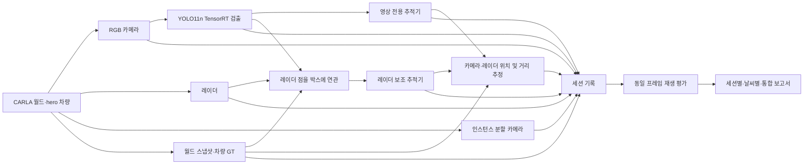

# CARLA 차량 검출·추적·레이더 융합·실험 보고서 기술 문서

> 기준: 2026-10-23 현재 저장소의 Python 구현과 기존 세션·보고서. 이 문서는 구현 설명이다. 예시 수치는 특정 기록의 결과이며 시스템의 일반 성능을 뜻하지 않는다. 아래의 소스 링크는 저장소 루트 기준이다.

## 1. 전체 처리 흐름

실시간 경로는 CARLA 콜백, 별도 YOLO 작업 스레드, 기록 스레드로 나뉜다. 분석 버튼은 저장된 YOLO 박스를 **다시 추론하지 않고**, 카메라·레이더·GT 기록과 결합해 두 추적기를 재생한다. 따라서 분석에서 비교하는 세 방법은 동일한 기록 박스를 입력으로 받는다. [수집기](../collector/live.py), [YOLO 작업자](../monitor/qt/yolo_worker.py), [세션 평가기](../monitor/qt/experiment_evaluator.py).

## 2. 데이터 수집과 시간·좌표 기준

### CARLA 구성

수집기는 `127.0.0.1:2000`의 CARLA에서 `role_name=hero` 차량을 찾는다. RGB와 인스턴스 분할 카메라는 차량 기준 `(x=1.5, y=0, z=2.4)m`, 640×480, 수평 FOV 90°, `sensor_tick=0.066666`이다. 레이더는 `(2.2, 0, 0.7)m`, 최대 100m, 수평/수직 FOV 35°/20°, 초당 1,500점, 같은 `sensor_tick`이다. IMU, GNSS, 충돌, 차선 침범 센서도 수집한다. 코드 주석은 30 FPS 월드의 두 틱을 전제로 약 15 FPS를 설명하지만, **이 코드가 CARLA 월드의 동기식 모드나 고정 시간 간격을 설정하지는 않는다**. [센서 생성](../collector/live.py#L683), [차량 연결](../collector/live.py#L935).

GT는 월드 틱 스냅샷의 차량 ID·모델·위치·회전·속도·bounding box, 내 차 위치와 지면 높이로 저장한다. 차량 메타데이터는 주기적으로 새로 읽는다. 화면에 표시하는 맵 이름은 `world.get_map().name`에서 얻지만 `session.json`에는 맵 이름을 기록하지 않는다. 따라서 **예시 세션의 맵을 기록 파일만으로 확정할 수 없다**. [GT 수집](../collector/live.py#L850), [월드 스냅샷](../collector/live.py#L891), [세션 메타데이터](../collector/live.py#L245).

좌표는 CARLA 월드 좌표에서 센서/차량 transform을 거쳐 차량 기준 `X=전방, Y=우측, Z=위쪽` 미터로 변환한다. 카메라 투영은 전방 깊이 `d`, 우측 `r`, 위쪽 `u`에 대해 `pixel_x=cx+fx·r/d`, `pixel_y=cy−fy·u/d`, `fx=fy=width/(2 tan(FOV/2))`이다. 레이더는 거리·방위각·고도각을 레이더 로컬 3D 점으로 바꾼 뒤 월드 및 카메라 좌표로 투영한다. [좌표 변환·투영](../monitor/qt/positioning.py#L46), [레이더 투영](../monitor/qt/positioning.py#L226).

`frame`은 CARLA 시뮬레이션 프레임, `simulation_timestamp`는 시뮬레이션 시각, `receive_timestamp`는 수신 벽시계 시각이다. 실시간 레이더 보조 추적은 해당 카메라 프레임의 레이더와 GT를 최대 0.05초 기다린다. 레이더 연관과 오프라인 평가에는 **같은 CARLA 프레임 번호**만 사용한다. 프레임이 빠지면 보간하지 않는다. 영상 추적의 속도 예측에는 `receive_timestamp`를 사용하므로 처리 간격의 영향은 남는다. [프레임별 상태 조회](../collector/live.py#L151), [YOLO 작업자](../monitor/qt/yolo_worker.py#L101), [평가 재생](../monitor/qt/experiment_evaluator.py#L321).

### 세션 파일과 주요 필드

| 파일 | 기록 내용과 이후 사용 |
| --- | --- |
| `session.json` | 생성 시각, 서버·차량 role, 기록 모드, 수집 시작 시 날씨, 엔진 경로, 거리 추정 설정, 선택적 워크플로 단계·예정 시간. 맵과 실제 YOLO 후처리 임계값은 없음. |
| `camera/*.jpg`, `measurements.jsonl` | 저장 영상과 카메라 크기·FOV·sensor transform·프레임; 레이더 점의 `distance_m`, `azimuth_rad`, `altitude_rad`, `relative_velocity_mps`; 차량·IMU 등 측정값. JPEG 품질은 82. |
| `detections.jsonl` | 이미지 경로, 프레임, 추론 시간, 각 박스의 `x,y,width,height,class_id,confidence`. 오프라인 평가는 이 박스를 재사용. |
| `tracks.jsonl`, `vision_tracks.jsonl` | 각각 현재 선택 추적 경로와 영상 전용 기준선의 `track_id`, 박스, `predicted`, `missed_frames`, `hits`, 픽셀 속도. 레이더 융합 모드에서 두 경로를 함께 기록. |
| `positions.jsonl`, `radar_fusion.jsonl` | 위치 추정 결과. 현재 기록기에서는 동일한 위치 결과를 `kind`만 달리하여 양쪽에 저장한다. 객체별 거리 원천·선택/거부 이유·GT 연결·위치 오차를 포함. |
| `ground_truth.jsonl` | 프레임별 내 차와 주변 차량의 transform·bounding box. 평가용 참조이며 상대 차량의 GT 크기·자세는 거리 추정에 직접 사용하지 않는다. 다만 **내 차 pose/지면 높이/차체 외곽은 거리 계산의 기준**으로 쓰인다. |
| `visibility_masks/*.png`, `visibility_masks.jsonl` | 새 기록 코드가 저장하는 무손실 인스턴스 마스크와 프레임별 인덱스. 마스크가 없는 과거 세션에는 파일이 없다. |

기록 모드는 `standard`, `yolo`, `tracking`, `radar_fusion`이다. 뒤의 두 모드에서 평가에 필요한 GT를 기록하며, `radar_fusion`은 영상 기준선도 별도 저장한다. 기록 큐가 가득 차면 프레임/레코드가 누락될 수 있고 기록 통계에 누락 수가 표시된다. [기록 모드·메타데이터](../collector/live.py#L245), [검출·트랙 파일 형식](../collector/live.py#L401), [기록 스레드](../collector/live.py#L486).

## 3. YOLO11n 검출

현재 대시보드의 활성 경로는 `run_yolo11n.bat`이 지정하는 `yolo11_detector.dll`과 `yolo11n.engine`을 `ctypes`로 불러오는 **YOLO11n TensorRT C++ 추론**이다. RGB 콜백의 BGRA 바이트를 작업 스레드가 `yolo11_detect_bgra`로 보내고, 최대 1,000개 `Box(x,y,width,height,class_id,confidence)`를 받는다. 새 카메라 프레임만 처리하므로 저장된 모든 카메라 프레임에 검출 결과가 반드시 존재하지는 않는다. [실행 설정](../run_yolo11n.bat), [Python DLL 연결](../core/yolo11_detector.py#L35), [작업 루프](../monitor/qt/yolo_worker.py#L101).

평가의 차량 GT 매칭과 마스크 검출률에서는 COCO 차량 클래스 ID `2,3,5,7`만 대상으로 삼는다. **실시간 트래커에 넘기는 박스 전체를 이 네 클래스로 먼저 필터링하는 코드는 없다.** Python 경로에서는 confidence/NMS 임계값을 별도로 지정하지 않는다. C++/CUDA 추론 소스는 이 저장소에 없고 외부 TensorRTx 빌드 기록만 있으므로, 정확한 전처리, confidence 임계값, NMS 방식/임계값은 현재 저장소만으로 확인할 수 없다. 엔진 자체의 가중치·학습 데이터·재학습 여부도 세션 메타데이터로 검증할 수 없다. [평가 차량 클래스](../monitor/qt/visibility.py#L71), [GT 연결 차량 클래스](../monitor/qt/positioning.py#L327), [외부 빌드 기록](PHASE_1_5_CMAKE.md).

`core/yolo11_tcp_detector.py`에는 WSL YOLO 서버용 TCP 클라이언트가 남아 있으나 현재 `monitor.qt.app`은 DLL/엔진 옵션만 생성한다. 따라서 아래 실험을 WSL 서버 경로에서 실행했다고 해석하지 않는다. [TCP 클라이언트](../core/yolo11_tcp_detector.py), [앱 시작 옵션](../monitor/qt/app.py#L1205).

## 4. 차량 추적 기술

채택된 구현은 저장소 자체의 **클래스 인식, 예측 박스 IoU·중심 거리 기반 탐욕적 다중 객체 추적기** `MultiObjectTracker`다. Kalman filter, Hungarian assignment, DeepSORT, ByteTrack 구현은 해당 경로에 없다. 영상 전용 인스턴스와 레이더 보조 인스턴스는 각각 독립된 ID 공간을 가진다. 저장소의 코드와 README는 가벼운 온라인 연결과 레이더 거리 활용을 보여 주지만, 다른 추적법과의 정량 비교를 통해 이 방법을 선정했다는 기록은 확인되지 않는다. [추적 구현](../monitor/qt/tracker.py#L81), [두 추적기 실행](../monitor/qt/yolo_worker.py#L36), [README](../README.md).

기존 트랙의 중심을 마지막 픽셀 속도와 경과 시간(최대 1초)으로 이동시켜 예측 박스를 만든다. 클래스가 다르면 후보에서 제외한다. 후보는 `IoU≥0.05` **또는** 중심 거리 `≤ max(40px, 예측 박스 대각선×1.5)`일 때 허용한다. 기본 점수는 `IoU + 0.15×max(0,1−중심거리/허용거리)`다. 레이더 보조 경로에서 현재 박스와 기존 트랙의 레이더 거리 묶음이 모두 3점 이상이고 편차가 0.5m 이하이면, 이전 거리와 상대속도로 예측한 거리의 오차에 따라 최대 0.22를 **가산**한다. 거리 오차 게이트는 `max(6m, 예측거리×0.25)`이다. 이것은 **레이더 오차가 크면 매칭을 반드시 배제하는 하드 게이트가 아니라 점수 보너스**다. 점수 내림차순, 트랙 ID, 검출 인덱스 순으로 후보를 정렬해 각 트랙·박스를 1:1 탐욕 매칭한다. [후보·점수](../monitor/qt/tracker.py#L93).

매칭되면 박스를 갱신하고 중심 속도는 `0.65×이전속도 + 0.35×새 측정속도`로 갱신한다. 레이더 거리와 상대속도도 해당 트랙에 붙이고, 레이더가 빠진 동안에는 보유한 거리·속도로 예측한다. 미매칭 트랙은 `predicted=True`로 기본 **10개 처리 프레임** 출력한 후 삭제한다. 대시보드에서 유지 기간을 0~100프레임으로 선택할 수 있으며, 변경 시 두 추적기의 기존 ID를 초기화한다. 선택값은 `session.json`의 `tracking_max_lost_frames`에 저장되어 보고서 재생에도 적용된다. 값이 없는 기존 세션은 10프레임을 사용한다. 미매칭 새 검출에는 새 ID를 준다. 즉 `hits`는 기록하지만 최소 hit 수를 만족할 때까지 출력을 막는 확정 단계는 없다. 검출/트래킹을 끄거나 레이더 모드를 바꾸면 관련 추적기가 초기화된다. 레이더 보조 점수가 있어도 두 추적기의 결과가 같은 경우가 가능하며, ID 교체를 원천 차단하지 않는다. [트랙 갱신·종료](../monitor/qt/tracker.py#L138), [모드 전환](../monitor/qt/yolo_worker.py#L53).

새 레이더 융합 녹화에서는 YOLO 공백 중 동일 프레임의 레이더 묶음으로 기존 트랙의 예측 박스를 제한적으로 보정한다. `session.json`의 `radar_track_correction_enabled`로 구분하며, 필드가 없는 이전 세션은 위의 점수 보너스 방식으로 재생한다. 알고리즘, 안전 게이트, 평가상 분리 방법은 [레이더 추적 보정 문서](RADAR_TRACK_CORRECTION.md)에 설명한다.

## 5. 레이더 연관, 위치 융합, 거리 선택

예측 트랙의 카메라 거리에는 별도 품질 검사를 적용한다. 마지막 YOLO 관측의 카메라 지면 투영 위치를 월드 좌표에 저장하고, 예측 위치가 `3m + 20m/s × 경과시간`보다 멀거나 마지막 관측이 1초 넘게 오래되면 거리를 미산출로 둔다. 박스 하단을 ±1px 이동했을 때 거리 변화가 `max(3m, 현재 거리의 10%)`를 넘는 불안정한 지면 투영도 거부한다. 트랙 자체는 유지하며 GT 대상 차량의 거리나 오차는 판정에 쓰지 않는다. `raw_camera_distance_m`, 이동량·허용량, 1px 민감도와 `distance_rejection_reason`에 진단값을 남긴다. 이 검사는 레이더 거리 선택의 3점·0.5m·카메라와 1m 일치 조건을 바꾸지 않는다.

1. 같은 프레임 레이더의 각 점을 월드→카메라 영상으로 투영한다. 카메라 상자 하단 중심을 평평한 내 차 지면 높이에 광선 투영하여 영상 기반 상대 위치를 구한다. 지면과 평행한 광선, 뒤쪽 교점, 광선 길이 250m 초과는 위치 산출에 실패한다. [영상 위치](../monitor/qt/positioning.py#L202), [레이더 영상 투영](../monitor/qt/positioning.py#L226).
2. 레이더 점이 YOLO 박스 안(가로·세로 각각 `max(4px, 박스 크기×0.08)` 여유)에 들어와야 한다. 영상 기반 전방 위치가 있으면 레이더 전방 위치가 `max(3m, 영상 전방거리의 15%)` 이내여야 한다. 여러 박스에 들어오면 정규화된 박스 중심 거리가 가장 작은 박스 하나에 배정한다. [점·박스 연결](../monitor/qt/positioning.py#L259).
3. 한 박스에 배정된 점은 차량 기준 거리순으로 묶는다. 이웃 점 간격이 0.5m를 넘거나 묶음 시작점과 1m를 넘으면 새 묶음이다. 가까운 묶음부터 살펴 **3점 이상, 중앙값 대비 최대 편차 0.5m 이하**인 첫 묶음을 택한다. 그런 묶음이 없으면 가장 가까운 묶음을 연관 결과로 반환한다. 각 좌표·거리·거리 변화율은 선택 묶음의 중앙값이다. 따라서 ‘연관된 레이더 점이 있음’과 ‘최종 거리로 레이더가 선택됨’은 다르다. [묶음 선택](../monitor/qt/positioning.py#L293).
4. 위치 추정 `fused_xy`는 레이더 점 1개일 때 전방에 레이더 0.25, 2개 이상일 때 0.80을 주고, 좌우 위치에는 카메라 0.65·레이더 0.35를 준다. 한쪽만 있으면 그 위치를 쓴다. 이전 추정 위치에서 `3m + 20m/s × 경과시간`보다 큰 위치 점프는 레이더 위치를 거부한다. **위치 융합 가중치와 보고서의 최종 거리 선택은 서로 다른 로직**이다. [위치 융합](../monitor/qt/positioning.py#L454).
5. 카메라 거리와 레이더 거리는 각각 추정된 관측 지점에서 **내 차 bounding box 평면 외곽까지**의 최단 간격이다. 레이더 거리는 선택 묶음의 각 점에 대해 이 간격을 구한 중앙값이다. 레이더를 최종 거리로 선택하려면 점 `≥3`, 묶음 편차 `≤0.5m`, 카메라 거리와 차이 `≤1m`가 모두 필요하다. 아니면 카메라 거리로 대체한다. `distance_source=radar_near_cluster`가 최종 거리 레이더 선택을 뜻한다. 위치 기록의 `radar_used`는 **레이더 위치가 사용 가능한지**를 뜻하므로 보고서의 레이더 거리 선택 수와 구분해야 한다. [거리 선택](../monitor/qt/positioning.py#L520).

`session.json`의 `fusion_weights`는 대표값 0.2/0.8을 적지만 실제 단일 레이더 점의 전방 위치 가중치는 0.25다. 구현 설명에는 실행 코드를 우선한다. 레이더 점은 차량 앞면이 아닌 다른 표면에서 반사될 수 있어 추정 거리와 GT 차체 외곽 간격 사이에 체계적 차이가 생길 수 있다. [메타데이터](../collector/live.py#L295), [실제 가중치](../monitor/qt/positioning.py#L21).

## 6. GT, 실제 가시성, 검출률의 분모

| 단계 | 현재 구현의 조건 | 의미와 한계 |
| --- | --- | --- |
| 주변 차량 | 월드 스냅샷에 있는 `vehicle.*`, 내 차 제외 | 영상 밖 차량도 포함. |
| 투영 GT `P` | 차량 3D bounding box 모서리를 카메라에 투영해 화면과 교차 | 기하학적 화면 진입이다. 가림·어둠·안개를 판단하지 않는다. |
| 마스크 정렬 투영 GT | 같은 CARLA 프레임의 유효한 인스턴스 마스크가 있는 `P` | 구 세션의 마스크 미기록은 0건 검출로 처리하지 않는다. |
| 가시 GT `V` | 해당 배우 ID의 차량 태그 픽셀 `≥50`, 가시 박스 폭·높이 각각 `≥8px` | 인스턴스 분할의 기하학적 노출. RGB에서 사람이/YOLO가 식별할 수 있다는 보장은 없다. ID는 마스크의 두 채널 16비트로 읽는다. |
| YOLO 검출 `D` | 차량 클래스 `2,3,5,7` 박스와 가시 마스크 박스의 IoU `≥0.5`, 박스·배우 1:1 | **YOLO 재현율 `D/V`**. 미매칭은 미검출과 박스 불일치가 섞이며, GT에 연결되지 않은 YOLO 박스의 precision은 계산하지 않는다. |
| 추적·GT 연결 `T` | 별도의 GT 3D 투영 박스와 차량 YOLO 박스의 IoU `≥0.05`, 1:1, 현재 프레임 관측 트랙 | 이 `T/V`는 위의 가시 마스크 IoU 0.5 검출과 **매칭 정의가 다르다**. 따라서 `D`의 엄격한 부분집합으로 해석하지 않는다. |
| 거리 표본 `N` | 현재 YOLO 관측 트랙 또는 유지 중인 예측 트랙에 선택 방법의 추정 거리와 GT 거리가 있음 | 차량·프레임당 최대 1건. 최종 MAE/RMSE의 분모 `N=N_obs+N_pred`. |

이 단계별 집계는 세션·프레임·GT 차량의 조합을 1건으로 센다. 마스크는 같은 프레임으로 연결한다. 유효하지 않은 마스크는 별도 카운트한다. GT 투영 박스는 보이지 않는 부분까지 포함할 수 있으므로, `P−N`을 YOLO 검출 실패로 부르면 안 된다. 또한 객체가 화면에 일부 들어왔어도 50픽셀/8픽셀 조건을 만족하지 못하면 `V`에서 제외된다. [GT 투영·연결](../monitor/qt/positioning.py#L166), [마스크 판독](../monitor/qt/visibility.py#L22), [마스크와 YOLO 연결](../monitor/qt/visibility.py#L71), [평가 행 구성](../monitor/qt/experiment_evaluator.py#L387).

## 7. 거리 GT와 평가 지표

GT 거리 `g`는 같은 프레임의 **회전된 내 차/상대 차 CARLA bounding box 평면 외곽 간 최단 거리**다. 맞닿거나 겹치면 0m이다. 이것은 상대 차 중심점 간 거리가 아니다. 추정 거리 `d`는 검출 상자/레이더에서 얻은 상대 차의 **관측 지점**부터 내 차 외곽까지의 거리이므로 기준 지점 차이를 해석에 반영해야 한다. [GT 거리 계산](../monitor/qt/experiment_evaluator.py#L62), [표본 선정](../monitor/qt/experiment_evaluator.py#L140).

| 지표 | 계산 및 분모 |
| --- | --- |
| 관측 매칭 | `T`: 현 프레임 검출이 GT 투영 박스에 연결된 트랙. 예측 트랙 제외. |
| 관측 거리 산출률 | `N_obs/T`. `N_obs`는 현재 YOLO 검출과 GT가 연결된 관측 트랙의 거리 표본 수다. `T=0`이면 계산 불가. `T/P`는 별도의 투영 매칭 비율이며 YOLO 검출률이 아님. |
| 가시 GT YOLO 재현율 | `D/V`. `V=0` 또는 평가 가능한 마스크가 없으면 계산 불가. |
| 거리 절대 오차 | `e_i=|d_i−g_i|`, `i`는 해당 방법의 `N`개 관측 또는 유지 중인 예측 트랙 거리 표본. 관측이 있으면 그 거리 한 건을 사용한다. |
| MAE / RMSE | `Σe_i/N` / `sqrt(Σe_i²/N)`. 세션 평균의 평균이 아닌 표본 합산. `N=0`이면 `null`/보고서 `-`. |
| 거리 편향 | `Σ(d_i−g_i)/N`; 양수는 거리 과대 추정. |
| 레이더 거리 선택 비율 | `distance_source=radar_near_cluster`이고 거리 오차가 있는 관측·예측 표본 수 / `N`. 영상 전용 방법에서는 해당 없음. |
| 카메라 대체 | 융합 방법의 `N−레이더 거리 선택 표본`. 별도 MAE도 계산. |
| 위치 MAE/RMSE | 연결된 관측 트랙의 추정 차량 기준 XY와 GT 차량 ground center XY 사이 2D 유클리드 오차. 이는 차체 간격 거리 오차와 다른 지표. |
| ID 변경 | 방법·세션별 같은 GT 배우의 현재 **관측** 트랙 ID가 직전 관측 ID와 달라진 횟수. 구간 필터에서는 그 구간에 남은 행의 이전 관측과 비교하므로 전체 세션의 ID 변경을 구간에 단순 분해한 값이 아닐 수 있다. |
| 예측 트랙 오차 | 현재 검출이 없는 유지 중인 트랙의 거리 표본 `N_pred`와 MAE를 별도로 표시하며 최종 `N`과 MAE/RMSE에도 포함. 관측 트랙의 `N_obs`와 MAE도 별도로 표시. |
| 세 방법 공통 표본 | 같은 세션·프레임·GT 배우에서 세 방법 모두 거리 오차가 있는 건. 비교용 공통 표본 MAE의 분모. |

세 방법은 `camera_tracking`(영상 추적+카메라 거리), `vision_radar_fusion`(영상 추적+카메라/레이더 거리 선택), `radar_tracking_fusion`(레이더 보조 추적+같은 거리 선택)이다. **두 번째와 세 번째의 차이는 거리 공식이 아니라 트랙 연관 경로**다. [방법 정의·구간](../monitor/qt/experiment_evaluator.py#L30), [행별 방법 선택](../monitor/qt/experiment_evaluator.py#L435), [지표 집계](../monitor/qt/experiment_evaluator.py#L164).

고정 구간은 `[0,3)`, `[3,5)`, `[5,10)`, `[10,15)`, `[15,20)`, `[20,30)`, `[30,∞)`m이다. 기본 전체 범위는 `[0,∞)`이며 사용자 지정 범위는 양 끝을 포함한다. 별도 기존 비교용 `3~15m` 집계도 양 끝을 포함한다. 범위 필터는 추정 거리가 아닌 **GT 차체 외곽 거리**에 적용한다. 날씨/통합 평가는 세션 ID를 유지하면서 원시 행을 합쳐 계산한다. [범위 처리](../monitor/qt/experiment_evaluator.py#L270), [날씨 풀링](../monitor/qt/weather_workflow_evaluator.py#L34).

## 8. 대시보드에서 보고서까지

대시보드의 **저장 세션/날씨 워크플로 결과 생성**은 사용자가 선택한 폴더와 거리 범위를 평가 스레드에 넘긴다. 활성 기록 폴더는 기록을 끝낸 뒤 평가하도록 막는다. 단일 세션이면 `session.json`, `measurements.jsonl`, `detections.jsonl`, `ground_truth.jsonl`을 요구하고 같은 프레임의 카메라·YOLO·GT를 재생한다. 같은 프레임 레이더가 없으면 카메라 기준으로 평가한다. 마스크 인덱스가 있으면 유효 프레임에 한해 검출률을 더한다. [대시보드 버튼](../monitor/qt/app.py#L819), [평가 스레드](../monitor/qt/experiment_evaluator.py#L685), [세션 재생](../monitor/qt/experiment_evaluator.py#L321).

단일 세션은 `experiment_results/report_distance_profile_<범위>.md`, `summary_distance_profile_<범위>.json`, `position_errors_distance_profile_<범위>.csv`를 만든다. Markdown은 방법별 전체, 거리 구간별, 기존 3~15m, 레이더 선택/카메라 대체, 가능한 경우 마스크 검출률을 담는다. JSON은 분모·수치·설정을, CSV는 차량·프레임·방법별 행을 담는다. 같은 세션·같은 범위 이름으로 버튼을 다시 누르면 **그 결과 파일은 덮어쓸 수 있다**. [파일 출력](../monitor/qt/experiment_evaluator.py#L544).

`workflow.json`이 있는 상위 폴더를 고르면 `weather_<프리셋>/<세션>`을 순회한다. 세션의 워크플로 ID·날씨 프리셋이 폴더와 맞는지 확인하고, 분석 불가 세션은 이유와 함께 제외한다. 각 세션 거리 보고서, 날씨별 풀링 보고서·JSON·CSV, 전체 통합 보고서·JSON·CSV를 만든다. `report_weather_detailed_<범위>.md`는 전체 요약 뒤에 각 날씨 보고서 본문을 붙인 별도 상세 문서다. 검출률은 마스크가 있는 프레임의 가시 GT만 합산한다. [워크플로 평가](../monitor/qt/weather_workflow_evaluator.py#L191), [상세 통합 보고서](../monitor/qt/weather_workflow_evaluator.py#L167), [날씨 일정/기록](../monitor/qt/weather_workflow.py).

| 결과 열/필드 | 근거 입력/계산 |
| --- | --- |
| `frames_scored` | `detections.jsonl`에서 동일 프레임 카메라·GT가 있는 프레임. |
| `eligible_gt_opportunities` / 투영 GT | `ground_truth.jsonl`의 차량 box + `measurements.jsonl`의 카메라 transform으로 투영한 차량·프레임 수. |
| `visibility.*`, 검출률 | `visibility_masks.jsonl` PNG + `detections.jsonl` 박스 + 투영 GT. |
| `observed_matches`, `id_switches` | 저장 박스를 `MultiObjectTracker`로 재생하고 GT box에 연결한 행. 기존 `tracks.jsonl` 수치를 그대로 세지 않음. |
| `gt_distance_m`, `distance_band` | 동일 프레임 `ground_truth.jsonl`의 양 차량 회전 차체 외곽. |
| `camera_distance_m`, `radar_distance_m`, `estimated_distance_m`, `radar_used` | 저장된 카메라·레이더·YOLO 박스로 `PositioningEngine`을 재실행한 결과. CSV의 `radar_used`는 **최종 거리에서 레이더 선택** 여부. |
| `error_m`, `predicted_error_m`, `tracking_error_m` | 각각 관측 거리 오차, 현재 YOLO 미검출 예측 트랙 거리 오차, 차량·프레임당 관측 우선 OR 예측 거리 오차. `mae_m`, `rmse_m`, `distance_samples`는 `tracking_error_m`의 합산 통계. |

## 9. 저장된 최신 예시와 확인 범위

아래 기존 저장 보고서의 MAE/RMSE는 생성 당시 관측만 집계한 값이다. 현재의 관측 OR 예측 정의와 비교하려면 원본 세션을 재분석해야 한다.

기존 [단일 세션 요약](../data/recordings/20261023_140202_760405_radar_fusion/experiment_results/summary_distance_profile_all.json)에는 평가 108프레임, 투영 GT 1,035건, 세 방법 공통 관측 거리 145건이 기록돼 있다. 영상 전용 MAE/RMSE는 0.605/0.938m, 레이더 보조 추적+거리 선택은 0.518/0.911m이고 후자의 거리 레이더 선택은 76/145건이다. 이 세션의 `session.json`에는 날씨·엔진·기록 모드가 있으나 `visibility_masks.jsonl`은 없다. 따라서 이 결과에 YOLO 검출률을 소급 계산할 수 없다.

기존 [9개 날씨 통합 요약](../data/recordings/workflow_20261023_140317_b609346a/experiment_results/summary_weather_combined_all.json)은 9세션·16,215 평가 프레임, 투영 GT 65,845건, 세 방법 공통 거리 표본 14,585건을 기록한다. 영상 전용 MAE/RMSE는 1.076/1.935m, 레이더 보조 추적+거리 선택은 1.023/1.922m이며 후자의 레이더 거리 선택은 2,877/14,585건이다. 이 워크플로의 9개 세션 모두 마스크 인덱스가 없다. 기존 JSON에는 새 코드의 `visibility` 필드도 없으므로 **현재 코드의 마스크 검출률 기능이 과거 보고서에서 실제 검증됐다고 말할 수 없다**. 기존 [워크플로 일정](../data/recordings/workflow_20261023_140317_b609346a/workflow.json)은 아홉 날씨를 각 120초씩 순차 수집하도록 지정한다. 이 결과만으로 날씨의 인과효과나 통계적 유의성을 주장할 수 없다.

**확인된 구현**: 마스크 PNG 저장과 가시 GT 재현율 계산 경로가 코드에 있다. **미확인 사항**: 실제 새 세션에서 마스크가 RGB와 얼마나 안정적으로 같은 프레임으로 저장되는지, 마스크 색상/배우 ID 해석이 실측 CARLA 출력과 일치하는지, 외부 C++ YOLO 후처리 임계값은 이 예시 기록과 저장소만으로 확인되지 않는다. 투영 GT `P`와 관측 표본 `N` 사이의 차이도 화면 가림, 검출, 박스 불일치, GT 연결, 거리 산출 중 어느 단계에서 발생했는지 마스크 없는 세션에서는 분리할 수 없다.

## 10. 논문 Methods 절용 기술 요약 초안

CARLA의 `hero` 차량에 전방 RGB 카메라와 레이더를 장착하고, 월드 스냅샷에서 차량 pose와 bounding box를 기록하였다. RGB 영상은 YOLO11n TensorRT 검출기로 처리하였다. 차량 박스는 클래스 일치, 예측 박스의 IoU 및 중심 거리로 탐욕적으로 연결하는 자체 다중 객체 추적기로 추적하였다. 레이더 보조 방법에서는 같은 CARLA 프레임의 레이더 반사점을 카메라 영상에 투영해 검출 상자에 연관하고, 이전 트랙의 레이더 거리·거리 변화율과 현재 반사점 거리의 일치도를 추적 매칭 점수에 추가하였다. 영상 상자 하단 중심의 평면 지면 투영을 카메라 기반 위치로 사용하고, 레이더 반사점 묶음의 중앙값으로 레이더 기반 위치를 얻었다. 최종 차체 간격은 내 차 외곽까지의 카메라 거리와 품질 조건을 만족한 레이더 거리 중에서 선택하였다. 동일 프레임의 두 차량 CARLA bounding box 평면 외곽 간 최단 거리를 GT로 정의하고, 현재 YOLO 검출에 연결된 관측 트랙 또는 검출이 끊겼지만 유지 중인 예측 트랙의 거리 오차를 차량·프레임당 한 번 집계해 최종 MAE와 RMSE를 계산하였다. 관측과 예측의 MAE도 별도로 제시하였다. 프레임이 같은 인스턴스 분할 마스크가 존재하는 세션에서는 충분한 차량 픽셀을 가진 GT를 분모로 YOLO 박스의 1:1 IoU 매칭 재현율을 추가 산출한다. 순차 수집된 날씨별 세션은 관측과 유지 중인 예측 트랙의 거리 표본을 합쳐 기술적으로 비교하며, 날씨의 인과효과를 이 설계만으로 추정하지 않는다.
