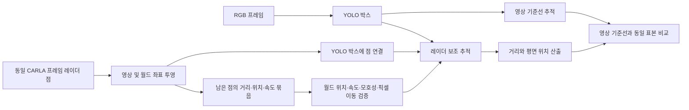

# YOLO 검출 공백 중 레이더 추적 보정

## 목적과 적용 범위

영상 전용 추적기는 YOLO 박스가 없는 프레임에서 마지막 영상 픽셀 속도로 박스를 예측한다. 이 예측은 내 차량 회전, 대상 차량의 가감속, 긴 검출 공백에 취약하다. 기존 레이더 보조 추적기는 레이더 거리를 **새 YOLO 박스와 기존 ID의 매칭 점수**에만 가산했다. 새 경로는 검출 공백에 들어간 *기존* 트랙의 예측 박스를 같은 프레임의 레이더 관측으로 제한적으로 보정한다. 레이더만으로 신규 차량 ID를 만들지 않는다.

현재 트랙 연관 점수의 레이더 가산은 **이전 트랙과 현재 박스 양쪽의 레이더 거리 묶음이 3점 이상이고 편차가 0.5m 이하**일 때만 적용한다. 단일 점 또는 퍼진 묶음은 거리·상대속도 상태에는 기록할 수 있지만 영상 박스의 연결 순서를 레이더 점수로 뒤집지 않는다. 검출 공백의 예측 박스에서 카메라 지면 투영 거리가 갑자기 뛰면 거리만 미산출로 두고 트랙은 유지한다. 상세 조건은 [거리 추정 기록](DISTANCE_ESTIMATION.md)에 있다.

대시보드의 **레이더 위치 보정** 버튼은 기본적으로 꺼져 있으며, 실험 전에 켤 수 있다. `radar_fusion` 세션의 `session.json`에는 선택 상태가 `radar_track_correction_enabled`로 저장된다. 기록 중에는 설정을 바꿀 수 없다. 기록 전 변경하면 레이더 추적 ID가 초기화된다. 필드가 없는 기존 세션은 **기존 점수 보너스 방식**으로 재생한다. 영상 추적 기준선은 항상 이 보정을 적용하지 않는다. 유지 프레임 수(`tracking_max_lost_frames`)는 두 추적기에 똑같이 적용되며, 레이더 보정 중이어도 YOLO가 그 기간 동안 없으면 트랙을 삭제한다.

## 데이터 흐름



1. 현재 YOLO 박스와 레이더 점을 연결하면, 레이더 묶음의 월드 평면 위치·거리·상대속도와 **지면에 투영한 레이더 픽셀**을 트랙에 저장한다. 박스의 가로 중심과 하단이 레이더 지면 픽셀에서 떨어진 양도 기록한다. 가로·세로 픽셀 오프셋은 연속 관측에서 평활화한다.
2. YOLO가 없는 프레임에는 마지막 월드 레이더 위치와 관측 간 이동 속도로 위치를 예측한다. 월드 좌표를 사용하므로 내 차량의 이동이 같은 레이더 대상의 좌표를 바꾸는 문제를 줄인다. 이 프로젝트에서는 CARLA가 기록한 내 차량 자세와 지면 높이를 사용한다. **대상 차량의 GT 위치·ID는 추론에 사용하지 않는다.**
3. 현재 YOLO 박스에 들어간 레이더 점은 제외한다. 남은 점을 월드 거리·레이더 거리·상대속도로 묶고, 예측 월드 위치에 가까운 트랙과 1:1로 연결한다. 후보 트랙 둘의 거리 차이가 작으면 연결하지 않는다.
4. 연결된 레이더 지면 픽셀과 저장한 박스 오프셋으로 박스 위치를 계산한다. 이동이 허용 범위를 넘으면 보정을 버린다. 허용되면 예측 박스를 새 좌표 쪽으로 일부 이동하고, 레이더 월드 상태와 속도 추정도 갱신한다. 이 트랙은 여전히 **`predicted=True`**이다. 즉 현재 프레임의 YOLO 검출로 세지 않는다.
5. 거리 산출 단계는 보정된 박스에 레이더를 다시 연결한다. 관측 중에는 카메라의 지면 접점과 레이더 반사점 사이의 월드 오프셋을 학습하고, 검출 공백에서는 반사점을 위치 융합에 쓸 때 이 차이를 반영한다. 반사점은 차량 중심과 같지 않으므로 오프셋을 학습할 수 없으면 위치 융합은 카메라 예측을 사용한다. 별도 거리 선택 규칙은 종전과 같다.

## 현재 보수적 조건

| 조건 | 값 | 이유 |
| --- | ---: | --- |
| 트랙 시작 | 현재 YOLO 박스 필요 | 레이더 클러터로 새 차량 ID를 만들지 않음 |
| 레이더 묶음 | 최소 3점, 거리 중앙값 편차 최대 0.5m | 단일 반사점 억제 |
| 점 묶음의 평면 이웃 | 1.0m | 떨어진 반사체 혼합 억제 |
| 점 묶음의 상대속도 차이 | 최대 4.0m/s | 서로 다른 이동체 혼합 억제 |
| 마지막 유효 레이더 앵커 나이 | 최대 1.0초 | 오래된 앵커로 재연결하지 않음 |
| 예측 월드 앵커와 레이더 묶음 간격 | 최대 1.0m | 다른 물체로의 이동 억제 |
| 트랙 후보 1·2위 간격 차이 | 0.75m 이상 | 가까운 차량 간 모호한 연결 거부 |
| 연속 영상·레이더 오프셋 | 최소 2회, 갱신 차이 12px 이하, 평활 변동 6px 이하 | 반사 위치가 계속 바뀌는 물체 거부 |
| 예측 박스와 보정 박스의 이동 차이 | 최대 `min(12px, max(6px, 박스 대각선×0.25))` | 큰 영상 점프 거부 |
| 허용한 픽셀 보정량 | 이동 차이의 70% | 한 번의 레이더 관측에 완전히 맞추지 않음 |
| 미검출 트랙 수명 | 사용자가 고른 0~100개 처리 프레임, 기본 10 | 두 추적기 공통 |

이 값들은 현재 구현의 초기 안전 게이트이며 최적 성능이 증명된 값이 아니다. 근거는 [레이더 점 투영·박스 연결](../monitor/qt/positioning.py), [점 묶음](../monitor/qt/radar_track_correction.py), [추적 갱신](../monitor/qt/tracker.py)에 있다. 현재 구현은 **Kalman filter나 CFTrack이 아니다.** 월드 레이더 앵커의 상수속도 예측과 제한적 픽셀 보정이다.

## 기록과 평가

`tracks.jsonl`과 `positions.jsonl`에는 `radar_corrected`가 기록된다. 추적 기록에는 보정에 사용한 `radar_correction_points`도 있다. 레이더 보정 중인 트랙은 현재 YOLO 박스가 없으므로 `observed=False`다. GT와 연결되고 거리 산출이 가능하면 최종 거리 표본 및 MAE/RMSE에 포함하고, 관측 표본과는 구분해 표시한다. 분석 CSV/JSON/Markdown에는 **레이더 보정 예측**, **보정 없는 예측**, 각각의 거리 오차를 분리한다. 레이더 보정 예측의 평면 위치 오차와 투영 GT 박스 중심 오차도 따로 기록한다. 투영 GT는 가림을 판정하지 않으므로 박스 오차를 YOLO 검출률로 해석하지 않는다.

기존 세션을 새 방식으로 시험할 때는 원본 보고서가 덮이지 않도록 별도 출력 폴더를 준다.

```python
from pathlib import Path
from monitor.qt.experiment_evaluator import evaluate_session

evaluate_session(
    Path("data/recordings/기존_세션"),
    output_dir=Path("data/analysis/radar_correction_trial"),
    radar_track_correction_override=True,
    max_lost_frames_override=50,
)
```

## 검증과 한계

단위 테스트는 동일 프레임 레이더 점의 보정, 희소·모호한 점의 거부, 유지 프레임 만료, 이전 추적 방식의 재현을 확인한다. 실제 저장 세션 재생에서도 보정 상태가 출력되는 것을 확인했다. **레이더 보정이 모든 날씨에서 영상 기준선보다 정확하다는 결론은 없다.** 반사점은 차량의 앞·옆면을 오가고, 차량 중심·영상 박스 중심과 다르다. 어둠·비·가림에서는 잘못된 클러스터가 가까운 트랙에 들어갈 수도 있다. 따라서 보정된 프레임과 보정하지 않은 프레임, 같은 GT 차량·프레임의 영상 기준선을 함께 비교해야 한다.

초기 재생 점검에서는 `workflow_20261023_165938_252e7aa6`의 `ClearNoon` 레이더 융합 세션 한 개를 사용했다. 보정된 예측 73개 차량·프레임을 동일 차량·프레임의 영상 추적과 비교하면 거리 절대오차 평균은 **1.357→0.557m**, 투영 GT 박스 중심 오차는 **6.210→3.605px**로 줄었지만, 평면 위치 오차는 **1.588→1.907m**로 늘었다. 이는 한 세션의 사후 재생 결과이며 다른 날씨나 장면에 일반화할 수 없다. 따라서 **현재 구현은 평면 위치 정확도 향상이 검증된 상태가 아니다.** 논문 비교 실험에서는 보정 켜짐·꺼짐을 같은 원본 세션으로 재생하고, 거리·박스·평면 위치 지표를 각각 보고해야 한다.

레이더 시야각 밖, 레이더 점이 3개 미만, 모호한 인접 차량, 오래된 레이더 앵커에서는 기존 영상 예측으로 되돌아간다. 레이더 상대속도는 시선 방향 속도이며 차량의 완전한 2D 속도가 아니다. `max_lost_frames`를 크게 해도 이 한계가 없어지지 않는다. CARLA 내 차량 자세와 지면 높이 대신 실제 차량에 적용할 때는 별도 내비게이션·자세 추정 및 지면 추정이 필요하다.
