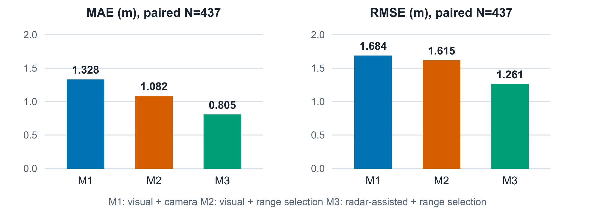

# 영상 검출 공백을 보완하는 센서 융합 알고리즘 연구보고서

CARLA RadarVision · 골프존 소프트웨어 연구개발 지원 포트폴리오

## 연구 결과와 기술 범위

카메라가 차량을 일시적으로 놓쳐도 기존 트랙을 유지하면서 거리값을 산출하도록 구성했다. 영상 예측 박스에 레이더 정보를 제한적으로 반영하고, 품질 조건을 통과한 레이더 거리만 선택하는 두 단계를 분리했다. 수집부터 검출·추적·거리 산출·기록·재생 평가·Qt 시각화까지 연결한 프로젝트다.

9개 날씨·시간대 세션의 **레이더 보정 예측 437개 차량·프레임**을 같은 평가 키로 비교했을 때, 영상 추적·카메라 거리의 MAE 1.328m가 레이더 보조 추적·거리 선택에서 **0.805m로 39.4% 감소**했다. RMSE는 1.684m에서 1.261m로 25.1% 감소했다. 전체 시스템이나 실도로에 대한 일반 성능이 아닌, 보정이 실제 적용된 동일 표본의 기술 통계다. [S01, S02, S03]

| 산출물 | 이 문서에서 제시하는 근거 |
| --- | --- |
| 알고리즘 설계 | 자체 영상 추적, 레이더 점 연관, 예측 보정, 조건부 거리 선택 |
| 계측 검증 | 차체 간 GT 거리, 공통 표본 비교, MAE·RMSE·편향, 실패 원인 |
| 응용 도구 | Qt 실시간 비교 화면, 시간 지정 녹화, 날씨 워크플로, 보고서 |
| 구현 경계 | C++/CUDA 추론 모듈 연동과 Python 추적·평가 경로를 구분 |

### 채용 업무와의 연결

센서 데이터 기반 산출 알고리즘, 영상 검출·트래킹, 계측 데이터 저장·검증, 실시간 검증용 UI에 직접 연결된다. 골프 시뮬레이터에 적용할 수 있는 공통 문제는 센서 프레임 정렬, 이상 측정 거부, 추정값과 기준값의 비교, 실패 사례 재생이다. 공·클럽의 속도나 궤적을 구현·검증한 프로젝트로 제시하지 않는다.

**읽는 순서:** 문제와 실험 환경 → 계측 기준 → 영상 추적 → 레이더 보정 → 거리 선택 → 짝비교 결과 → 조건별 차이 → 검증 한계와 실무 적용.

작성 기준일 2026년 10월 24일 · 원본 실험 및 기존 문서 보존

<!-- PAGE -->

## 1. 문제 정의와 시뮬레이션 환경

### 1.1. 트랙이 살아 있어도 거리값은 틀어질 수 있다

현재 영상 박스와 연결되지 않은 트랙은 이전 관측의 픽셀 속도로 박스를 예측한다. 예측이 누적되면 박스 하단이 실제 접지 위치에서 벗어난다. 카메라 거리 계산은 박스 하단 광선의 지면 교점을 사용하므로, 작은 수직 오차가 원거리에서 큰 거리 오차로 확대될 수 있다. 트랙 ID 유지와 거리 정확도는 별도 평가 대상이다.

이 문서의 ‘검출 공백’은 대상 트랙에 현재 YOLO 관측이 연결되지 않은 `observed=false` 상태다. 영상 전체에 박스가 없다는 뜻도, 실제 가림으로 원인이 확정됐다는 뜻도 아니다. 검출 실패와 연관 실패가 포함될 수 있다.

### 1.2. CARLA를 사용한 이유

같은 차량·프레임의 차체 외곽과 자세를 참값으로 확보하고, 기록한 동일 센서 입력과 YOLO 박스를 여러 알고리즘에 공급하기 위해 시뮬레이터를 사용했다. 장비를 준비하기 전에 좌표 변환, 동기화, 센서 선택 규칙과 실패 사례를 정량 점검할 수 있다. 실제 도로에서는 별도 정밀 측위·기준 장비·동기화가 필요한 비교다.

날씨와 센서 구성을 설정할 수 있다는 기능과 이번 실험의 통제 수준은 구분한다. 이번 데이터는 동일 경로·교통을 반복 고정한 실험이 아니라 조건별 1회 순차 수집이다. CARLA 날씨의 RGB 효과를 실환경 강우의 레이더 감쇠·클러터 검증으로 확대하지 않는다. 시뮬레이터 사용 이유와 한계는 기존 논문 서론 및 참고문헌에도 연결돼 있다. [S04]

| 항목 | 확인된 설정 또는 기록 |
| --- | --- |
| 실험 | 맑음·흐림·강한 비 × 낮·저녁·밤, 9개 세션 |
| 기록 모드·길이 | `radar_fusion`, 조건당 계획 시간 120초 |
| RGB | 640×480, FOV 90°, 센서 주기 설정 0.066666초 |
| 레이더 | 최대 100m, 수평 35°·수직 20°, 설정상 1,500 points/s |
| 인스턴스 마스크 | RGB와 같은 프레임의 원시 PNG 및 JSONL 인덱스 |
| 추적 유지 | 두 방식 모두 해당 세션에서 10개 처리 프레임 |
| 맵 | 분석 세션 메타데이터에 이름이 없어 특정 맵으로 단정하지 않음 |

설정 주기는 실측 FPS나 처리 지연 보장값이 아니다. 프레임 번호·시뮬레이션 시각·수신 시각을 각각 기록한다. [S05, S06]

<!-- PAGE -->

## 2. 처리 파이프라인과 모듈 경계

그림 1. 현재 구현의 처리 경로. 수집·추론·디스크 기록·GUI를 분리하고, 프레임 번호로 대응 관계를 보존한다. C++/CUDA 영역은 외부 TensorRTx 기반 검출 모듈이며 나머지 주 처리 경로는 Python이다.

| 단계 | 처리와 출력 | 대표 코드 |
| --- | --- | --- |
| 취득 | CARLA 콜백 → RGB·레이더·차량·IMU·GNSS·이벤트 | `CarlaCollector` |
| 동기화 | 최신 영상과 동일 번호의 레이더·GT 문맥 | `LiveState` |
| 검출 | BGRA → TensorRT YOLO11n → 박스·클래스·점수 | `Detector`, `YoloWorker` |
| 추적 | 영상 기준선과 레이더 보조 트랙 동시 유지 | `MultiObjectTracker` |
| 계측 | 박스 지면 투영, 레이더 연관, 차체 간 거리 | `PositioningEngine` |
| 기록 | JPEG·PNG·JSONL, 세션 설정·누락 계수 | `SessionRecorder` |
| 평가 | 동일 GT 키 짝비교 → CSV·JSON·Markdown | 세션·날씨 평가기 |

원본 영상과 박스·트랙·위치 결과를 분리해 저장하므로, 화면에 표시한 추정값을 원본 프레임과 연결해 추적할 수 있다. 실제 상태 전환과 예외 처리는 아키텍처 설계서에 별도로 정리했다. [S05-S11]

<!-- PAGE -->

## 3. GT와 평가 모집단 정의

### 3.1. 거리의 물리적 의미

GT는 같은 프레임의 내 차와 상대 차량의 회전 bounding box를 평면 사각형으로 표현하고 두 외곽의 최단 간격을 계산한 값이다. 외곽이 겹치거나 접하면 0m다. 상대 차량 중심 간 거리, 레이더 센서 원점에서 반사점까지의 거리와 다르다.

카메라·레이더 추정은 관측 지점에서 내 차 외곽까지의 간격이다. 상대 차의 전체 외곽을 직접 복원하지 않기 때문에 GT와 추정의 기하학적 차이가 남는다. 내 차 자세·차체 크기·지면 높이는 좌표 기준으로 쓰고 상대 차량의 GT 위치·ID는 정답 연결·평가에만 사용한다.

| 기호 | 포함 조건 | 지표상 역할 |
| --- | --- | --- |
| P | 상대 차량 3D 상자가 카메라 화면에 기하학적으로 투영 | 가림을 보장하지 않는 평가 기회 |
| V | 동일 프레임 마스크 차량 픽셀 ≥50, 가시 박스 양 변 ≥8px | 마스크 기준 YOLO 검출률의 분모 |
| D | 차량 YOLO 박스와 가시 박스 IoU ≥0.5, 1:1 연결 | 검출률 D/V의 분자 |
| T | 기존 투영 GT 기준과 현재 관측 트랙의 연결 | D와 매칭 기준이 다른 관측 연결 |
| N | 관측 또는 유지 예측 트랙에서 유효 GT·거리 오차 | 방법별 차량·프레임당 최대 한 표본 |

### 3.2. 주 분석은 보정이 실제 적용된 공통 표본

방법 3의 `radar_corrected=true`, `observed=false`, 유효 `tracking_error_m`인 표본을 고른 뒤 `(session, frame, gt_actor_id)`로 세 방법을 연결했다. 437건 전부 세 방법에 유효한 오차가 있어 추가 제외는 0건이다. 프레임과 GT 차량을 연결했으므로 방법별 track ID가 같아야 한다고 요구하지 않는다.

전체 P는 161,061건이고 세 방법 행을 가진 통합 CSV는 483,183행이다. V=35,669, D=12,365로 전체 마스크 검출률은 34.7%지만, 이 값과 보정 예측 N=437은 서로 다른 모집단이다. P→V→D→T→N을 하나의 엄격한 전환율로 취급하지 않는다. [S01, S02, S03, S10]

마스크는 물체 가림을 반영하는 렌더링 기준이며 어두운 RGB에서 사람이 식별할 수 있는지까지 보장하지 않는다. 과거 세션에 마스크가 없으면 V·D·D/V를 측정 불가로 처리하고 T/P나 N/P를 검출률로 바꾸지 않는다.

<!-- PAGE -->

## 4. 영상 검출과 프레임 간 추적

### 4.1. YOLO11n과 C++ 추론 모듈 연동

Windows 활성 경로는 TensorRTx 기반 `yolo11_detector.dll`과 `yolo11n.engine`이다. 작업 스레드가 BGRA 영상 버퍼를 `ctypes` C ABI로 전달하고 `x, y, width, height, class_id, confidence`를 반환받는다. 외부 모듈은 OpenCV로 색상을 변환하고 CUDA 전처리·TensorRT 실행·후처리를 수행한다. 신경망 전체 또는 모든 CUDA 커널을 직접 구현한 성과로 표현하지 않는다. [S07, S12, S13]

외부 빌드 기록에는 MSVC 2022·CMake·CUDA·TensorRT·OpenCV 연동과 한 장의 공식 모델 출력 비교가 남아 있다. 단일 이미지의 출력 일치 확인은 전체 검출 정확도나 추론 처리량 검증과 구분한다. 과거 세션의 정확한 confidence·NMS 빌드값은 세션에 보존돼 있지 않아 관행값을 가정하지 않는다.

### 4.2. 자체 클래스 인식 탐욕 매칭 추적기

외부 SORT·DeepSORT·ByteTrack을 사용하지 않는다. 최근 픽셀 속도로 박스를 예측하고 클래스가 같은 검출 중 IoU·중심 거리 조건을 통과한 후보에 점수를 준 뒤 높은 순으로 1:1 배정한다. 신규 검출은 ID를 만들고, 미연결 트랙은 설정한 처리 프레임 수까지 예측 상태로 유지한다. [S08]

| 규칙 | 실제 구현 |
| --- | --- |
| 운동 예측 | x'=x+vx·dt, y'=y+vy·dt, dt는 0~1초로 제한 |
| 후보 허용 | 클래스 동일, IoU ≥0.05 또는 중심 거리 ≤L |
| 중심 허용 거리 L | max(40px, 예측 박스 대각선×1.5) |
| 영상 점수 | IoU + 0.15×max(0, 1-중심 거리/L) |
| 속도 갱신 | 이전 속도×0.65 + 새 관측 속도×0.35 |
| ID 삭제 | 미관측 처리 프레임 수가 max_lost_frames를 초과 |
| 설정 변경 | UI에서 0~100, 두 추적기에 공통 적용 후 상태 초기화 |

레이더 보조 방식에는 유효 레이더 거리 예측과 현재 측정의 일치도에 따른 최대 0.22의 매칭 보너스가 추가된다. 이는 YOLO 공백 중 예측 박스를 움직이는 보정 단계와 별개다. 레이더 보정으로 새 영상 관측이 생기거나 새 ID가 생성되는 것은 아니다.

<!-- PAGE -->

## 5. 레이더 보조 추적과 오연관 억제

레이더의 거리·방위각·고도각을 센서 로컬 좌표로 변환하고, 센서 장착 자세를 통해 월드·ego·카메라 좌표로 옮긴다. CARLA의 전방 X·우측 Y·상방 Z를 영상 투영 좌표로 바꾸어 점과 박스를 연관한다. 카메라와 동일 프레임의 점만 사용한다. [S06, S09]

### 5.1. 관측 중 학습하고 공백 중 제한적으로 갱신

관측 중에는 레이더 앵커와 차량 박스 하단 중앙 사이의 픽셀 오프셋을 학습한다. YOLO 관측이 연결되지 않으면 이전 레이더 월드 위치와 추정 속도로 후보 위치를 예측하고 현재 점 묶음에 연결한다. 레이더 반사점은 차량 중심과 다르므로 반사점 자체로 박스 중심을 대체하지 않는다.

| 단계 | 수용·거부 조건 |
| --- | --- |
| 현재 검출 배제 | 현재 YOLO 박스의 사방 4px 안에 들어간 점은 공백 보정 후보에서 제외 |
| 군집 | 평면 이웃 ≤1m, 거리 차 ≤0.5m, 거리변화율 차 ≤4m/s |
| 최소 품질 | 3점 이상, 거리 중앙값 기준 최대 편차 ≤0.5m |
| 앵커 유효성 | 마지막 유효 레이더 관측이 1초 이내 |
| 위치·속도 | 예측 앵커와 군집 ≤1m, 거리변화율 차 ≤4m/s |
| 모호한 연관 | 후보 1·2위 거리 차 <0.75m이면 거부 |
| 픽셀 오프셋 | 최소 2회 관측, 평활 변동 ≤6px |
| 혁신 한계 | 이동 크기 ≤min(12px, max(6px, 박스 대각선×0.25)) |
| 갱신량 | 통과한 가로·세로 혁신의 70%만 반영 |

대표 위치·거리·속도는 군집 중앙값으로 계산한다. 군집은 기존 트랙에 1:1로 연결하며 수명 제한을 연장하지 않는다. 보정이 성공해도 `predicted=true`, `observed=false`이며 `radar_corrected`와 사용 점 수를 기록한다. 희소·모호·오래된 점 또는 큰 이동이면 원래 영상 예측으로 되돌아간다. [S08, S09, S14]

이 방식은 월드 앵커 상수속도 예측과 제한적 픽셀 갱신이다. Kalman filter나 학습 기반 레이더 추적기를 구현했다고 명명하지 않는다. 임계값은 초기 품질 규칙이며 최적값으로 입증된 값은 아니다.

<!-- PAGE -->

## 6. 카메라 거리와 최종 레이더 거리 선택

### 6.1. 두 거리의 기준을 맞춘다

영상 박스 하단 중앙에서 카메라 광선을 지면으로 투영해 관측점을 구한다. 광선의 지면 교점과 내 차 회전 bounding box 사이의 최소 평면 간격이 카메라 거리다. 레이더는 해당 박스에 연결한 가까운 점 묶음의 ego 차체 간격 중앙값을 사용한다. 센서 원점 거리와 차체 간 거리를 혼용하지 않는다. [S09]

### 6.2. 거리 선택 조건과 산출 거부

| 검사 | 통과 조건 또는 처리 |
| --- | --- |
| 레이더 묶음 | 가까운 유효 군집의 점 수 ≥3 |
| 군집 편차 | 거리 중앙값 기준 최대 편차 ≤0.5m |
| 두 거리 일치 | 카메라·레이더 차체 간격 차이 ≤1m |
| 시간적 이동 | 최근 1초 위치가 있으면 이동 ≤3m+20m/s×dt |
| 예측 카메라 앵커 | 마지막 YOLO 관측 앵커 나이 ≤1초 |
| 투영 민감도 | 하단 ±1px 변화의 거리 민감도 ≤max(3m, 원 거리×10%) |
| 선택 실패 | 유효한 카메라값으로 대체, 사유 기록 |
| 거리 전체 무효 | 트랙은 유지할 수 있으나 거리는 미산출로 기록 |

트랙 위치의 2차원 가중 융합과 최종 거리값 선택은 별도 로직이다. 최종 거리는 두 거리의 가중평균이 아니라 품질 규칙에 따른 선택이다. `radar_corrected=true`만 보고 최종 거리 출처가 레이더라고 판단하면 안 된다.

### 6.3. 두 상태를 나누어 원인을 설명

437건 모두 레이더 보정 트랙이지만 242건(55.4%)만 최종 레이더 거리를 사용했다. 카메라 대체 195건(44.6%)은 불일치 130건, 군집 퍼짐 53건, 점 부족 12건이다. 카메라 대체에서도 보정된 박스 하단이 달라지므로 카메라 지면 투영 거리값이 변할 수 있다. [S01-S03]

분석 CSV의 `radar_used`는 최종 거리 출처다. 원본 위치 기록에서 같은 이름이 레이더 XY 사용을 나타내는 경우가 있어, 필드 이름만으로 의미를 통합하지 않는다. 재현용 스크립트는 분석 CSV의 `position_source`도 대조한다.

<!-- PAGE -->

## 7. 동일 표본 성능 비교

M1은 영상 추적+카메라 거리, M2는 같은 영상 추적+조건부 거리 선택, M3는 레이더 보조 추적+동일 거리 선택이다. 세 방법의 차이를 한 번에 합치지 않고 M1→M2, M2→M3, M1→M3을 모두 비교했다.

| 방법 | 동일 N | MAE m | RMSE m | 편향 m | 절대오차 중앙값 m |
| --- | --- | --- | --- | --- | --- |
| M1 | 437 | 1.328 | 1.684 | +0.894 | 0.990 |
| M2 | 437 | 1.082 | 1.615 | +0.719 | 0.858 |
| M3 | 437 | 0.805 | 1.261 | +0.549 | 0.392 |

| 비교 | MAE 감소 m | MAE 개선율 | RMSE 감소 m | RMSE 개선율 |
| --- | --- | --- | --- | --- |
| 1→2 | 0.246 | 18.6% | 0.069 | 4.1% |
| 2→3 | 0.277 | 25.6% | 0.355 | 22.0% |
| 1→3 | 0.523 | 39.4% | 0.424 | 25.1% |

그림 2. 레이더 보정 예측 A=437에서 재계산한 거리 오차. 막대 원점은 0이며 단위는 m다. 원자료는 통합 평가 CSV, 값은 기존 두 분석 보고서와 대조했다. [S01-S03]

오차 e=추정 거리-GT 거리, MAE=Σabs(e)/N, RMSE=√(Σe²/N), 편향=Σe/N이다. 상대 개선율은 (기준 오차-비교 오차)/기준 오차×100이며 음수는 악화다. 전체는 437개 오차를 합쳐 계산하고 조건별 개선율을 평균하지 않는다.

<!-- PAGE -->

## 8. 최종 거리 출처별 효과와 실패 분석

| 최종 출처 집단 | N | M1 MAE/RMSE m | M2 MAE/RMSE m | M3 MAE/RMSE m |
| --- | --- | --- | --- | --- |
| A 전체 보정 | 437 | 1.328 / 1.684 | 1.082 / 1.615 | 0.805 / 1.261 |
| B 레이더 선택 | 242 | 1.018 / 1.269 | 0.621 / 1.116 | 0.194 / 0.363 |
| C 카메라 대체 | 195 | 1.712 / 2.087 | 1.653 / 2.074 | 1.562 / 1.844 |

| 집단 | 비교 | MAE 감소 m / % | RMSE 감소 m / % |
| --- | --- | --- | --- |
| B | 1→2 | 0.397 / 39.0% | 0.153 / 12.1% |
| B | 2→3 | 0.427 / 68.8% | 0.753 / 67.5% |
| B | 1→3 | 0.824 / 80.9% | 0.907 / 71.4% |
| C | 1→2 | 0.059 / 3.5% | 0.013 / 0.6% |
| C | 2→3 | 0.091 / 5.5% | 0.231 / 11.1% |
| C | 1→3 | 0.150 / 8.8% | 0.244 / 11.7% |

표의 각 행은 해당 하위집단에서 동일 차량·프레임을 세 방법으로 비교한 결과다. B와 C의 집단 간 MAE 차이를 레이더 사용의 직접 효과로 계산하지 않는다. 두 집단은 거리·차량·군집 품질이 다른 선택 집단이며 A=B+C다. [S01-S03]

### 8.1. 개별 오차의 개선과 악화

전체 437건에서 M1→M3의 절대오차는 320건(73.2%) 감소, 94건(21.5%) 증가, 23건(5.3%) 동일했다. M2→M3은 165건 감소, 92건 증가, 180건 동일했다. 평균 개선과 개별 실패가 함께 존재한다. 같은 값의 판단 허용치는 1e-9m다.

B=242에서 M1→M3은 226건 감소, 16건 증가했다. 카메라 대체 C=195에서는 94건 감소, 78건 증가, 23건 동일했다. 카메라 대체 구간의 낮은 평균 개선율은 강한 근거 없이 레이더가 늘 도움이 된다고 결론내리지 않게 한다.

### 8.2. 거리 개선과 위치 개선을 구분

차체 간격 오차가 줄어도 추정한 2차원 차량 위치가 좋아졌다고 보장할 수 없다. 기존 분석의 M3 보정 예측 평면 위치 MAE 1.729m와 같은 M3의 카메라 투영 위치 MAE 1.721m는 다른 영상 추적기와의 짝비교가 아니다. 이번 성과의 핵심은 정의된 거리 오차이며 ID 안정성·평면 위치 개선을 성과 수치에 추가하지 않는다. [S01]

<!-- PAGE -->

## 9. 날씨와 거리 구간별 결과

아래 값은 모두 A=437을 분할한 결과이며, M1·M2·M3은 각 행의 동일 표본을 사용한다. 조건별 차량 수와 주행 장면이 달라 날씨 효과의 순위표로 해석하지 않는다. [S02, S03]

| 날씨·시간 | N | M1 MAE m | M2 MAE m | M3 MAE m | M1→M3 개선 |
| --- | --- | --- | --- | --- | --- |
| 맑음 낮 | 75 | 1.762 | 1.660 | 1.496 | 15.1% |
| 맑음 저녁 | 4 | 0.845 | 0.524 | 0.480 | 43.2% |
| 맑음 밤 | 10 | 1.880 | 1.650 | 0.838 | 55.4% |
| 흐림 낮 | 59 | 1.183 | 0.940 | 0.481 | 59.4% |
| 흐림 저녁 | 130 | 1.122 | 0.702 | 0.297 | 73.5% |
| 흐림 밤 | 10 | 0.579 | 0.364 | 0.362 | 37.5% |
| 강한 비 낮 | 34 | 0.840 | 0.652 | 0.858 | -2.1% |
| 강한 비 저녁 | 39 | 2.197 | 2.096 | 1.449 | 34.0% |
| 강한 비 밤 | 76 | 1.189 | 0.991 | 0.957 | 19.5% |

| GT 거리 | N | M1 MAE m | M2 MAE m | M3 MAE m | M1→M3 개선 |
| --- | --- | --- | --- | --- | --- |
| 0~3m | 74 | 0.859 | 0.088 | 0.088 | 89.8% |
| 3~5m | 16 | 0.524 | 0.375 | 0.375 | 28.6% |
| 5~10m | 107 | 1.018 | 0.871 | 0.866 | 14.9% |
| 10~15m | 39 | 1.398 | 1.273 | 0.562 | 59.8% |
| 15~20m | 39 | 1.584 | 1.442 | 0.759 | 52.1% |
| 20~30m | 65 | 1.688 | 1.530 | 1.073 | 36.5% |
| 30m 이상 | 97 | 1.787 | 1.666 | 1.291 | 27.8% |

맑음·저녁 N=4, 맑음·밤과 흐림·밤 각 N=10은 특히 적다. 강한 비·낮에서는 M1→M3 MAE가 2.1%, RMSE가 11.1% 악화됐다. 3~5m에서는 MAE가 줄어도 RMSE가 증가해 큰 오차 사례를 별도로 봐야 한다.

거리 구간별 분석은 GT 거리를 기준으로 나누고 하한 포함·상한 제외, 마지막 구간은 30m 이상으로 정의했다. 같은 구간이어도 차량별 프레임 노출량과 상대운동의 차이가 남는다. 437개 차량·프레임을 독립 실험 437회로 해석하지 않는다.

값은 CSV 원정밀도에서 최종 반올림했다. 맑음·낮 M3 MAE 1.4964728m는 이 문서에서 1.496m다. 과거 요약의 1.497m는 1.4965m를 다시 반올림한 표기와 차이가 있어, 원정밀도 값을 기준으로 통일했다.

<!-- PAGE -->

## 10. 실험 운영과 결과 검증 절차

### 10.1. 수집부터 보고서까지 반복 가능한 입력 보존

Qt에서 일반·검출·추적·융합 중 기록 모드를 선택하고 수동 종료 또는 지정 시간 종료를 사용한다. 날씨 워크플로는 날씨 적용, 안정화 대기, 단계별 녹화를 순차 실행한다. 단계와 날씨 매개변수·보정 설정·트랙 수명을 세션에 기록한다. 상위 워크플로 폴더를 선택하면 세션별·날씨별·통합 보고서를 생성한다. [S05, S11]

| 확인 항목 | 실제 기록·코드 근거 |
| --- | --- |
| 원본과 추정값 분리 | camera JPEG, 마스크 PNG, detections/tracks/positions JSONL |
| 동일 시점 연결 | CARLA frame, simulation_timestamp, receive_timestamp |
| 방법 비교 | 영상 트랙 기준선과 레이더 보조 트랙, 동일 저장 박스 재사용 |
| 측정 불가 추적 | 거리 거부 사유, 레이더 선택 여부, 관측·예측 플래그 |
| 입력 손실 확인 | 저장 큐 초과 시 dropped_frames·dropped_records 계수 |
| 재계산 | 세션·GT·frame 키 중복 검사와 공통 표본 검증 |
| 결과 분모 | N=437, B=242, C=195 및 마스크 검출률 분모 별도 명시 |

### 10.2. 단위 검증과 실제 세션 분석의 역할

저장소의 테스트는 희소·모호 레이더 거부, 미검출 보정 상태, 수명 만료, 거리 게이트, 가시성 마스크, 평가·워크플로·기록을 다룬다. 테스트의 존재와 전체 통과를 혼용하지 않는다. 이 문서의 수치 근거는 기존 실험 CSV와 보고서이며 새 문서 생성 시 해당 437건의 거리 오차를 다시 집계했다. [S14]

실시간 도구는 수신률·처리시간·저장 누락을 보여주지만, 현재 자료에는 부하 조건별 장시간 p95/p99 지연·전체 누락률·GPU 처리량 벤치마크가 없다. 약 15Hz 센서 설정을 보장된 실시간 성능으로 표기하지 않는다.

<!-- PAGE -->

## 11. 골프존 업무에 연결되는 설계 판단

### 계측 데이터에 근거를 남기는 개발 방식

센서 선택 결과만 저장하면 이상값의 원인을 복원하기 어렵다. 원본 포인트, 대상 프레임, 선택 센서, 거부 사유, 알고리즘 설정을 함께 보존해 값의 생성 경로를 확인하게 했다. 이 방식은 다른 계측 대상에서도 신뢰도 규칙과 실패 분석을 설계하는 근거가 된다.

### 검출 모듈과 계측 알고리즘을 분리하는 방식

TensorRT 추론 호출과 트랙 수명·거리 기준을 분리했다. 같은 박스 기록으로 M1·M2·M3을 비교해 추론 입력 차이를 줄이고, 새 레이더 로직이 얼마나 영향을 주는지 확인했다. 레거시 변경 시 입출력 기준선을 보존하고 차이를 측정하는 접근에 연결된다.

### 업무 요건별 확인 가능한 범위

| 공고 요건 | 이 프로젝트의 근거와 범위 |
| --- | --- |
| 센서 기반 산출·퓨전 | 좌표 변환, 군집·연관·거리 선택, GT 기반 오차 평가 |
| 영상 검출·추적 | 외부 YOLO11n 추론 연동, 자체 IoU·중심 거리 추적 |
| 실시간 검증 UI | PySide6 비교 화면, 상태·센서·누락 표시, 실험 실행 |
| C++·OpenCV·CUDA | 외부 TensorRTx 빌드·C ABI 연결, 추론 코드 경계 확인 |
| Windows/Linux | Windows 활성 경로, TCP 클라이언트·Linux 서버 소스 경계 |
| FFT·원시 레이더 DSP | 이 프로젝트에서 검증한 범위에 포함되지 않음 |
| MCU/FPGA | 실제 장비 연동 경험의 근거로 사용하지 않음 |

### 추가 검증의 우선순위

같은 경로·교통 시드의 독립 반복, 보정 불가 구간을 포함한 커버리지 평가, 임계값 민감도, 타깃 간 오연관, 장시간 지연·누락 측정을 우선한다. 실제 하드웨어로 확장하면 캘리브레이션·시각 동기화·신호 품질·지면 추정부터 재검증해야 한다. 골프공·클럽의 고속·소형 대상은 이번 차량 모델의 파라미터를 그대로 적용할 수 없다.

<!-- PAGE -->

## 12. 결론과 검증 자료

영상 관측 공백에서 기존 트랙을 유지하고 품질이 확인된 레이더로 보정하는 처리 경로를 구성했다. 보정 예측 437건의 동일 표본에서 M1→M2→M3의 MAE가 1.328→1.082→0.805m로 변했으며, 두 단계의 추가 효과와 최종 거리 출처별 차이를 분리해 보고했다. 동시에 악화 조건, 가시성 분모, GT와 추정 기하학의 차이, 시뮬레이션 및 반복 실험의 한계를 드러냈다.

포트폴리오의 기술적 근거는 센서 취득·추론 연동·상태 관리·거리 산출·기록·정량 평가를 하나의 검증 경로로 연결한 점이다. 성능 수치와 구현 범위를 함께 제시해, 새 알고리즘을 추가할 때 비교할 기준과 재현 자료를 남겼다.

### 근거 자료 색인

[S01] [보정 예측 437건의 원 분석](../../../data/recordings/workflow_20261023_203600_8af7ab2a/experiment_results/radar_corrected_prediction_paired_analysis_20261023.md)

[S02] [437·242·195건 통합 분석](../../../data/recordings/workflow_20261023_203600_8af7ab2a/experiment_results/radar_corrected_all_groups_integrated_analysis_20261024.md)

[S03] [통합 평가 CSV](../../../data/recordings/workflow_20261023_203600_8af7ab2a/experiment_results/position_errors_weather_combined_all.csv)

[S04] [논문 초안과 시뮬레이터 근거](../../../data/recordings/workflow_20261023_203600_8af7ab2a/experiment_results/paper_radar_assisted_distance_20261024/manuscript.md)

[S05] [현재 구현 기술 문서](../../../docs/DETECTION_TRACKING_EVALUATION_TECHNICAL.md)

[S06] [수집·상태·기록 코드](../../../collector/live.py)

[S07] [작업자·C ABI Python 브리지](../../../monitor/qt/yolo_worker.py)

[S08] [클래스 기반 탐욕 매칭 추적기](../../../monitor/qt/tracker.py)

[S09] [좌표·거리·품질 게이트](../../../monitor/qt/positioning.py)

[S10] [세션 평가와 가시성](../../../monitor/qt/experiment_evaluator.py)

[S11] [Qt UI와 워크플로](../../../monitor/qt/app.py)

[S12] [외부 TensorRTx CMake 빌드 기록](../../../docs/PHASE_1_5_CMAKE.md)

[S13] [외부 C++ 추론 구현](../../../../../ai/tensorrtx/yolo11/src/detector.cpp)

[S14] [레이더 보정·검증 테스트](../../../tests/test_radar_track_correction.py)

[S15] [WSL TCP 클라이언트](../../../core/yolo11_tcp_detector.py)

동일 폴더의 `evidence_index.md`에서 소스·문서·실험 경로와 현재 구현/계획의 구분을 확인할 수 있다. `build_portfolio.py`는 기존 파일을 읽어 결과를 재계산하고 이 새 산출물 폴더에만 기록한다. `verification.json`에는 파일 해시와 짝비교 검증값을 저장한다.
