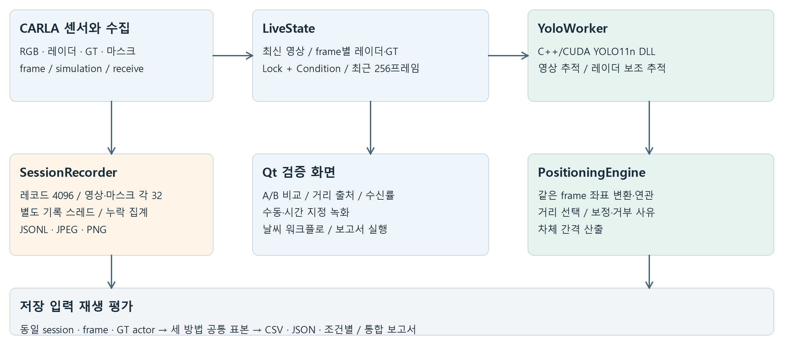

# 실시간 센서 계측 소프트웨어 아키텍처 설계서

CARLA RadarVision · 골프존 소프트웨어 연구개발 지원 포트폴리오

## 설계 개요

센서 콜백의 취득, GPU 추론, Qt 표시, 디스크 기록을 분리하고 공통 프레임 번호로 결과를 연결하는 구조다. 라이브 화면은 최신 입력을 우선하고, 녹화는 유한 큐와 전용 스레드를 사용한다. 원본·추정 결과·GT·실험 설정을 분리 보존해 동일 입력의 재생 평가를 지원한다.

| 경계 | 현재 구현 |
| --- | --- |
| 수집·상태·기록 | Python threading, Queue, Lock, Condition |
| 검출 | 외부 TensorRTx 기반 C++17·OpenCV·CUDA·TensorRT 모듈 |
| 추적·거리·평가 | Python 자체 로직, 원본 센서와 프레임 키 연결 |
| UI | PySide6 Qt GUI, 작업 스레드·비교 화면·녹화·분석 도구 |
| 플랫폼 | Windows DLL 활성 경로, 별도 TCP 클라이언트·Linux 서버 소스 |

설계 목적은 현재 프로토타입의 처리 경계·검증 계약을 설명하고, 이를 유지하면서 C++ Core로 분리할 수 있는 경로를 제시하는 것이다. 아래의 ‘확장 설계’는 완료 기능과 구분한다. C++ 기반 전체 응용 코드 또는 전체 Linux 제품 빌드를 완성한 것으로 표현하지 않는다. [S05-S13]

작성 기준일 2026년 10월 24일

<!-- PAGE -->

## 1. 실행 단위와 데이터 흐름

### 1.1. 서로 다른 지연 특성을 분리

CARLA 센서 콜백은 영상을 상태에 반영하고 저장 큐에 넣는다. 추론이 끝날 때까지 센서 콜백이나 GUI를 기다리게 하지 않는다. `YoloWorker`는 새 `received_at`의 최신 영상만 골라 검출한다. 입력을 전부 처리하는 무한 대기열이 아니므로 수신한 모든 영상을 추론한다는 보장은 없다. [S06, S07]

| 실행 단위 | 책임 | 경합·종료 방식 |
| --- | --- | --- |
| CARLA 콜백 | 센서 값 변환·상태 반영·기록 요청 | 짧은 상태 잠금, put_nowait |
| carla-collector | 서버·hero 탐색, 센서 부착, 재연결 | Event 중단, 재시도 대기 |
| yolo11-worker | 상주 엔진, 두 추적기, 위치 추정 | 제어 Lock, Event, stop 후 join |
| session-recorder | JSONL·JPEG·PNG 실제 쓰기 | 유한 큐, 종료 시 잔여 작업 소진 |
| Qt GUI | 버튼·상태·영상 표시 | 별도 추론, 비동기 분석 완료 처리 |
| 분석·영상 작업 | 세션 읽기, 보고서·비교 MP4 생성 | 작업자 완료·실패 시그널 |

### 1.2. 같은 프레임을 기다리는 조건과 한계

`LiveState`는 레이더·GT를 frame별 사전에 저장하고 각 최근 256개 항목만 유지한다. 작업자는 동일 번호가 준비되기를 최대 0.05초 기다리는 `Condition`을 사용한다. 없으면 인접 프레임으로 대신 연결하지 않고 해당 문맥을 미사용 처리한다. 영상에 다른 프레임 결과를 그리지 않는다.

### 1.3. 저장 큐의 포화 정책

센서·결과 레코드는 4,096건, RGB와 가시성 마스크는 각각 32건의 큐를 사용한다. 큐가 차면 현재 입력을 버리고 `dropped_records` 또는 `dropped_frames`를 올린다. 유한 메모리와 콜백 지연 억제를 택한 구조다. 중요한 계측 데이터 무손실이 요구되는 제품이라면 중단·경보·역압 정책을 별도로 설계해야 한다.

### 1.4. 실시간의 정의

이 구조는 실시간 표시·처리를 위한 소프트 실시간 프로토타입이다. Python GIL과 동기식 C ABI GPU 완료 대기, 디스크 변동을 포함하므로 하드 실시간이나 최대 지연을 보장하지 않는다. 센서 tick 0.066666초를 종단 지연 보장값으로 사용하지 않는다.

<!-- PAGE -->

## 2. 모듈 계약과 기록 데이터 모델

| 모듈 | 입력 | 출력·계약 |
| --- | --- | --- |
| CarlaCollector | 서버 주소·role, CARLA 센서 | frame·시각·센서 자세·측정값 |
| Detector | BGRA bytes, 폭·높이·stride | 박스·class_id·confidence |
| MultiObjectTracker | 박스, 수신 시각, 선택적 레이더 | track_id·predicted·missed_frames·보정 상태 |
| PositioningEngine | 프레임·박스·트랙·레이더·자차 기준 | 추정 XY·거리·선택 센서·거부 사유 |
| SessionRecorder | 메타데이터, 측정값, 영상 | 새 세션 디렉터리·JSONL·이미지 |
| 평가기 | 세션 또는 workflow 상위 폴더 | 방법별 오차 CSV·집계 JSON·보고서 |

센서 자료의 기본 키는 `(sensor_id, frame)`이며, 센서 간 연결은 frame 기준이다. 세 방법의 평가 연결은 `(session, frame, gt_actor_id)`다. `track_id`는 추적기가 발급한 로컬 ID이므로 세션·방법 경계를 넘어 동일 차량 키로 사용하지 않는다.

| 저장 파일 | 주요 의미·검증 포인트 |
| --- | --- |
| session.json | 모드·계획 시간·날씨·보정 토글·트랙 수명·엔진 경로 |
| measurements.jsonl | 센서별 kind, frame, simulation/receive timestamp |
| camera/*.jpg | 원본 RGB, JSONL 이미지 상대 경로와 연결 |
| visibility_masks/*.png | 원시 semantic/instance 채널, 별도 인덱스 |
| detections.jsonl | 원 프레임·센서·박스·처리시간 |
| tracks/vision_tracks.jsonl | 융합 트랙과 영상 기준선의 상태 이력 |
| positions/radar_fusion.jsonl | 카메라·레이더 추정과 선택·보정의 근거 |
| ground_truth.jsonl | 평가용 상대 차량 자세·bounding box |

### 좌표와 시간의 계약

ego는 X 전방·Y 우측·Z 상방, 길이는 m, 속도는 m/s다. 레이더 각도는 rad로 저장하고 화면에서 필요할 때 °로 바꾼다. 좌표 변환은 센서 외부 파라미터와 카메라 내부 파라미터를 사용한다. 시뮬레이션 시각과 수신 시각의 역할이 다르므로 한 시간축으로 합치지 않는다. [S05, S06, S09]

현재 session.json은 모든 알고리즘 임계값·소스 리비전·모델 해시를 완전하게 보존하지 않는다. 제품화 시 `schema_version`, 코드·설정·모델 해시, 단위·좌표 프레임, 교정 버전의 명시를 추가하는 확장 설계를 권장한다.

<!-- PAGE -->

## 3. C++ CUDA 경계와 플랫폼 전략

### 3.1. 현재 Windows 경로

Python 작업자가 `ctypes.CDLL`로 C ABI의 `create/detect_bgra/destroy`를 호출한다. 엔진은 인스턴스 생성 시 한 번 로드한다. 호출은 같은 프로세스 안에서 실행되며 이미지당 외부 실행 파일을 띄우지 않는다. C++ 예외는 C 경계에서 null 또는 -1과 오류 버퍼로 변환하고 Python에서 예외로 처리한다. [S07, S12, S13]

| 경계 조건 | 구현 근거 |
| --- | --- |
| 입력 | BGRA 포인터, width·height·stride_bytes |
| 출력 | 고정 필드 박스 배열, 호출자 지정 용량 |
| 출력 초과 | C++에서 오류 반환, Python 출력 버퍼 1,000개 |
| GPU 리소스 | runtime·engine·context·stream·device buffer 상주 |
| 병렬 사용 | 외부 C++ 구현의 process 전역 mutex와 단일 Detector 제한 |
| 해제 | destroy와 context manager, 생성 실패의 cleanup |

외부 CMake는 C++17·CUDA17, OpenCV, TensorRT import target과 DLL/공유 라이브러리를 구성한다. `WIN32` 설정과 Linux 전용 TCP 서버 타깃이 있다. 빌드 경로를 인자로 전달하는 기록은 있지만, 이 저장소의 독립 C++ Core·루트 CMake·양 플랫폼 CI가 완료된 것은 아니다.

### 3.2. WSL 경계와 통신 계약

`TcpDetector`는 magic `Y11T`, version 1, 길이·종류 헤더와 frame ID를 사용하는 지속 TCP 연결이다. 네트워크 바이트 순서를 사용하고 `_recv_exact`로 분할 수신을 처리한다. 요청은 64MiB 이하, 응답은 최대 1,000박스, 크기·frame·상태·박스 개수를 검사한다. [S15]

현재 Qt의 활성 `YoloWorker`는 로컬 `Detector`를 직접 사용한다. README의 과거 WSL UI·CLI 경로와 달리 현재 앱에는 선택 연결이 없어, TCP 코드 존재를 전체 Linux 실행 완료로 제시하지 않는다. 별도 외부 Linux 서버 소스와 클라이언트 테스트를 확인한 범위다.

### 3.3. 제품화 시 분리 방향

검출 구현을 `IDetector` 계약 뒤에 두고 DLL/TCP 어댑터를 교체하도록 분리한다. 엔진은 OS·GPU·TensorRT 조합별로 생성하고 공통 소스의 빌드·패키징을 CI에서 검증한다. 이 항목은 현 상태를 보존한 후 수행할 확장 설계다.

<!-- PAGE -->

## 4. 상태 전환과 검증용 UI

### 4.1. 사용자 제어와 알고리즘 상태를 함께 관리

탐지·트래킹·보정 토글과 수명 입력을 GUI가 작업자에 전달한다. 작업자는 `_control_lock` 안에서 설정을 바꾸고 필요한 추적·위치 상태를 초기화한다. 이전 설정에서 학습한 앵커를 새 설정에 남기지 않는 처리다. 다만 초기화 시 ID가 다시 시작될 수 있으므로 설정 변경 구간을 연속성 평가에서 구분해야 한다. [S07, S08, S11]

| 이벤트 | 실제 처리 |
| --- | --- |
| 탐지 OFF | 탐지·트래킹 비활성, 추적·위치 초기화, 표시 결과 제거 |
| 트래킹 ON | 탐지 활성 조건 확인, 두 추적기와 위치 초기화 |
| 수명 변경 | 0~100 정수 검사, 영상·융합 두 추적기 공통 반영·초기화 |
| 레이더 보정 변경 | 융합 추적기·위치 상태 초기화 |
| 기록 시작 | 단일 모드 확인, 고유 폴더 생성, 메타데이터 저장 |
| 시간 만료 | 기존 수동 중지 경로로 종료, 잔여 기록 처리 |
| 연결 단절 | 상태 비우기·재연결, 워크플로 후속 단계 중단 |

### 4.2. 워크플로가 실험 기록을 구조화

별도 Qt 창에서 날씨 순서·각 기록 시간·안정화 대기를 설정한다. CARLA API로 날씨를 적용한 뒤 단계별 세션을 만든다. workflow ID·프리셋·단계 번호를 기록해 상위 폴더 하나로 조건별·통합 평가가 가능하게 했다. pygame 키 입력 자동화가 아닌 동일 CARLA 월드 API 제어다.

### 4.3. 검증 UI의 관찰 항목

영상 A/B에서 원본·YOLO·영상 추적·레이더 추적을 선택하고 거리 출처·박스·프레임을 비교한다. 수신률·처리시간·레이더 플롯·차량 상태·저장 누락을 확인하며, 비교 영상과 보고서 생성은 별도 작업으로 실행한다.

충돌·차선 이탈 콜백 이벤트 수집과 수동·시간 지정 기록은 구현돼 있다. 센서 융합 판단으로 이벤트를 검출해 앞뒤 구간을 자동 보존하는 pre/post-trigger 메커니즘은 현재 완료 기능이 아니다. 채용공고의 이벤트 트리거 요건에는 기존 이벤트 경계와 앞으로 추가할 상태 기계를 구분해 제시한다.

<!-- PAGE -->

## 5. 평가 경로와 장애 처리

### 5.1. 동일 입력 기준의 회귀 비교

저장 검출 박스를 재사용해 영상 추적과 레이더 보조 추적을 비교한다. 평가기는 GT 투영·연결, 관측/예측 거리 산출, 거부 사유와 공통 표본을 집계한다. 날씨 평가기는 세션 경계를 유지해 차량·프레임 오차를 합치며 세션별 MAE의 단순 평균으로 대체하지 않는다. [S03, S10, S11]

| 실패 상황 | 현재 동작·남는 근거 |
| --- | --- |
| 동일 frame의 레이더 없음 | 다른 프레임으로 대체하지 않음, 카메라 경로 사용 |
| 희소·퍼진 군집 | 레이더 거리·보정 거부, 선택 사유 기록 |
| 연관 모호·큰 박스 이동 | 보정 거부 후 기존 예측 유지 |
| 지평선 근처 거리 폭증 | 민감도·관측 앵커·이동 검사로 거리 미산출 가능 |
| 큐 포화 | 비차단 입력 폐기와 누락 계수 증가 |
| 쓰기 실패 | 기록기 오류 상태·저장 실패 집계 |
| 추론 오류 | 탐지·추적 비활성화, 상태 초기화, 오류 표시 |
| 마스크 없음 | 검출률 측정 불가, 투영 수를 검출률 분모로 대체하지 않음 |

### 5.2. 검증 계층

단위 테스트에는 위치 기하, 레이더 보정·수명, 기록, 마스크, 세션 평가, 날씨 워크플로, TCP 분할 응답·다른 frame 거부가 포함돼 있다. 전체 테스트의 이번 실행 성공을 주장하지 않으며, 성능 결과는 보존된 실험 CSV의 동일 표본 재계산으로 확인한다. [S14, S15]

### 5.3. 아직 측정해야 할 비기능 요구

현재 자료에는 장시간 입력률별 queue depth·p95/p99 종단 지연·디스크 처리량·메모리 상한 실측이 없다. GUI에 표시되는 processing_ms와 센서 수신률만으로 시스템 전체의 지연·유실 보장을 만들 수 없다. 파일 손상 복구, 전원 차단 내구성, 큐 overflow 알람, 장비 재연결 순서도 제품 기준으로 검증해야 한다.

<!-- PAGE -->

## 6. 유지보수와 C++ Core 확장 설계

현재 모듈화는 Python 수집·추론 브리지·추적·거리·평가기의 책임 분리다. 실제 레거시 프로젝트의 코드량·유지보수 비용을 전후 측정한 사례로 과장하지 않는다. 아래는 기존 기록과 검증식을 유지하며 이식할 순서다.

| 순서 | 확장 설계 | 완료 판단 기준 |
| --- | --- | --- |
| 1 | 공통 측정 스키마·시간·단위·오류 코드 고정 | 고정 세션의 키·필드·거부 사유 호환 |
| 2 | CARLA·Qt 비종속 C++ geometry·tracking Core | 같은 입력의 박스·거리·수명 결과 차이 허용치 만족 |
| 3 | C ABI/pybind 어댑터와 기존 Python 비교 | 동일 CSV 모집단, MAE·RMSE·실패 사유 회귀 비교 |
| 4 | MSVC/GCC CMake preset·CTest·CI | 양 OS 빌드·단위·Replay 성공 기록 |
| 5 | I/Q 입력 DSP를 별도 모듈로 구성 | 합성·실측 자료의 FFT peak·잡음·필터 검증 |
| 6 | 트리거·장비 어댑터·운영 계측 | 중복 트리거·단절·overflow·종료 내구성 시험 |

### 골프 시뮬레이터 업무에 적용할 수 있는 계약

센서 어댑터는 장비 고유 형식을 공통 측정 모델로 바꾸고, 알고리즘은 유효성·선택 근거를 출력하며, Tool은 원본·추정·기준을 같은 시간축에서 비교하도록 구성할 수 있다. 공·클럽 계측에 적용할 때는 노출 시간·프레임률·센서 분해능·트리거 지연·운동모델을 새로 정의해야 한다. 현재 차량 실험에서 그 정확도를 보장하지 않는다.

### 근거와 함께 제시하는 기술 역량

현재 포트폴리오는 C++/CUDA 추론 모듈의 응용 통합, Python 동시성 경계, Qt 검증 도구, 센서 연관·거리 선택과 재생 평가를 보여준다. 독립 C++ Core·FFT·임베디드·전체 크로스 플랫폼은 위 확장 과제로 남겨 구현 사실과 구분했다.

관련 파일·함수와 현재 구현/계획 구분은 [근거 색인](evidence_index.md)에 모았다. 센서 융합의 수식·437건 실험 결과는 연구보고서, 채용 요건에 대한 핵심 요약은 2쪽 성과 요약서에서 확인할 수 있다.
